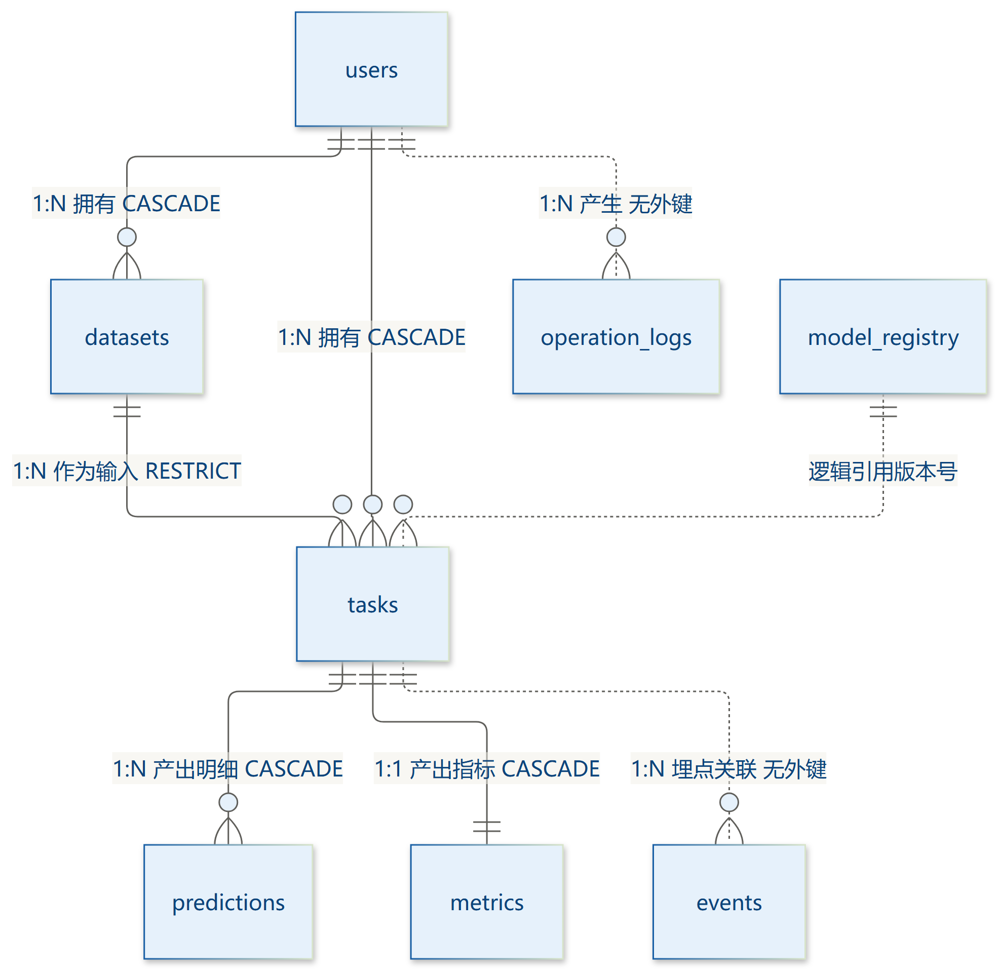
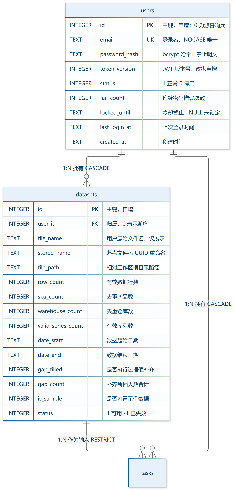
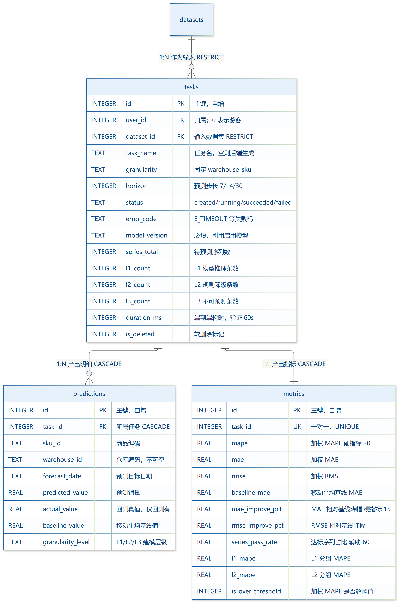
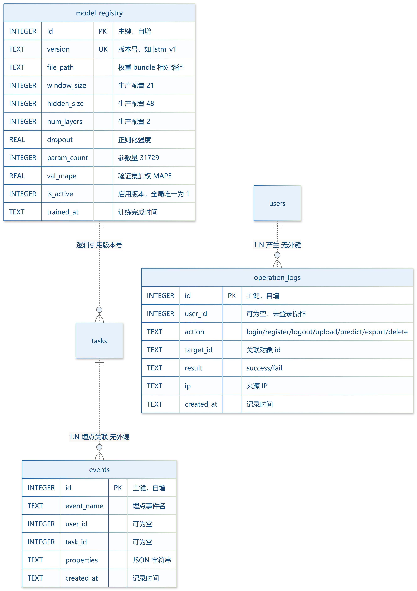
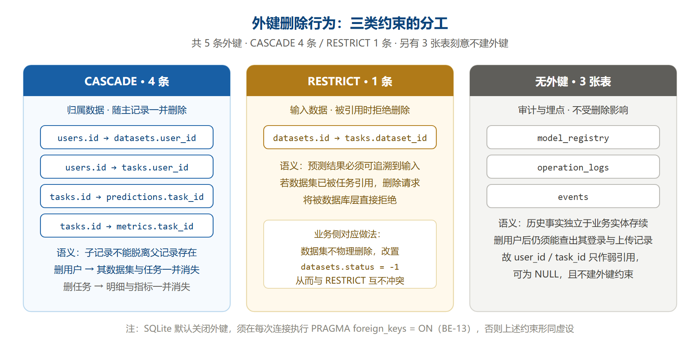
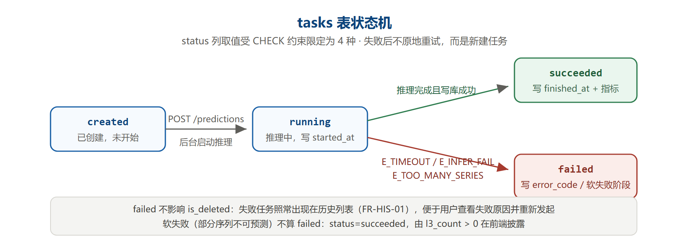
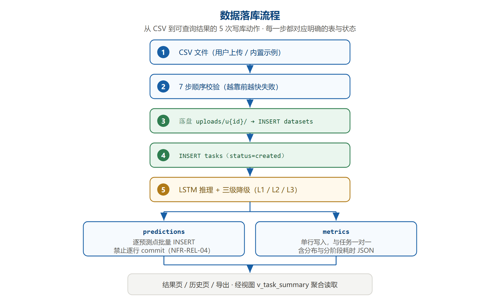

# 电商销量预测系统 · 数据库设计文档

| 项 | 内容 |
|---|---|
| 文档名称 | 电商销量预测系统 · 数据库设计文档 |
| 版本号 | V1.0 |
| 文档状态 | 正式版（可交付评审） |
| 编制日期 | 2026-10-09 |
| 数据库类型 | SQLite 3（嵌入式，单文件） |
| 表 / 列规模 | 8 表 · **121 列** · 10 显式索引 · 3 触发器 · 1 视图 · **15 处 CHECK 约束** |
| 上游依据 | 《PRD V1.0》《开发方案文档 V1.1》《UI/UX 设计文档 V1.0》《开发技术文档 V1.0》 |
| 下游产物 | `code/db/schema.sql`（可执行 DDL）、`code/db/seed.sql`（初始化数据） |
| 冲突仲裁 | 功能范围以 PRD 为准；技术口径以《开发技术文档 V1.0》为准；本文档只对「数据结构」做最终解释 |

---

## 0. 文档信息与阅读指南

### 0.1 文档定位

本文档回答一个问题：**数据以什么结构存在、为什么这么存、怎么保证它不出错。**

它是一份**纯数据结构设计书**，覆盖三块内容：

| 块 | 内容 | 读者 |
|---|---|---|
| 实体关系 | 8 张表之间的引用关系、基数、删除行为 | 研发、评审、答辩 |
| 表结构与数据字典 | 逐表、逐列的定义、约束、取值域、业务含义 | 研发（照此写 DDL 与 ORM 映射） |
| 建表 SQL | 可直接执行的完整 DDL 与初始化数据 | 研发、运维 |

本文档**不重复**以下内容，遇到时直接交叉引用：

- 接口的请求/响应字段 → 《开发技术文档 V1.0》§5 + 附录 A
- 算法函数签名与调用契约 → 《开发技术文档 V1.0》§4
- 页面如何消费数据 → 《UI/UX 设计文档 V1.0》§7–§9
- 功能需求编号与验收标准 → 《PRD V1.0》§3 / §7

### 0.2 与既有五份资产的关系

```
PRD V1.0                    ← 功能需求（FR-*）与硬指标（NFR-*）
  │
  ├── 开发方案文档 V1.1      ← 架构分层、逻辑数据模型（§5.2）
  │       │
  │       └── 开发技术文档 V1.0   ← 物理落地方案（§3 表结构、§5 接口）
  │               │
  │               └── 数据库设计文档 V1.0  ← 本文档：把「结构」写到 DDL 级
  │
  ├── UI/UX 设计文档 V1.0    ← 页面消费哪些字段（§6 页面清单）
  │
  └── code/ 代码资产          ← schema.sql / seed.sql / schemas.py / types.ts
```

**本文档与前序文档的边界（避免出现「两套说法」）**

| 主题 | 唯一权威来源 | 本文档的处理 |
|---|---|---|
| 功能范围、优先级、验收红线 | PRD V1.0 | 只引用 `FR-*` / `NFR-*` 编号，不改写需求 |
| 技术选型、版本锁定、接口 schema | 开发技术文档 V1.0 | 引用其结论；若与 DDL 相关则给出列级落点 |
| 表字段长度、索引、约束 | **本文档** | 开发方案 §5.2 明确留白：「需在数据库设计文档中细化」 |
| 视觉与交互 | UI/UX 设计文档 V1.0 | 不涉及 |

> 📌 开发方案 §5.2 原文留话：「⚠️ 具体字段长度、索引与约束需在数据库设计文档中细化」。本文档即为还这笔账。

### 0.3 口径仲裁规则

出现不一致时，按以下顺序裁决：

1. **功能要不要做** → 以 PRD 为准
2. **技术怎么做** → 以《开发技术文档 V1.0》为准
3. **字段怎么定义** → 以本文档 + `code/db/schema.sql` 为准
4. **文档与代码不一致** → **以代码为准**，并回改文档（附录 B 给出逐项校验证据）

第 4 条是刻意设定的：可执行的代码不会说谎，文档会。

### 0.4 编号体系

沿用前四份文档风格，不新造冲突前缀：

| 前缀 | 含义 | 示例 |
|---|---|---|
| `DB-T01` ~ `DB-T08` | 表级编号（**沿用开发技术文档编号**，指向同一实体） | `DB-T03` = tasks 表 |
| `DB-01` ~ `DB-32` | 设计原则与规范条目（含各章以「🔒」标注的硬约束条目） | `DB-05` = 时间字段全用 TEXT；`DB-17` = `email` 查询必须显式 `COLLATE NOCASE` |
| `DD-T03-05` | 数据字典条目（表 03 的第 5 列） | `DD-T03-05` = `task_name` |
| `IX-01` ~ `IX-10` | 索引（另 `IX-AUTO-01` / `IX-AUTO-02` 由唯一约束自动生成） | `IX-06` = `ix_predictions_task_sku` |
| `TRG-01` ~ `TRG-03` | 触发器 | `TRG-01` = `trg_users_updated` |
| `VW-01` | 视图 | `v_task_summary` |
| `FIG-01` ~ `FIG-07` | 图表 | `FIG-01` = 全景 ER 图 |
| `TQ-*` | 待确认问题（**续用开发技术文档的问题池**） | `TQ-1` = token_version |

> ⚠️ **避坑提醒**：`DB-01`~`DB-12` 为集中列出的设计原则（§1.5）；`DB-13`~`DB-32` 为散落在各章正文中的硬约束条目（🔒）。其中 `DB-12` 已被《开发技术文档 V1.0》占用（清理任务隔离），本文档续用不重号。另：`DB-D1`~`DB-D8` 为 §0.5 的决策编号，与 `DB-xx` 不冲突。

### 0.5 关键设计决策一览（本版已定死）

以下决策**不再讨论**，实现必须照此执行：

| 编号 | 决策 | 理由摘要 | 章节 |
|---|---|---|---|
| 📌 `DB-D1` | 全库 8 张表，不增不减 | 覆盖 PRD 全部 `FR-*` 落库需求；`token_version` 用列而非新表解决 | §1.6 |
| 📌 `DB-D2` | 时间字段统一 `TEXT`，格式 `YYYY-MM-DD HH:MM:SS` | 规避 SQLite 类型亲和性与驱动层隐式 UTC 转换（`NFR-COMP-04`） | §1.3 |
| 📌 `DB-D3` | `user_id = 0` 表示游客，`users` 表落一条哨兵行 | 外键完整性要求 `user_id` 有对应主记录（`JT-10`） | §10.2 |
| 📌 `DB-D4` | `users.token_version` 支撑改密后 Token 立即失效 | JWT 无状态，无法枚举某用户已签发的全部 Token（`TQ-1` 决议） | §10.5 |
| 📌 `DB-D5` | `datasets` 与 `tasks` 之间用 `RESTRICT` 而非 `CASCADE` | 预测结果必须可追溯到输入数据集 | §2.6 |
| 📌 `DB-D6` | `operation_logs` / `events` / `model_registry` 不建外键 | 历史事实须独立于业务实体存续 | §2.7 |
| 📌 `DB-D7` | `predictions` 写入必须批量 `INSERT`，禁止逐行 commit | 单任务 1,582 行（示例规模），逐行提交会拖垮 `NFR-REL-04` | §3.4 |
| 📌 `DB-D8` | 数据集与任务用**软删除**，不改物理删除 | `FR-HIS-05` 要求历史可查回 | §9.2 |

### 0.6 图表清单与渲染说明

本文档含 7 张图，全部由脚本生成、源文件留档、可复现：

| 图号 | 图名 | 生成方式 | 源文件 |
|---|---|---|---|
| `FIG-01` | 数据库全景 ER 图 | Mermaid `erDiagram` → `mmdc` → PNG | `docs/assets/db-design/fig-01-er-overview.mmd` |
| `FIG-02` | 用户与数据集域 ER 图（含字段） | 同上 | `fig-02-er-user-dataset.mmd` |
| `FIG-03` | 预测执行域 ER 图（含字段） | 同上 | `fig-03-er-prediction.mmd` |
| `FIG-04` | 支撑域 ER 图（含字段） | 同上 | `fig-04-er-support.mmd` |
| `FIG-05` | 外键删除行为图 | 手写内联属性 SVG → Edge 无头截图 | `fig-05-fk-behavior.svg` |
| `FIG-06` | `tasks` 表状态机 | 同上 | `fig-06-task-state.svg` |
| `FIG-07` | 数据落库流程图 | 同上 | `fig-07-data-flow.svg` |

> ⚠️ **渲染链路的一个硬教训**（留给后续维护者）：Mermaid 输出的 SVG **无法**用 PyMuPDF 转 PNG —— MuPDF 引擎不解析 `<style>` CSS 类，会把所有元素渲染成纯黑块。必须让 `mmdc` **直接输出 PNG**（内部用 Edge 引擎），源文件与 PNG 同时留档。详见附录 B。

### 0.7 配套资产

| 文件 | 内容 | 规模 | 校验方式 |
|---|---|---|---|
| `code/db/schema.sql` | 完整建表脚本（幂等） | 332 行 / 17.2 KB | `python scripts/verify_schema.py` |
| `code/db/seed.sql` | 初始化数据（模型注册 + 哨兵） | 约 120 行 | 随 schema 执行 |
| `scripts/verify_schema.py` | DDL 可执行性、对象齐备、约束有效性、游客态实测 | 约 250 行 | 直接运行 |
| `scripts/explain_queries.py` | 典型查询的执行计划实测（§6 数据来源） | 约 270 行 | 直接运行 |
| `scripts/verify_doc_sql.py` | 本文档 §5 收录的 SQL 与 `schema.sql` 逐行一致性校验 | 约 120 行 | 直接运行 |
| `scripts/verify_doc_refs.py` | 本文档引用的 `FR-*`/`NFR-*` 编号与《PRD V1.0》一致性校验（悬空引用 + §11.1 矩阵计数） | 约 110 行 | 直接运行 |

---

## 1. 设计概述

### 1.1 设计目标与范围

**目标**

1. 用**最小表数**覆盖 PRD 全部需落库的功能（`FR-USR-*` / `FR-UPL-*` / `FR-MOD-*` / `FR-VIS-*` / `FR-HIS-*` / `FR-SYS-*`）。
2. 让「数据隔离」成为**数据库层的结构性保证**，而不是靠开发者每处记得加 `WHERE user_id = ?`。
3. 支撑 PRD 的三条硬指标可**直接从库中复算**：加权 MAPE ≤ 20%、MAE/RMSE 相对基线降低 ≥ 15%、达标序列占比 ≥ 60%。

**范围（本版包含）**

- 8 张表的完整 DDL、索引、触发器、视图
- 121 个字段的逐列字典
- 初始化数据与版本迁移约定
- 数据生命周期（落盘目录、TTL、清理隔离）

**范围（本版不含）**

- 后端 ORM 映射代码（`SQLAlchemy` 模型）→ 属《开发技术文档 V1.0》§4 的实现范畴
- 缓存层（Redis）→ 库存疑，`TQ-2`
- 多租户行级安全（RLS）→ SQLite 无此能力，靠应用层 + 本文档 §10 的判定顺序保证

### 1.2 存储选型：为什么是 SQLite

| 候选 | 结论 | 理由 |
|---|---|---|
| **SQLite 3** | ✅ **选定** | 单机部署（服务端 OS 见 `NFR-COMP-03`），无独立数据库进程；单文件便于备份与迁移；Python 标准库 `sqlite3` 直接可用，零额外依赖；WAL 模式足以支撑本项目并发量 |
| PostgreSQL | ❌ | 需独立服务进程与安装配置，超出课程项目部署复杂度；本项目无高并发写入场景 |
| MySQL | ❌ | 同上，且需处理字符集与时区配置，与 `NFR-COMP-04`（不引入 UTC 转换）冲突面更大 |

**SQLite 的三个已知限制与应对**

| 限制 | 影响 | 应对 |
|---|---|---|
| 默认**不启用外键** | 外键写了也不生效，删除主记录不留孤儿，看似正常实为隐患 | 🔒 `BE-13`：每次连接执行 `PRAGMA foreign_keys = ON`（§1.2.1） |
| 写操作**全库串行** | 并发写入会 `database is locked` | 启用 WAL 模式 + 设置 `busy_timeout`（§1.2.2） |
| 无原生 `DATETIME` 类型 | 时间存储格式不统一会导致排序错乱 | 🔒 `DB-05`：统一 `TEXT` + 固定格式（§1.3） |

#### 1.2.1 连接参数（必须每次设置）

```sql
PRAGMA foreign_keys = ON;      -- 外键约束开关，默认 OFF，必须显式开启
PRAGMA journal_mode = WAL;     -- 写前日志：允许「一写多读」并发
PRAGMA busy_timeout = 5000;    -- 写锁等待 5 秒再报错，避免瞬时冲突
PRAGMA synchronous = NORMAL;   -- WAL 下的推荐值，兼顾安全与性能
```

> 🔒 `DB-13`（对应 `BE-13`）：**`foreign_keys` 是连接级设置，不是数据库级设置**。忘记设置时，`schema.sql` 里所有 `FOREIGN KEY` 都形同虚设——删数据集不会报错，却会留下指向不存在数据集的孤儿任务。这是 SQLite 最容易被忽略的陷阱。

**实测证据**：`scripts/verify_schema.py` 中有一条用例专门验证这一点——插入 `user_id = 99999`（`users` 表无此 id）的数据集，期望被外键拒绝：

```
[ OK ] 非法 user_id=99999 被外键拒绝：FOREIGN KEY constraint failed
```

#### 1.2.2 WAL 模式的取舍

| 项 | 说明 |
|---|---|
| 收益 | 读操作不再被写操作阻塞；单机多请求场景下响应更稳定 |
| 代价 | 额外生成 `app.db-wal` 与 `app.db-shm` 两个文件 |
| 注意 | 备份时必须连同 `-wal` 一起复制，或用 `VACUUM INTO`（§9.5） |
| 不适用 | 若后续改为网络文件系统（NFS）挂载，WAL 会失效，需退回 `DELETE` 模式 |

### 1.3 时间类型约定：为什么全用 TEXT

**决策**：全库所有时间字段统一为 `TEXT`，格式 `YYYY-MM-DD HH:MM:SS`（本地时区，不转 UTC）。

**理由**

1. **依据 `NFR-COMP-04`**：全部日期按本地时区处理，不引入 UTC 转换。SQLite 无原生时区概念，用 `TEXT` 可完全避开驱动层的隐式转换。
2. **`TEXT` 定长格式可直接比较**：`'2026-10-09 10:30:00'` 的字典序与时间序一致，因此 `ORDER BY created_at DESC`、`WHERE created_at >= ?` 都无需转换函数，索引也能直接生效。
3. **`DEFAULT (datetime('now', 'localtime'))` 可用**：SQLite 的 `datetime()` 函数天然输出该格式。

**三种时间列的语义区分**

| 语义 | 类型 | 示例 | 说明 |
|---|---|---|---|
| 时间戳（时刻） | `TEXT` | `2026-10-09 10:30:00` | `created_at` / `started_at` / `last_login_at` |
| 日期（粒度到天） | `TEXT` | `2026-10-09` | `forecast_date` / `date_start` / `date_end` |
| 截止时间 | `TEXT` | `2026-10-09 10:35:00` | `locked_until`，`NULL` 表示未锁定 |

> ⚠️ **禁止混用**：`forecast_date` 只写日期（10 字符），`created_at` 只写时刻（19 字符）。混用会让同一列的排序结果不可预期。

**为什么不用整数时间戳（Unix 秒）**

| 方案 | 优点 | 缺点 | 结论 |
|---|---|---|---|
| `TEXT` 定长 | 可读、可直接比较、`datetime()` 原生支持 | 占 19 字节 | ✅ **选用** |
| `INTEGER` Unix 秒 | 存储省、比较快 | 排障时需转换；与 `NFR-COMP-04` 的「本地时区」语义易混淆；调试成本高于其收益 | ❌ |

### 1.4 命名规范

| 对象 | 规则 | 示例 |
|---|---|---|
| 表 | 小写、下划线分隔、**复数** | `users` / `datasets` / `predictions` |
| 列 | 小写、下划线分隔、单数 | `user_id` / `forecast_date` |
| 主键 | 统一 `id` | 所有表 |
| 外键列 | `{被引用表单数}_id` | `user_id` / `dataset_id` / `task_id` |
| 布尔语义列 | 以 `is_` / `has_` 开头，类型 `INTEGER` + `CHECK IN (0,1)` | `is_sample` / `is_deleted` / `device_fallback` |
| 计数列 | 以 `_count` 结尾 | `row_count` / `sku_count` |
| 百分比列 | 以 `_pct` 或 `_rate` 结尾，**存百分数数值**（`26.42` 表示 26.42%） | `mae_improve_pct` / `series_pass_rate` |
| 索引 | `ix_{表}_{用途}`；唯一索引 `ux_{表}_{列}` | `ix_tasks_user_list` / `ux_predictions_key` |
| 触发器 | `trg_{表}_{动作}` | `trg_tasks_updated` |
| 视图 | `v_{语义}` | `v_task_summary` |

> 🔒 `DB-05`：百分比列存**百分数数值**而非小数（`26.42` 而非 `0.2642`）。理由：算法层 `metrics.py` 的输出即为百分数，存储层若转换，会出现「库里 0.2642、接口返回 26.42」的二次换算，是口径不一致的常见来源。

### 1.5 设计原则（`DB-01` ~ `DB-12`）

| 编号 | 原则 | 落地方式 |
|---|---|---|
| `DB-01` | **隔离即结构** | 所有业务表带 `user_id`；外键 + 应用层双重约束（§10.1） |
| `DB-02` | **归属数据随主记录消失** | `ON DELETE CASCADE`（`datasets` / `tasks` / `predictions` / `metrics`） |
| `DB-03` | **引用数据不可悬空** | `tasks.dataset_id` 用 `RESTRICT`，禁止删除被引用的数据集 |
| `DB-04` | **历史事实独立存续** | `operation_logs` / `events` 不建外键，删用户不丢审计 |
| `DB-05` | **时间全用 TEXT 定长** | 见 §1.3 |
| `DB-06` | **约束写在库里，而非只写在代码里** | 15 处 `CHECK` + 3 处唯一索引 + 3 个触发器 |
| `DB-07` | **可追溯**：结果能回溯到输入 | `tasks` 保留 `dataset_id` + `model_version`；`predictions` 保留 `baseline_value` |
| `DB-08` | **删除优先软删除** | `datasets.status = -1`、`tasks.is_deleted = 1`（§9.2） |
| `DB-09` | **派生数据可重算** | `metrics` 全部可从 `predictions` 重算，故允许整表重建 |
| `DB-10` | **枚举值落库前受限** | 所有枚举列加 `CHECK IN (...)`，防止拼写漂移 |
| `DB-11` | **计数冗余需有出处** | `l1_count` / `l2_count` / `l3_count` 冗余存储（结果页高频读取），但必须与 `predictions.granularity_level` 分组计数一致（§3.3） |
| `DB-12` | **清理任务必须按用户隔离** | 导出文件清理不得跨用户匹配路径（对应《开发技术文档 V1.0》同名条目） |

### 1.6 表清单总览

| 编号 | 表名 | 中文名 | 列数 | 外键 | 行数量级 | 主要需求 |
|---|---|---|---|---|---|---|
| `DB-T01` | `users` | 用户表 | 12 | — | 10¹~10⁴ | `FR-USR-01`~`08` |
| `DB-T02` | `datasets` | 数据集表 | 18 | `user_id → users` CASCADE | 10¹~10³ | `FR-UPL-01`~`15` |
| `DB-T03` | `tasks` | 预测任务表 | 24 | `user_id → users` CASCADE<br>`dataset_id → datasets` RESTRICT | 10²~10⁴ | `FR-MOD-01`~`15` |
| `DB-T04` | `predictions` | 预测结果表 | 12 | `task_id → tasks` CASCADE | **10⁵~10⁷** | `FR-VIS-01`~`05` |
| `DB-T05` | `metrics` | 任务指标表 | 20 | `task_id → tasks` CASCADE（1:1） | 与 `tasks` 等量 | `FR-MOD-11`~`13` |
| `DB-T06` | `model_registry` | 模型版本表 | 21 | 无（逻辑引用） | 10⁰~10¹ | `FR-MOD-05`/`07` |
| `DB-T07` | `operation_logs` | 操作日志表 | 8 | 无（弱引用） | 10³~10⁵ | `FR-SYS-03` |
| `DB-T08` | `events` | 埋点事件表 | 6 | 无（弱引用） | 10³~10⁵ | PRD §5.1 `EV-*` |

**为什么是 8 张表，而不是更多**

| 曾被考虑的候选表 | 结论 | 理由 |
|---|---|---|
| `auth_tokens`（Token 黑名单落库） | ❌ 不建 | 单机部署，登出用内存 `jti` 黑名单即可；进程重启后旧 Token 本就应重新登录。改密场景由 `users.token_version` 覆盖（`TQ-1` 方案 A） |
| `user_settings`（用户偏好） | ❌ 不建 | PRD 未提出任何用户偏好需求，前端主题存在 `localStorage` |
| `dataset_rows`（原始行数据落库） | ❌ 不建 | 原始 CSV 保留在文件系统（`FR-SYS-08`），入库只存统计元信息，避免 SQLite 承载百万级行 |
| `prediction_series`（序列维度表） | ❌ 不建 | `sku_id` / `warehouse_id` 直接冗余在 `predictions` 中，避免多一次 JOIN；序列维度本身无需额外属性 |
| `roles` / `permissions` | ❌ 不建 | 本期只引入**单一管理员角色**（`users.role` 两值 `user`/`admin`，`CH-01`），不做多角色 RBAC。两张表的复杂度（角色-权限多对多、鉴权中间表）与单管理员场景不匹配，加列即可 |

**为什么不是 7 张或 9 张**

- 减到 7 张：只能砍 `events`（埋点）。但 PRD §5.1 明确要求埋点与成功指标，且埋点生命周期与 `operation_logs` 不同（前者面向指标分析、可归档，后者面向排障审计、须长留），合并会导致后续无法独立清理。**保留**。
- 增到 9 张：需引入 `auth_tokens`。已在 `TQ-1` 中权衡后否决（`DB-D4`）。**保持 8 张**。

---

## 2. 实体关系设计

### 2.1 数据库全景 ER 图



> 图 1 说明：实线为**已建外键**的关系，虚线为**逻辑引用**（应用层维护，无数据库约束）。标签中的 `CASCADE` / `RESTRICT` / `无外键` 标注删除行为。
>
> 本图**刻意不展开字段**——8 张表共 121 列，全部展开会使图长到无法一屏阅读。分域展开见 `FIG-02` ~ `FIG-04`，完整字段见 §3 与 §4。

### 2.2 关系清单与基数

| 编号 | 关系 | 基数 | 外键列 | 删除行为 | 语义 |
|---|---|---|---|---|---|
| `R-01` | `users` → `datasets` | 1:N | `datasets.user_id` | CASCADE | 一个用户拥有多个数据集 |
| `R-02` | `users` → `tasks` | 1:N | `tasks.user_id` | CASCADE | 一个用户拥有多个预测任务 |
| `R-03` | `datasets` → `tasks` | 1:N | `tasks.dataset_id` | **RESTRICT** | 一个数据集可被多个任务作为输入；被引用时不可删除 |
| `R-04` | `tasks` → `predictions` | 1:N | `predictions.task_id` | CASCADE | 一个任务产出多条预测明细 |
| `R-05` | `tasks` → `metrics` | **1:1** | `metrics.task_id`（UNIQUE） | CASCADE | 一个任务对应唯一一组指标 |
| `R-06` | `model_registry` ⇢ `tasks` | 逻辑 1:N | `tasks.model_version` | 无约束 | 版本号字符串引用，不建外键 |
| `R-07` | `users` ⇢ `operation_logs` | 逻辑 1:N | `operation_logs.user_id` | 无约束 | 可空（未登录操作也记录） |
| `R-08` | `tasks` ⇢ `events` | 逻辑 1:N | `events.task_id` | 无约束 | 可空（非任务类埋点也记录） |

> 📌 `R-05` 的 1:1 为何不用共享主键：`metrics.task_id` 用 `INTEGER NOT NULL UNIQUE` 而非 `PRIMARY KEY`。这样 `metrics` 仍保有自己的 `id` 主键，便于后续若需拆分「评估批次」（如同一任务多次回测）时平滑演进。约束强度相同，扩展性更好。

### 2.3 用户与数据集域



**本域的三个关键设计**

1. **`users.id = 0` 是游客哨兵**。未登录用户上传的数据集，其 `user_id` 记为 0，指向这条哨兵记录，从而不违反 `NOT NULL` 与外键（`DB-D3`）。
2. **`datasets` 存的是元信息，不是数据本身**。原始 CSV 落在文件系统（`file_path`），库中只存行数、商品数、序列数等统计值。若把 14,305 行原始数据入库，`datasets` 会立刻变成百万行级大表，得不偿失。
3. **`gap_filled` / `gap_count` 是「数据质量披露」字段**。`FR-UPL-13` 要求前端告知用户「补齐了几天断档」，故必须落库而非只写日志。

**为什么 `datasets` 需要 4 个计数字段**

| 字段 | 用途 | 不存的后果 |
|---|---|---|
| `row_count` | 上传结果页展示「已解析 N 行」 | 每次都要扫描 CSV 文件重新计数 |
| `sku_count` | 参数页右栏展示「商品数」 | 同上 |
| `warehouse_count` | 展示「仓库数」，且用于校验仓库列非空 | 同上 |
| `valid_series_count` | 参数页展示「待预测序列数」，且是 `MAX_SERIES` 上限校验的依据 | 需实时做 `COUNT(DISTINCT)` 组合 |

> ⚠️ 这四个字段是**冗余的派生值**。写入时必须由上传流程一次性算好，且不得事后手工修改——若与文件实际内容不符，会导致「界面上说 113 条序列、实际只预测出 80 条」的口径撕裂。

### 2.4 预测执行域



**本域的三个关键设计**

1. **`tasks` 是状态机的主体**（见 `FIG-06`）。`status` 四态由 `CHECK` 限定，`error_code` 只在 `failed` 时有值。
2. **`predictions` 是唯一的大表**。示例规模 113 序列 × 14 天 = 1,582 行；若用户上传 1,000 序列（`MAX_SERIES` 上限）× 30 天（最大 `horizon`）= 30,000 行/任务。这是全库唯一需要考虑批量写入与分页查询的表（`DB-D7`）。
3. **`metrics` 把「硬指标」逐项落库**。PRD 的三条硬指标（加权 MAPE ≤ 20%、MAE/RMSE 降幅 ≥ 15%、达标占比 ≥ 60%）在 `metrics` 中都有对应列，且**必须存基线值**（`baseline_mae` / `baseline_rmse`），否则事后无法验证「降幅」这个相对量。

**为什么 `predictions` 要同时存 `predicted_value` 与 `baseline_value`**

`FR-MOD-06` 要求「移动平均基线必须在完全相同的预测点、相同序列集合上计算」。若只存预测值、基线在查询时现算，则：

- 基线随参数变化而漂移，历史任务的「当时基线」无法复现
- 报表中「LSTM vs 基线」的对比曲线会随时间改动而失去一致性

故 `baseline_value` **落库固化**，与 `predicted_value` 同行存储，保证同任务同预测点可比。

### 2.5 支撑域



**本域的三个关键设计**

1. **`model_registry` 用部分唯一索引保证「有且仅有一个启用版本」**（`IX-07`）。这是 `FR-MOD-05` 验收要点的数据库层实现——若靠应用层保证，并发激活两个版本会同时成功。
2. **`operation_logs` 面向排障审计**，记录谁在什么时候对什么对象做了什么、成功还是失败。
3. **`events` 面向指标分析**，记录产品行为的原始埋点。两者**刻意分开**：生命周期不同（日志长期保留、埋点可归档），且 `FR-SYS-03` 只要求日志覆盖四类操作，不要求埋点。

**`operation_logs.action` 的取值与 PRD 的对应**

| 取值 | 对应需求 | 触发时机 |
|---|---|---|
| `login` | `FR-USR-04`/`06` | 登录成功或失败（含限流触发） |
| `register` | `FR-USR-01` | 注册成功或失败 |
| `logout` | `FR-USR-05` | 登出 |
| `upload` | `FR-UPL-*` | 数据集上传成功或失败 |
| `predict` | `FR-MOD-*` | 预测任务创建与执行结果 |
| `export` | `FR-VIS-05` / `FR-HIS-03` | 结果导出 |
| `delete` | `FR-HIS-05` | 历史任务删除 |
| `admin` | `CH-01`（管理端） | 管理端 4 类写操作的统一动作：停用/启用用户、重置密码、强制删除任务、切换模型版本。**细分动作写入 `detail`**（形如 `sub=user_disable;target_user=3;by=1`） |

> ⚠️ 注意：`action` 的 `CHECK` 列表是 **8 类**，而非字面意义上的「四类」。开发方案 §6.2.2 提到「四类操作」，指的是 PRD 原始需求中的四类核心动作（登录、上传、预测、导出）；本文档按实际审计需要扩展到 **7 类**（增补 `register`/`logout`/`delete`），`CH-01` 落地后再增 1 类 `admin` 至 **8 类**，且**扩展是向后兼容的**（不删除已有取值）。此差异已在附录 C `TQ-11` 记录。

### 2.6 外键删除行为总表



| 编号 | 外键 | 行为 | 删除父记录时 | 设计意图 |
|---|---|---|---|---|
| `FK-01` | `datasets.user_id → users.id` | CASCADE | 数据集一并删除 | 数据集是用户的**归属物**，脱离用户无意义 |
| `FK-02` | `tasks.user_id → users.id` | CASCADE | 任务一并删除 | 同上 |
| `FK-03` | `tasks.dataset_id → datasets.id` | **RESTRICT** | **拒绝删除，抛错** | 任务结果必须可追溯到输入数据集（`DB-07`） |
| `FK-04` | `predictions.task_id → tasks.id` | CASCADE | 明细一并删除 | 明细是任务的**产物** |
| `FK-05` | `metrics.task_id → tasks.id` | CASCADE | 指标一并删除 | 同上 |

**`FK-03` 用 RESTRICT 带来的连锁问题与解法**

RESTRICT 意味着：**已被任务引用的数据集无法物理删除**。而 `FR-UPL-*` 并未要求删除数据集，`FR-HIS-05` 只要求删除**任务**。因此实际业务中不会走到这一步。

但若将来需要「清理无用数据集」，直接 `DELETE` 会失败。正确做法：

```sql
-- ❌ 会因 FK-03 报 FOREIGN KEY constraint failed
DELETE FROM datasets WHERE id = ?;

-- ✅ 改为软删除，与 RESTRICT 互不冲突
UPDATE datasets SET status = -1, updated_at = datetime('now','localtime') WHERE id = ?;
```

`datasets.status` 支持 `1`（可用）/ `-1`（已失效），正是为此预留。

### 2.7 为什么不建外键的三张表

| 表 | 列 | 不建外键的理由 |
|---|---|---|
| `model_registry` | — | 该表**不引用**任何表；反过来被 `tasks.model_version` 以字符串引用。若建外键，则每次换模型版本都要更新历史任务的引用，而历史任务应当记录「当时用的哪个版本」 |
| `operation_logs` | `user_id` | 用户被删除后，其登录、上传记录**仍须可查**（审计要求）。若建 `CASCADE`，删用户会抹掉审计线索；若建 `RESTRICT`，又会导致用户无法删除 |
| `events` | `user_id` / `task_id` | 埋点是**历史事实**，与业务实体生命周期解耦。删任务不应导致埋点消失（否则留存分析会出现「数据凭空减少」） |

> 🔒 `DB-14`：这三张表的引用列**必须允许 `NULL`**。因为「谁做的」在以下场景无法确定：注册失败（尚无用户）、系统定时任务、埋点上报时用户已登出。

**实测证据**（`scripts/verify_schema.py`）：

```
[ OK ] 游客哨兵存在：id=0, email='__guest__@local.invalid', nickname='游客（未登录）'
[ OK ] 非法 user_id=99999 被外键拒绝：FOREIGN KEY constraint failed
```

第二条证明：**不建外键的表之外，所有应有的外键都真实生效**。

---

## 3. 表结构设计

> 本章逐表给出结构、约束与设计理由。**完整逐列字典见 §4**，本章的字段一览表只列「类型 / 可空 / 默认 / 约束」四项，业务含义与取值域集中在 §4。

### 3.1 `users` 用户表（`DB-T01`）

**定位**：账号与认证状态的唯一载体。除承载登录所需信息外，还承担两个系统级职责——**游客哨兵的宿主**（`id = 0`）与 **Token 版本号的存储点**（`token_version`）。

**字段一览**

| # | 字段 | 类型 | 可空 | 默认 | 约束 |
|---|---|---|---|---|---|
| 1 | `id` | INTEGER | 否 | 自增 | PRIMARY KEY AUTOINCREMENT |
| 2 | `email` | TEXT | 否 | — | 唯一（NOCASE） |
| 3 | `password_hash` | TEXT | 否 | — | — |
| 4 | `nickname` | TEXT | 是 | NULL | — |
| 5 | `status` | INTEGER | 否 | 1 | CHECK IN (0, 1) |
| 6 | `role` | TEXT | 否 | `'user'` | CHECK IN ('user', 'admin')（`CH-01`） |
| 7 | `fail_count` | INTEGER | 否 | 0 | — |
| 8 | `locked_until` | TEXT | 是 | NULL | — |
| 9 | `last_login_at` | TEXT | 是 | NULL | — |
| 10 | `token_version` | INTEGER | 否 | 1 | CHECK >= 1 |
| 11 | `created_at` | TEXT | 否 | `datetime('now','localtime')` | — |
| 12 | `updated_at` | TEXT | 否 | `datetime('now','localtime')` | 由 `TRG-01` 维护 |

**约束与索引**

| 类型 | 名称 | 定义 |
|---|---|---|
| 主键 | — | `id` |
| 唯一索引 | `IX-01` `ux_users_email` | `(email COLLATE NOCASE)` |
| CHECK | — | `status IN (0, 1)`；`role IN ('user','admin')`（`CH-01`）；`token_version >= 1` |
| 触发器 | `TRG-01` | `AFTER UPDATE` 时刷新 `updated_at` |

**设计理由与取舍**

| 决策 | 理由 |
|---|---|
| `email` 用 `COLLATE NOCASE` 唯一索引 | `Alice@x.com` 与 `alice@x.com` 必须视为同一账号，否则攻击者可用大小写变体重复注册。**但查询时必须显式写 `WHERE email = ? COLLATE NOCASE`**，否则索引不生效（§6.4 有实测证据） |
| `role` 只有 2 个取值（`CH-01` 引入） | 本期引入**单一管理员角色**：`user` 普通用户 / `admin` 管理员。**不做多角色 RBAC**（无 `roles`/`permissions` 表）。管理端是 `NFR-SEC-02` 数据隔离红线的**唯一显式例外**，例外范围严格限于 `app/api/v1/admin.py`；`role` 不建索引（基数 2，选择性差，管理端用户列表为全量分页） |
| `fail_count` + `locked_until` 落库而非放内存 | `FR-USR-06` 要求登录限流。若只放内存，进程重启即清零，攻击者可借重启绕过限流 |
| `token_version` 初始为 1 而非 0 | 便于把 `0` 视为「非法/未初始化」的哨兵值。`CHECK (token_version >= 1)` 阻止误置 0，避免「全员 Token 永久失效」这类不可逆故障 |
| `password_hash` 无长度上限校验 | bcrypt 串固定 60 字符，且写入前必经过 `schemas.py` 的字节校验。库层再加约束属重复保护，收益低 |

> 📌 **哨兵行**：`INSERT OR IGNORE INTO users (id, email, password_hash, nickname, status) VALUES (0, '__guest__@local.invalid', '!', '游客（未登录）', 1)` 随建表脚本一并执行（见 §8.2）。它不是「种子数据」，而是**外键完整性的结构前提**——缺了它，游客上传会被 `FK-01` 拒绝。

---

### 3.2 `datasets` 数据集表（`DB-T02`）

**定位**：上传 CSV 的**元信息**与统计摘要。原始数据存文件系统，本表只存「这份数据长什么样」，供参数配置页与上传结果页直接读取，避免每次回扫文件。

**字段一览**

| # | 字段 | 类型 | 可空 | 默认 | 约束 |
|---|---|---|---|---|---|
| 1 | `id` | INTEGER | 否 | 自增 | PRIMARY KEY AUTOINCREMENT |
| 2 | `user_id` | INTEGER | 否 | — | FK → `users.id` CASCADE |
| 3 | `file_name` | TEXT | 否 | — | — |
| 4 | `stored_name` | TEXT | 否 | — | — |
| 5 | `file_path` | TEXT | 否 | — | — |
| 6 | `file_size` | INTEGER | 是 | NULL | — |
| 7 | `row_count` | INTEGER | 是 | NULL | — |
| 8 | `sku_count` | INTEGER | 是 | NULL | — |
| 9 | `warehouse_count` | INTEGER | 是 | NULL | — |
| 10 | `valid_series_count` | INTEGER | 是 | NULL | — |
| 11 | `date_start` | TEXT | 是 | NULL | — |
| 12 | `date_end` | TEXT | 是 | NULL | — |
| 13 | `gap_filled` | INTEGER | 否 | 0 | 0 / 1 |
| 14 | `gap_count` | INTEGER | 否 | 0 | — |
| 15 | `is_sample` | INTEGER | 否 | 0 | CHECK IN (0, 1) |
| 16 | `status` | INTEGER | 否 | 1 | CHECK IN (1, -1) |
| 17 | `created_at` | TEXT | 否 | `datetime('now','localtime')` | — |
| 18 | `updated_at` | TEXT | 否 | `datetime('now','localtime')` | 由 `TRG-02` 维护 |

**约束与索引**

| 类型 | 名称 | 定义 |
|---|---|---|
| 主键 | — | `id` |
| 外键 | `FK-01` | `user_id → users(id) ON DELETE CASCADE` |
| 索引 | `IX-02` | `(user_id, created_at DESC)` |
| 触发器 | `TRG-02` | `AFTER UPDATE` 刷新 `updated_at` |

**设计理由与取舍**

| 决策 | 理由 |
|---|---|
| `file_name` 与 `stored_name` **分成两列** | `file_name` 是用户原始文件名（含中文、含特殊字符），仅用于展示；`stored_name` 是落盘名（UUID 重命名），用于拼路径。`NFR-SEC-07` 要求「不使用用户原始文件名作为落盘名」，避免路径穿越与重名覆盖 |
| `file_path` 存**相对**工作区根目录的路径 | 项目要求「所有中间产物必须在工作区内」（开发方案 R12）。存相对路径使整个工作区可整体搬迁而不失效 |
| 统计字段全部可空 | 上传校验失败时，数据集可能已创建但统计未算出。可空比填 `0` 更诚实——`0` 会被误读为「真的 0 行」 |
| `status` 用 `1/-1` 而非 `0/1` | 与 `is_sample` 的 `0/1` 语义区分开：`status = 0` 容易与「未启用」混淆，而 `-1` 明确表达「已失效/已作废」 |
| 不存原始行数据 | 14,305 行示例数据入库会立刻让本表成为大表，而它的读取模式是「取统计摘要」，不是「取明细」。明细仍在 CSV 中，按需读取 |

---

### 3.3 `tasks` 预测任务表（`DB-T03`）

**定位**：全库的**状态机主体**与**业务主干**。一次预测请求 = 一行 `tasks` 记录，其余表围绕它产生数据。

**字段一览**

| # | 字段 | 类型 | 可空 | 默认 | 约束 |
|---|---|---|---|---|---|
| 1 | `id` | INTEGER | 否 | 自增 | PRIMARY KEY AUTOINCREMENT |
| 2 | `user_id` | INTEGER | 否 | — | FK → `users.id` CASCADE |
| 3 | `dataset_id` | INTEGER | 否 | — | FK → `datasets.id` **RESTRICT** |
| 4 | `task_name` | TEXT | 是 | NULL | — |
| 5 | `granularity` | TEXT | 否 | `warehouse_sku` | CHECK IN ('warehouse_sku') |
| 6 | `horizon` | INTEGER | 否 | — | CHECK IN (7, 14, 30) |
| 7 | `use_holiday_feature` | INTEGER | 否 | 1 | CHECK IN (0, 1) |
| 8 | `status` | TEXT | 否 | `created` | CHECK IN 四态 |
| 9 | `error_code` | TEXT | 是 | NULL | — |
| 10 | `error_msg` | TEXT | 是 | NULL | — |
| 11 | `completed_stage` | TEXT | 是 | NULL | — |
| 12 | `model_version` | TEXT | 否 | — | — |
| 13 | `device` | TEXT | 是 | NULL | — |
| 14 | `device_fallback` | INTEGER | 否 | 0 | 0 / 1 |
| 15 | `series_total` | INTEGER | 是 | NULL | — |
| 16 | `l1_count` | INTEGER | 是 | NULL | — |
| 17 | `l2_count` | INTEGER | 是 | NULL | — |
| 18 | `l3_count` | INTEGER | 是 | NULL | — |
| 19 | `duration_ms` | INTEGER | 是 | NULL | — |
| 20 | `started_at` | TEXT | 是 | NULL | — |
| 21 | `finished_at` | TEXT | 是 | NULL | — |
| 22 | `is_deleted` | INTEGER | 否 | 0 | CHECK IN (0, 1) |
| 23 | `created_at` | TEXT | 否 | `datetime('now','localtime')` | — |
| 24 | `updated_at` | TEXT | 否 | `datetime('now','localtime')` | 由 `TRG-03` 维护 |

**约束与索引**

| 类型 | 名称 | 定义 |
|---|---|---|
| 主键 | — | `id` |
| 外键 | `FK-02` | `user_id → users(id) ON DELETE CASCADE` |
| 外键 | `FK-03` | `dataset_id → datasets(id) ON DELETE RESTRICT` |
| 索引 | `IX-03` | `(user_id, is_deleted, created_at DESC)` |
| 索引 | `IX-04` | `(status)` |
| 触发器 | `TRG-03` | `AFTER UPDATE` 刷新 `updated_at` |

**状态机**



**设计理由与取舍**

| 决策 | 理由 |
|---|---|
| `granularity` 是**只有一个取值**的 CHECK 约束 | 看似冗余，但它是**契约的显式声明**：粒度固定为「仓库 × 商品」（`Q3` 决议）。将来放开多粒度时，只需扩展 CHECK 列表，且迁移脚本能立刻定位所有引用点 |
| `model_version` 设为 `NOT NULL` | 在线预测采用**纯预训练推理**（`Q6` 决议），不存在「本次训练出的模型」。因此每个任务必然引用一个已注册版本，`NOT NULL` 强制记录「这次是用哪个模型跑的」 |
| 三个覆盖率计数**冗余落库** | 结果页与历史列表都要显示「L1 81 / L2 32 / L3 0」。若不存，则每次都要 `SELECT granularity_level, COUNT(*) FROM predictions WHERE task_id = ? GROUP BY 1` —— 对 30,000 行的任务是一次全索引扫描。冗余存储后，历史列表的 `v_task_summary` 无需触碰 `predictions` 表 |
| `completed_stage` 单独一列 | `FR-SYS-02` 定义「软失败」：部分序列不可预测但任务整体成功。此列记录失败发生在哪一阶段，供前端展示「已跑到第几步」 |
| `error_code` 与 `error_msg` 分开 | 前者是**可编程处理**的枚举码（`E_TIMEOUT` 等），前端据此决定展示哪种引导；后者是**给人看**的文本。混在一列会导致前端必须做字符串匹配 |
| `is_deleted` 而非物理删除 | `FR-HIS-05` 要求「删除后仍可通过链接查看」 |

> 🔒 `DB-11` **冗余计数的一致性要求**：`l1_count + l2_count + l3_count` 必须等于该任务 `predictions` 表中对应 `granularity_level` 的分组计数之和，且等于 `series_total`。写入时三者必须在**同一事务**内落库；若只写 `tasks` 而 `predictions` 写入失败，会立刻出现「界面上说 81 条 L1、实际 0 条明细」的撕裂。
>
> **实测事实**（`outputs/eval_series.json`）：`113 = 81 (L1) + 32 (L2) + 0 (L3)`，三项之和等于总序列数。

---

### 3.4 `predictions` 预测结果表（`DB-T04`）

**定位**：全库**唯一的大表**，一行 = 一条序列的一个预测日。结果明细页、导出、指标复算都依赖它。

**字段一览**

| # | 字段 | 类型 | 可空 | 默认 | 约束 |
|---|---|---|---|---|---|
| 1 | `id` | INTEGER | 否 | 自增 | PRIMARY KEY AUTOINCREMENT |
| 2 | `task_id` | INTEGER | 否 | — | FK → `tasks.id` CASCADE |
| 3 | `sku_id` | TEXT | 否 | — | 联合唯一的一部分 |
| 4 | `warehouse_id` | TEXT | 否 | — | 联合唯一的一部分 |
| 5 | `forecast_date` | TEXT | 否 | — | 联合唯一的一部分 |
| 6 | `predicted_value` | REAL | 否 | — | — |
| 7 | `actual_value` | REAL | 是 | NULL | — |
| 8 | `baseline_value` | REAL | 是 | NULL | — |
| 9 | `granularity_level` | TEXT | 否 | — | CHECK IN ('L1','L2','L3') |
| 10 | `lower_bound` | REAL | 是 | NULL | — |
| 11 | `upper_bound` | REAL | 是 | NULL | — |
| 12 | `created_at` | TEXT | 否 | `datetime('now','localtime')` | — |

**约束与索引**

| 类型 | 名称 | 定义 |
|---|---|---|
| 主键 | — | `id` |
| 外键 | `FK-04` | `task_id → tasks(id) ON DELETE CASCADE` |
| 唯一索引 | `IX-05` `ux_predictions_key` | `(task_id, warehouse_id, sku_id, forecast_date)` |
| 索引 | `IX-06` | `(task_id, sku_id, warehouse_id)` |
| CHECK | — | `granularity_level IN ('L1','L2','L3')` |

**规模估算**

| 场景 | 序列数 | 步长 | 行数 |
|---|---|---|---|
| 内置示例（实测） | 113 | 14 | **1,582** |
| 单任务上限 | 1,000 | 30 | **30,000** |
| 100 个任务（上限场景） | 1,000 | 30 | **3,000,000** |

> ⚠️ 上限场景下 `predictions` 会达到 300 万行。这是选 SQLite 时唯一需要正视的压力点。缓解措施：`IX-06` 保证按任务查询是索引范围扫描（§6.3 Q2/Q3 有实测），且导出走流式游标而非 `fetchall()`。

**设计理由与取舍**

| 决策 | 理由 |
|---|---|
| 联合唯一索引 `(task_id, warehouse_id, sku_id, forecast_date)` | 同一任务内「仓库 + 商品 + 日期」不得重复。这是**幂等重跑**的基础：若推理中途失败重跑，不会产生重复行。注意列序是「仓库在前、商品在后」，与 `FR-VIS-05` 的导出列序（`sku_id` 在前）**故意不同** —— 唯一索引的列序影响去重效率，而导出排序由 `IX-06` 承担 |
| `baseline_value` 与 `predicted_value` **同行存储** | 见 §2.4。基线必须在同一预测点、同一序列集合上计算（`FR-MOD-06`），落库固化才能保证历史可复现 |
| `actual_value` 可空 | 只有回测（`backtest=True`）才有真值；在线预测时该列为 `NULL`。前端据此决定是否展示「误差」列 |
| `lower_bound` / `upper_bound` 可空 | 置信区间属 P2 需求，本期未实现。列先建好，避免后续加列触发迁移 |
| 不建 `sku_id` 或 `warehouse_id` 的维表 | 序列维度没有额外属性需要描述。建维表只增加一次 JOIN，不带来任何规范化收益 |
| `granularity_level` 存 `L1/L2/L3` 字符串而非 `1/2/3` | 与算法层 `levels_for_main=("L1",)` 的口径字面一致（《开发技术文档 V1.0》§4），避免「库里 1、代码里 L1」的映射层 |
| **不建** `(task_id, granularity_level)` 索引 | `task_id` 是 `IX-06` 的前导列，按任务过滤已走索引；再按 level 过滤只是在该任务的行集（≤30,000）上做一次二次筛。建复合索引的收益低于维护成本（§6.6 有实测） |

> 🔒 `DB-D7` **批量写入要求**：写入 `predictions` 必须用 `executemany` / 单事务批量提交，**禁止逐行 `commit()`**。1,582 行逐行提交在 SQLite 上约 1,582 次 fsync，实测会把写入耗时从毫秒级推到秒级，直接威胁 `NFR-PERF-01` 的 60 秒端到端 SLA。

---

### 3.5 `metrics` 任务指标表（`DB-T05`）

**定位**：与 `tasks` 一对一，固化一次预测的**全部评估结果**，含硬指标、基线值、分组指标、分布与耗时。

**字段一览**

| # | 字段 | 类型 | 可空 | 默认 | 约束 |
|---|---|---|---|---|---|
| 1 | `id` | INTEGER | 否 | 自增 | PRIMARY KEY AUTOINCREMENT |
| 2 | `task_id` | INTEGER | 否 | — | **UNIQUE** + FK → `tasks.id` CASCADE |
| 3 | `mape` | REAL | 是 | NULL | — |
| 4 | `mae` | REAL | 是 | NULL | — |
| 5 | `rmse` | REAL | 是 | NULL | — |
| 6 | `baseline_mape` | REAL | 是 | NULL | — |
| 7 | `baseline_mae` | REAL | 是 | NULL | — |
| 8 | `baseline_rmse` | REAL | 是 | NULL | — |
| 9 | `mae_improve_pct` | REAL | 是 | NULL | — |
| 10 | `rmse_improve_pct` | REAL | 是 | NULL | — |
| 11 | `series_evaluated` | INTEGER | 是 | NULL | — |
| 12 | `series_passed` | INTEGER | 是 | NULL | — |
| 13 | `series_pass_rate` | REAL | 是 | NULL | — |
| 14 | `l1_mape` | REAL | 是 | NULL | — |
| 15 | `l2_mape` | REAL | 是 | NULL | — |
| 16 | `is_over_threshold` | INTEGER | 否 | 0 | CHECK IN (0, 1) |
| 17 | `eval_note` | TEXT | 是 | NULL | — |
| 18 | `distribution_json` | TEXT | 是 | NULL | — |
| 19 | `timing_json` | TEXT | 是 | NULL | — |
| 20 | `created_at` | TEXT | 否 | `datetime('now','localtime')` | — |

**约束与索引**

| 类型 | 名称 | 定义 |
|---|---|---|
| 主键 | — | `id` |
| 唯一约束 | `IX-AUTO-01` | `task_id UNIQUE`（自动生成 `sqlite_autoindex_metrics_1`） |
| 外键 | `FK-05` | `task_id → tasks(id) ON DELETE CASCADE` |
| CHECK | — | `is_over_threshold IN (0, 1)` |

**指标口径与 PRD 硬指标的对应**

| 硬指标 | 库中列 | 阈值 | 实测值 |
|---|---|---|---|
| 加权 MAPE | `mape` | ≤ 20 | **14.26** |
| MAE 相对移动平均基线降幅 | `mae_improve_pct` | ≥ 15 | **26.42** |
| RMSE 相对移动平均基线降幅 | `rmse_improve_pct` | ≥ 15 | **27.52** |
| 达标序列占比 | `series_pass_rate` | ≥ 60 | **83.95** |

**设计理由与取舍**

| 决策 | 理由 |
|---|---|
| 基线值（`baseline_*`）**必须落库** | 「降幅」是相对量。若只存 `mae_improve_pct` 而不存 `baseline_mae`，事后无法验证该百分比算得对不对——而这是 `FR-MOD-06` 的核心验收点。⚠️ 如实披露：本期算法只产出 `baseline_mae` / `baseline_rmse` 两项，`baseline_mape` 为**预留列**（恒为 `NULL`），详见 §4.5 与 `TD-DB-04` |
| `l1_mape` / `l2_mape` **分开存储，不合并** | 算法层的**铁律**是「主指标只算 L1」（L2 是规则降级、实测 MAPE ≈ 60%，混算会把 13.6% 变成 25.9%）。库结构必须让「分开统计」成为默认路径，而不是靠开发者记得 |
| `l2_mape` 必须允许为 `NULL` | L2 的 MAPE 在部分场景下算不出（无真值或无穷大），实测为 `NaN`。`NaN` 不是合法 JSON，序列化时必须转 `null`，否则前端 `JSON.parse` 直接失败 |
| `distribution_json` / `timing_json` 存 JSON 文本 | 逐序列 MAPE 分布（直方图用）与分阶段耗时（进度页用）都是**一次写入、整体读出**的结构，无需查询内部字段。建独立表会让一次结果页读取变成 3 次 JOIN。SQLite 的 `json_extract()` 在需要时仍可解析 |
| `series_evaluated` 与 `series_passed` 都存 | 只存 `series_pass_rate` 会丢失分母。前端要显示「68 / 81 条达标」，必须两个原始值都在 |
| 无 `l3_mape` | L3 表示「无历史、不可预测」，其预测值取自全局均值，MAPE 无统计意义，不计入评估 |

> 📌 **`is_over_threshold` 的语义**：表示「加权 MAPE 是否超过 20% 阈值」。**超阈值不等于任务失败**（`FR-MOD-12`）。任务 `status` 仍为 `succeeded`，前端必须显著披露该事实（`UX-*` 判定条）。这两件事分属两个字段，不可混淆。

---

### 3.6 `model_registry` 模型版本表（`DB-T06`）

**定位**：模型权重与超参数的注册表。**在线推理完全依赖本表取权重**，因此 `is_active = 1` 的记录必须存在且唯一。

**字段一览**

| # | 字段 | 类型 | 可空 | 默认 | 约束 |
|---|---|---|---|---|---|
| 1 | `id` | INTEGER | 否 | 自增 | PRIMARY KEY AUTOINCREMENT |
| 2 | `version` | TEXT | 否 | — | **UNIQUE** |
| 3 | `file_path` | TEXT | 否 | — | — |
| 4 | `window_size` | INTEGER | 否 | — | — |
| 5 | `hidden_size` | INTEGER | 否 | — | — |
| 6 | `num_layers` | INTEGER | 否 | — | — |
| 7 | `dropout` | REAL | 否 | — | — |
| 8 | `learning_rate` | REAL | 否 | — | — |
| 9 | `batch_size` | INTEGER | 否 | — | — |
| 10 | `train_data_range` | TEXT | 是 | NULL | — |
| 11 | `train_row_count` | INTEGER | 是 | NULL | — |
| 12 | `series_count` | INTEGER | 是 | NULL | — |
| 13 | `val_mae` | REAL | 是 | NULL | — |
| 14 | `val_rmse` | REAL | 是 | NULL | — |
| 15 | `val_mape` | REAL | 是 | NULL | — |
| 16 | `device` | TEXT | 是 | NULL | — |
| 17 | `peak_memory_mb` | REAL | 是 | NULL | — |
| 18 | `param_count` | INTEGER | 是 | NULL | — |
| 19 | `is_active` | INTEGER | 否 | 0 | CHECK IN (0, 1) |
| 20 | `trained_at` | TEXT | 是 | NULL | — |
| 21 | `created_at` | TEXT | 否 | `datetime('now','localtime')` | — |

**约束与索引**

| 类型 | 名称 | 定义 |
|---|---|---|
| 主键 | — | `id` |
| 唯一约束 | — | `version UNIQUE` |
| 唯一索引 | `IX-07` | `(is_active) WHERE is_active = 1` —— **部分唯一索引** |

**真实种子数据（`lstm_v1`，来自 `outputs/models/lstm_v1.report.json`）**

| 字段 | 实际值 | 说明 |
|---|---|---|
| `version` | `lstm_v1` | 版本号 |
| `file_path` | `outputs/models/lstm_v1.pt` | 权重 bundle |
| `window_size` | 21 | **生产配置**，与 `app/algo/config.py` 一致 |
| `hidden_size` | 48 | 同上 |
| `num_layers` | 2 | 同上 |
| `dropout` | 0.1 | 同上 |
| `learning_rate` | 0.001 | 同上 |
| `batch_size` | 128 | 同上 |
| `train_row_count` | 14,305 | 与示例数据集行数一致 |
| `series_count` | 113 | L1 81 + L2 32 + L3 0 |
| `val_mae` | 1.33 | 加权口径 |
| `val_rmse` | 3.06 | 加权口径 |
| `val_mape` | **14.07** | 加权口径，阈值 ≤ 20 |
| `device` | `cuda` | MX450，CUDA 12.9 |
| `peak_memory_mb` | 111.0 | 实测峰值显存 |
| `param_count` | **31,729** | 来自 `report.json` 的 `train.n_params` |
| `is_active` | 1 | 全局唯一启用版本 |

**设计理由与取舍**

| 决策 | 理由 |
|---|---|
| 超参数**逐列存储**而非 JSON | 超参数需要被查询与比对（如「哪个版本的 `window_size` 是 21」）。逐列存储让这类查询可走索引，且 `NOT NULL` 约束能在库层拦截遗漏 |
| 部分唯一索引保证「仅一个启用版本」 | `FR-MOD-05` 的验收要点。靠应用层「先查询再更新」在并发下会同时激活两个版本。**部分唯一索引是唯一可靠的实现**（`WHERE is_active = 1` 使 `is_active = 0` 的行不受约束，可任意多） |
| `param_count` 落库 | 用于判断模型是否可在线复现。真实值 31,729 与开发方案 R6 提到的 5,454（基准配置）不同，落库可避免混淆 |
| `train_data_range` 存字符串 | 训练数据的时间范围是「给人和报表看」的描述性信息，无需参与计算。存 `'2015-01-28 ~ 2015-12-27'` 比拆成两列更直观 |

> ⚠️ **超参数两套值的坑**（《开发技术文档 V1.0》§0.7.1 `JT-02`）：生产配置是 `window 21 / hidden 48 / layers 2`，而开发方案附录 D 的性能基准用 `14 / 32 / 1`。**本表只登记生产配置**。若把基准值写入 `model_registry`，在线推理会用错窗口长度而产出静默错误的预测。

---

### 3.7 `operation_logs` 操作日志表（`DB-T07`）

**定位**：审计与排障。记录「谁 / 何时 / 对什么 / 做了什么 / 成功还是失败」。

**字段一览**

| # | 字段 | 类型 | 可空 | 默认 | 约束 |
|---|---|---|---|---|---|
| 1 | `id` | INTEGER | 否 | 自增 | PRIMARY KEY AUTOINCREMENT |
| 2 | `user_id` | INTEGER | 是 | NULL | 无外键（弱引用） |
| 3 | `action` | TEXT | 否 | — | CHECK IN (8 类) |
| 4 | `target_id` | TEXT | 是 | NULL | — |
| 5 | `result` | TEXT | 否 | `success` | CHECK IN ('success','fail') |
| 6 | `detail` | TEXT | 是 | NULL | — |
| 7 | `ip` | TEXT | 是 | NULL | — |
| 8 | `created_at` | TEXT | 否 | `datetime('now','localtime')` | — |

**约束与索引**

| 类型 | 名称 | 定义 |
|---|---|---|
| 主键 | — | `id` |
| 索引 | `IX-08` | `(user_id, created_at DESC)` |
| CHECK | — | `action IN ('login','register','logout','upload','predict','export','delete','admin')`；`result IN ('success','fail')` |

**设计理由与取舍**

| 决策 | 理由 |
|---|---|
| `user_id` 可空且不建外键 | 见 §2.7。注册失败时尚未有用户，删用户后审计线索必须保留 |
| `target_id` 用 `TEXT` 而非 `INTEGER` | 它需要同时承载 `dataset_id`（整数）与将来的其他标识（如 UUID 形式的导出文件名）。用 `TEXT` 避免类型不一致 |
| `action` 扩展到 8 类 | 见 §2.5 的说明与 `TQ-11`。第 8 类 `admin` 由 `CH-01` 引入，用于承载管理端 4 类写操作（细分动作在 `detail`）。🔒 **SQLite 不支持修改已有列的 `CHECK`**，本期库中无数据，直接改 `schema.sql` 建表语句重建即可（`CH-01` 场景 A） |
| 不索引 `action` | 日志表的实际查询模式是「按用户 + 时间」或「按时间范围」。按 `action` 单独查询是运维排查场景，频率极低，全表扫描可接受（§6.6） |
| `detail` 存错误摘要而非完整堆栈 | 完整堆栈体积大且含内部路径。审计只需「失败原因一句话」，堆栈写日志文件 |

---

### 3.8 `events` 埋点事件表（`DB-T08`）

**定位**：产品指标分析的原始数据源，对应 PRD §5.1 的 `EV-*` 事件定义。

**字段一览**

| # | 字段 | 类型 | 可空 | 默认 | 约束 |
|---|---|---|---|---|---|
| 1 | `id` | INTEGER | 否 | 自增 | PRIMARY KEY AUTOINCREMENT |
| 2 | `event_name` | TEXT | 否 | — | — |
| 3 | `user_id` | INTEGER | 是 | NULL | 无外键（弱引用） |
| 4 | `task_id` | INTEGER | 是 | NULL | 无外键（弱引用） |
| 5 | `properties` | TEXT | 是 | NULL | JSON 字符串 |
| 6 | `created_at` | TEXT | 否 | `datetime('now','localtime')` | — |

**约束与索引**

| 类型 | 名称 | 定义 |
|---|---|---|
| 主键 | — | `id` |
| 索引 | `IX-09` | `(event_name, created_at DESC)` |
| 索引 | `IX-10` | `(task_id)` |

**设计理由与取舍**

| 决策 | 理由 |
|---|---|
| `event_name` **不加 CHECK 约束** | 埋点事件会随产品迭代快速增减。加 `CHECK` 意味着每加一个事件就要改表结构（SQLite 改 CHECK 需重建表）。用应用层常量约束更合适 |
| `properties` 存 JSON 而非拆列 | 不同事件的属性差异极大（`prediction_complete` 有 `horizon`/`duration_ms`；`export_click` 只有 `format`）。拆列会产生大量稀疏列 |
| 与 `operation_logs` **分离** | 见 §2.5。`events` 可归档（90 天后），`operation_logs` 须长留 |
| 写入失败**仅记日志不抛异常** | PRD §5.1 明确要求「埋点不得阻塞主流程」。实现上须用 `try/except` 包裹，失败时写应用日志 |

> 🔒 `DB-15`：**埋点写入必须在业务事务之外**。若把埋点 `INSERT` 与业务写入放在同一事务，一旦埋点失败会导致整个业务回滚——这正好违背「埋点不得阻塞主流程」的要求。

---

### 3.9 表间引用与状态联动



**一次完整预测涉及 5 次写库动作，且必须保证一致性**

| 步骤 | 操作 | 事务要求 |
|---|---|---|
| 1 | 校验通过后落盘，`INSERT datasets` | 独立事务（上传成功即提交） |
| 2 | `INSERT tasks`（`status = created`） | 独立事务，返回 `task_id` 供前端轮询 |
| 3 | 更新 `tasks.status = running`，写 `started_at` | 独立事务（前端依赖此状态变化） |
| 4 | 批量 `INSERT predictions` + `INSERT metrics` + 更新 `tasks`（`succeeded` / 覆盖率 / `duration_ms`） | **必须在同一事务内** |
| 5 | 失败路径：更新 `tasks.status = failed`，写 `error_code` / `completed_stage` | 独立事务（需保留失败痕迹） |

> 🔒 `DB-16`：**第 4 步的三项写入必须同事务**。理由：若 `predictions` 写入成功而 `metrics` 失败，任务会停在 `running` 却已有明细，前端轮询将永远等不到终态。反之若 `metrics` 成功而 `predictions` 失败，则出现「有指标、无明细」的荒谬状态。

**为什么任务状态用「先创建、后异步跑」而非同步等待**

`NFR-PERF-01` 要求端到端 ≤ 60 秒，而单机实测端到端约 7.9 秒（`horizon = 14`）。理论上同步可行，但：

- 若用户上传的是 1,000 序列的大数据集，耗时可能逼近 60 秒，同步请求会让前端长时间无反馈
- 进度页需要展示「L1/L2/L3 分级进度」，这要求任务状态可被独立轮询

故 `tasks` 先落 `created`，后台执行，前端轮询 `GET /predictions/{id}/status`。

---

## 4. 数据字典

### 4.0 阅读说明

本章逐列给出 **11 项属性**，覆盖全部 **121 列**：

| 属性 | 含义 |
|---|---|
| 字段名 | 数据库中的列名（小写下划线） |
| 中文名 | 面向评审与文档的中文称呼 |
| 类型 | `INTEGER` / `TEXT` / `REAL` |
| 长度/精度 | `TEXT` 给字符上限约定；`REAL` 给小数位；`INTEGER` 标 `—` |
| 可空 | `否` = `NOT NULL`；`是` = 允许 `NULL` |
| 默认值 | DDL 中的 `DEFAULT`；`—` 表示无默认 |
| 约束 | `CHECK` / `FK` / `UNIQUE` / `PK` |
| 取值域 | 合法取值集合或范围；自由文本标「任意文本」 |
| 业务含义 | 该列在业务上代表什么、何时被写入 |
| 来源需求 | 对应的 `FR-*` / `NFR-*` / 决策编号 |
| 示例值 | 取自真实产出的样例 |

> 📌 **「长度/精度」的处理**：SQLite 的 `TEXT` 长度约束不强制执行（`VARCHAR(20)` 与之等价），故长度约定**写在字典里由应用层保证**，而非依赖 DDL。这是 SQLite 的固有特性，不是遗漏——若改用 PostgreSQL，这些约定应转为 `VARCHAR(n)`。

### 4.1 `users` 用户表（12 列）

| 字段名 | 中文名 | 类型 | 长度/精度 | 可空 | 默认值 | 约束 | 取值域 | 业务含义 | 来源需求 | 示例值 |
|---|---|---|---|---|---|---|---|---|---|---|
| `id` | 用户 ID | INTEGER | — | 否 | 自增 | PK AUTOINCREMENT | ≥ 0 | 主键。**`0` 保留为游客哨兵**，自增从 1 开始 | `FR-USR-01` / `JT-10` | `0` / `1` |
| `email` | 邮箱 | TEXT | ≤ 254 字符 | 否 | — | UNIQUE (NOCASE) | 合法邮箱格式 | 登录名。大小写不敏感，`Alice@x.com` 与 `alice@x.com` 视为同一账号 | `FR-USR-01` | `alice@example.com` |
| `password_hash` | 密码哈希 | TEXT | 固定 60 字符 | 否 | — | — | bcrypt 串；哨兵为 `'!'` | bcrypt（cost 12）哈希串。**禁止明文**；哨兵的 `'!'` 非合法 bcrypt 串，故该账号永久无法登录 | `FR-USR-03` | `$2b$12$…` |
| `nickname` | 昵称 | TEXT | ≤ 32 字符 | 是 | NULL | — | 任意文本 | 展示名。空值前端回落为邮箱前缀 | `FR-USR-07` | `吕同学` |
| `status` | 账号状态 | INTEGER | — | 否 | 1 | CHECK IN (0,1) | 0 / 1 | `1` 正常；`0` 停用（停用后无法登录）。**管理端可切换**（`CH-01`） | 设计扩展（PRD 无「停用账号」条目）| `1` |
| `role` | 角色 | TEXT | ≤ 5 字符 | 否 | `'user'` | CHECK IN ('user','admin') | `user` / `admin` | 角色标识（`CH-01` 引入）。`admin` 可访问 `/api/v1/admin` 全部 9 个接口。**游客哨兵默认落 `user`**，不会因默认值意外获得管理员权限 | `CH-01`（PRD 附录 A `Q13` 决议） | `user` |
| `fail_count` | 连续失败次数 | INTEGER | — | 否 | 0 | — | ≥ 0 | 连续密码错误次数。登录成功清零；达阈值触发冷却 | `FR-USR-06` | `0` |
| `locked_until` | 冷却截止时间 | TEXT | 19 字符 | 是 | NULL | — | `YYYY-MM-DD HH:MM:SS` 或 NULL | 限流冷却截止时刻。`NULL` = 未锁定；当前时间早于该值则拒绝登录 | `FR-USR-06` | `2026-10-09 10:35:00` |
| `last_login_at` | 上次登录时间 | TEXT | 19 字符 | 是 | NULL | — | 同上 | 最近一次登录成功时刻。用于个人中心展示 | `FR-USR-04` | `2026-10-09 10:30:00` |
| `token_version` | JWT 版本号 | INTEGER | — | 否 | 1 | CHECK ≥ 1 | ≥ 1 | JWT 载荷中的 `ver` 须与此值一致。**改密时 +1，使该用户全部旧 Token 立即失效** | `FR-USR-07` / `TQ-1` | `1` |
| `created_at` | 创建时间 | TEXT | 19 字符 | 否 | `datetime('now','localtime')` | — | 同上 | 账号注册时刻 | `FR-USR-01` | `2026-10-09 09:00:00` |
| `updated_at` | 更新时间 | TEXT | 19 字符 | 否 | `datetime('now','localtime')` | 由 `TRG-01` 维护 | 同上 | 任意字段变更时自动刷新，由触发器保证 | `DB-06` | `2026-10-09 10:30:00` |

### 4.2 `datasets` 数据集表（18 列）

| 字段名 | 中文名 | 类型 | 长度/精度 | 可空 | 默认值 | 约束 | 取值域 | 业务含义 | 来源需求 | 示例值 |
|---|---|---|---|---|---|---|---|---|---|---|
| `id` | 数据集 ID | INTEGER | — | 否 | 自增 | PK AUTOINCREMENT | ≥ 1 | 主键 | `FR-UPL-15` | `1` |
| `user_id` | 归属用户 | INTEGER | — | 否 | — | FK → `users.id` CASCADE | ≥ 0 | 归属用户。**`0` 表示游客上传** | `NFR-SEC-02` / `JT-10` | `0` |
| `file_name` | 原始文件名 | TEXT | ≤ 255 字符 | 否 | — | — | 任意文本 | 用户上传时的文件名，**仅用于展示**，不可用于拼路径 | `FR-UPL-01` | `my_sales_export.csv` |
| `stored_name` | 落盘文件名 | TEXT | ≤ 128 字符 | 否 | — | — | UUID + 扩展名 | 实际落盘名。`NFR-SEC-07` 要求重命名，避免路径穿越与覆盖 | `NFR-SEC-07` | `a1b2c3d4-e5f6.csv` |
| `file_path` | 相对路径 | TEXT | ≤ 512 字符 | 否 | — | — | 相对工作区根 | 形如 `data/uploads/u{user_id}/{stored_name}.csv`。存相对路径使工作区可整体搬迁 | `NFR-REL-05` | `data/uploads/u0/a1b2c3d4-e5f6.csv` |
| `file_size` | 文件大小 | INTEGER | — | 是 | NULL | — | ≥ 0（字节） | 字节数。用于展示与容量统计 | `FR-UPL-03` | `430080` |
| `row_count` | 数据行数 | INTEGER | — | 是 | NULL | — | ≥ 0 | 有效数据行数（不含表头）。上传结果页展示「已解析 N 行」 | `FR-UPL-15` | `14305` |
| `sku_count` | 商品数 | INTEGER | — | 是 | NULL | — | ≥ 1 | 去重后的商品数。参数页右栏展示 | `FR-UPL-15` | `40` |
| `warehouse_count` | 仓库数 | INTEGER | — | 是 | NULL | — | ≥ 1 | 去重后的仓库数。**仓库列必填**，故该值必 ≥ 1 | `FR-UPL-09` | `5` |
| `valid_series_count` | 有效序列数 | INTEGER | — | 是 | NULL | — | 1 ~ 1000 | 「商品 × 仓库」的有效组合数。是 `MAX_SERIES = 1000` 上限校验的直接依据 | `FR-UPL-14` | `113` |
| `date_start` | 起始日期 | TEXT | 10 字符 | 是 | NULL | — | `YYYY-MM-DD` | 数据中最早的日期 | `FR-UPL-15` | `2015-01-28` |
| `date_end` | 结束日期 | TEXT | 10 字符 | 是 | NULL | — | `YYYY-MM-DD` | 数据中最晚的日期 | `FR-UPL-15` | `2015-12-27` |
| `gap_filled` | 是否补齐断档 | INTEGER | — | 否 | 0 | — | 0 / 1 | 是否执行过线性插值补齐。`1` 时前端须披露「数据已补齐」 | `FR-UPL-13` | `1` |
| `gap_count` | 补齐天数 | INTEGER | — | 否 | 0 | — | ≥ 0 | 补齐的断档天数合计。为 0 时前端不展示披露条 | `FR-UPL-13` | `3` |
| `is_sample` | 是否示例数据 | INTEGER | — | 否 | 0 | CHECK IN (0,1) | 0 / 1 | `1` = 内置示例数据集。用于结果页标注「这是示例数据」 | `FR-UPL-02` | `1` |
| `status` | 状态 | INTEGER | — | 否 | 1 | CHECK IN (1,-1) | 1 / -1 | `1` 可用；`-1` 已失效（软删除）。**不能物理删除被任务引用的数据集**（`FK-03` RESTRICT） | `DB-08` | `1` |
| `created_at` | 创建时间 | TEXT | 19 字符 | 否 | `datetime('now','localtime')` | — | — | 上传完成时刻 | `FR-UPL-15` | `2026-10-09 09:10:00` |
| `updated_at` | 更新时间 | TEXT | 19 字符 | 否 | `datetime('now','localtime')` | 由 `TRG-02` 维护 | — | 触发器自动维护 | `DB-06` | `2026-10-09 09:10:00` |

### 4.3 `tasks` 预测任务表（24 列）

> 本节列 1~24 对应编号 `DD-T03-01` ~ `DD-T03-24`。

| 字段名 | 中文名 | 类型 | 长度/精度 | 可空 | 默认值 | 约束 | 取值域 | 业务含义 | 来源需求 | 示例值 |
|---|---|---|---|---|---|---|---|---|---|---|
| `id` | 任务 ID | INTEGER | — | 否 | 自增 | PK AUTOINCREMENT | ≥ 1 | 主键。前端的任务标识 | `FR-HIS-01` | `1` |
| `user_id` | 归属用户 | INTEGER | — | 否 | — | FK → `users.id` CASCADE | ≥ 0 | 归属用户。`0` 表示游客任务（登录后不可见） | `NFR-SEC-02` | `1` |
| `dataset_id` | 输入数据集 | INTEGER | — | 否 | — | FK → `datasets.id` **RESTRICT** | ≥ 1 | 本次预测使用的数据集。被引用后该数据集不可物理删除 | `FR-UPL-15` | `1` |
| `task_name` | 任务名称 | TEXT | ≤ 64 字符 | 是 | NULL | — | 任意文本 | 用户自定义任务名。为空时后端按「数据集名 + 时间」生成 | `FR-HIS-01` | `双十一预测` |
| `granularity` | 预测粒度 | TEXT | 固定 13 字符 | 否 | `warehouse_sku` | CHECK IN ('warehouse_sku') | 单值 | 预测粒度，固定「仓库 × 商品」。单值 CHECK 是**契约显式声明** | `Q3`（PRD 未列粒度条目）| `warehouse_sku` |
| `horizon` | 预测步长 | INTEGER | — | 否 | — | CHECK IN (7,14,30) | 7 / 14 / 30 | 预测未来多少天。仅三档，越界由库层直接拒绝 | `FR-MOD-03` | `14` |
| `use_holiday_feature` | 启用节假日特征 | INTEGER | — | 否 | 1 | CHECK IN (0,1) | 0 / 1 | 是否把节假日作为特征输入模型 | `FR-FEA-06` | `1` |
| `status` | 任务状态 | TEXT | ≤ 9 字符 | 否 | `created` | CHECK IN 四态 | created / running / succeeded / failed | 状态机当前态。**软失败不算 failed**（见 `completed_stage`） | `NFR-REL-02` | `succeeded` |
| `error_code` | 失败码 | TEXT | ≤ 24 字符 | 是 | NULL | — | E_TIMEOUT / E_TOO_MANY_SERIES / E_INFER_FAIL | 可编程处理的失败枚举。前端据此选择引导文案。仅 `failed` 时有值 | `FR-SYS-02` | `E_TIMEOUT` |
| `error_msg` | 失败说明 | TEXT | ≤ 500 字符 | 是 | NULL | — | 任意文本 | 给人看的失败描述。与 `error_code` 分离，避免前端做字符串匹配 | `FR-SYS-02` | `推理耗时超过 60 秒` |
| `completed_stage` | 已完成阶段 | TEXT | ≤ 32 字符 | 是 | NULL | — | 如 `validation` / `feature` / `inference` | 软失败时已跑完的阶段。供前端展示「已到第几步」 | `NFR-REL-02` | `inference` |
| `model_version` | 模型版本 | TEXT | ≤ 32 字符 | 否 | — | — | 须存在于 `model_registry.version` | 本次推理使用的模型版本。**必填**，因在线预测无「本次训练的模型」 | `FR-MOD-05` / `Q6` | `lstm_v1` |
| `device` | 运行设备 | TEXT | ≤ 8 字符 | 是 | NULL | — | cuda / cpu | 实际执行设备（含回退后的结果） | `FR-MOD-10` | `cuda` |
| `device_fallback` | 是否发生设备回退 | INTEGER | — | 否 | 0 | — | 0 / 1 | `1` = CUDA 不可用已回退到 CPU。前端须披露「本次用 CPU 跑」 | `FR-MOD-10` | `0` |
| `series_total` | 待预测序列数 | INTEGER | — | 是 | NULL | — | ≥ 0 | 本次实际参与预测的序列数 | `FR-VIS-07` | `113` |
| `l1_count` | L1 序列数 | INTEGER | — | 是 | NULL | — | ≥ 0 | 走模型推理的序列数（历史充足） | `FR-VIS-07` | `81` |
| `l2_count` | L2 序列数 | INTEGER | — | 是 | NULL | — | ≥ 0 | 走规则兜底的序列数（历史偏短） | `FR-VIS-07` | `32` |
| `l3_count` | L3 序列数 | INTEGER | — | 是 | NULL | — | ≥ 0 | 完全不可预测的序列数（无历史） | `FR-VIS-07` | `0` |
| `duration_ms` | 端到端耗时 | INTEGER | — | 是 | NULL | — | ≥ 0（毫秒） | 从开始推理到写库完成。**用于验证 ≤ 60 秒硬指标** | `NFR-PERF-01` | `7873` |
| `started_at` | 开始时间 | TEXT | 19 字符 | 是 | NULL | — | — | 状态转为 `running` 的时刻 | `FR-HIS-01` | `2026-10-09 10:20:00` |
| `finished_at` | 完成时间 | TEXT | 19 字符 | 是 | NULL | — | — | 状态转为终态的时刻（成功或失败） | `FR-HIS-01` | `2026-10-09 10:20:08` |
| `is_deleted` | 软删除标记 | INTEGER | — | 否 | 0 | CHECK IN (0,1) | 0 / 1 | `1` = 已在历史列表中删除。**记录保留**，`FR-HIS-05` 要求可查回 | `FR-HIS-05` | `0` |
| `created_at` | 创建时间 | TEXT | 19 字符 | 否 | `datetime('now','localtime')` | — | — | 任务创建时刻。历史列表按其倒序 | `FR-HIS-01` | `2026-10-09 10:19:52` |
| `updated_at` | 更新时间 | TEXT | 19 字符 | 否 | `datetime('now','localtime')` | 由 `TRG-03` 维护 | — | 触发器自动维护 | `DB-06` | `2026-10-09 10:20:08` |

### 4.4 `predictions` 预测结果表（12 列）

> 本节列 1~12 对应编号 `DD-T04-01` ~ `DD-T04-12`。

| 字段名 | 中文名 | 类型 | 长度/精度 | 可空 | 默认值 | 约束 | 取值域 | 业务含义 | 来源需求 | 示例值 |
|---|---|---|---|---|---|---|---|---|---|---|
| `id` | 明细 ID | INTEGER | — | 否 | 自增 | PK AUTOINCREMENT | ≥ 1 | 主键。仅用于定位单行，业务上无意义 | `DB-09` | `1` |
| `task_id` | 所属任务 | INTEGER | — | 否 | — | FK → `tasks.id` CASCADE | ≥ 1 | 所属预测任务。所有查询的**首要过滤条件** | `FR-VIS-01` | `1` |
| `sku_id` | 商品编码 | TEXT | ≤ 64 字符 | 否 | — | 联合唯一的一部分 | 任意文本（来自 CSV） | 商品唯一标识。**原样保留 CSV 中的字符串**，不做数值化 | `FR-UPL-09` | `item_0030` |
| `warehouse_id` | 仓库编码 | TEXT | ≤ 64 字符 | 否 | — | 联合唯一的一部分 | 任意文本（来自 CSV） | 仓库唯一标识。**PRD 规定仓库列必填**，缺失即拒绝上传 | `FR-UPL-09` | `上海仓` |
| `forecast_date` | 预测日期 | TEXT | 10 字符 | 否 | — | 联合唯一的一部分 | `YYYY-MM-DD` | 该行预测的目标日期（未来某天） | `FR-VIS-03` | `2015-05-04` |
| `predicted_value` | 预测销量 | REAL | 2 位小数 | 否 | — | — | ≥ 0 | 模型/规则产出的预测销量 | `FR-VIS-01` | `133.70` |
| `actual_value` | 实际销量 | REAL | 2 位小数 | 是 | NULL | — | ≥ 0 或 NULL | 回测时的真值。**在线预测时为 NULL**（未来尚未发生） | `FR-VIS-05` | `120.00` |
| `baseline_value` | 基线值 | REAL | 2 位小数 | 是 | NULL | — | ≥ 0 或 NULL | 同预测点、同序列的移动平均基线值。用于对比展示与事后复算降幅 | `FR-MOD-06` | `137.43` |
| `granularity_level` | 建模层级 | TEXT | 2 字符 | 否 | — | CHECK IN ('L1','L2','L3') | L1 / L2 / L3 | 该预测点由哪一级策略产出。**决定前端置信度标签** | `FR-MOD-08` | `L1` |
| `lower_bound` | 置信下界 | REAL | 2 位小数 | 是 | NULL | — | ≤ `predicted_value` | 预测区间下界。**P2 需求，本期未产出** | P2 | `NULL` |
| `upper_bound` | 置信上界 | REAL | 2 位小数 | 是 | NULL | — | ≥ `predicted_value` | 预测区间上界。**P2 需求，本期未产出** | P2 | `NULL` |
| `created_at` | 写入时间 | TEXT | 19 字符 | 否 | `datetime('now','localtime')` | — | — | 该行落库时刻。同任务的全部行时间戳几乎相同（批量写入） | `DB-07` | `2026-10-09 10:20:05` |

> 📌 **`granularity_level` 的 L1/L2/L3 语义**
>
> | 级别 | 含义 | 历史要求 | 实测 MAPE |
> |---|---|---|---|
> | `L1` | 走 LSTM 模型推理 | 有效点数 ≥ 90 | 约 14%（主指标口径） |
> | `L2` | 走规则兜底（历史偏短） | 有效点数 < 90 | 约 60%（**不计入主指标**） |
> | `L3` | 完全不可预测 | 无历史 | 不评估 |
>
> 本文档样本数据的真实分布：`L1 = 81`、`L2 = 32`、`L3 = 0`，合计 113。**主指标只算 L1**——把 L2 混进来会把 14% 抬到 26%，这是算法层五条铁律之一。

### 4.5 `metrics` 任务指标表（20 列）

> 本节列 1~20 对应编号 `DD-T05-01` ~ `DD-T05-20`。

| 字段名 | 中文名 | 类型 | 长度/精度 | 可空 | 默认值 | 约束 | 取值域 | 业务含义 | 来源需求 | 示例值 |
|---|---|---|---|---|---|---|---|---|---|---|
| `id` | 指标 ID | INTEGER | — | 否 | 自增 | PK AUTOINCREMENT | ≥ 1 | 主键 | `DB-09` | `1` |
| `task_id` | 所属任务 | INTEGER | — | 否 | — | **UNIQUE** + FK → `tasks.id` CASCADE | ≥ 1 | 与任务一对一。`UNIQUE` 保证不可能出现两组指标 | `FR-MOD-11` | `1` |
| `mape` | 加权 MAPE | REAL | 2 位小数 | 是 | NULL | — | ≥ 0（百分数） | 主指标。`Σ|e| / Σ|y|`（即 WAPE），**硬指标 ≤ 20** | `FR-MOD-11` | `14.26` |
| `mae` | 加权 MAE | REAL | 3 位小数 | 是 | NULL | — | ≥ 0 | 加权平均绝对误差 | `FR-MOD-11` | `1.32` |
| `rmse` | 加权 RMSE | REAL | 3 位小数 | 是 | NULL | — | ≥ 0 | 加权均方根误差 | `FR-MOD-11` | `3.37` |
| `baseline_mape` | 基线 MAPE | REAL | 2 位小数 | 是 | NULL | — | ≥ 0 或 NULL | 移动平均基线在同一预测点、同一序列集合上的 MAPE。⚠️ **预留列**：本期 `app/algo/metrics.py` 只产出 `baseline_mae` / `baseline_rmse`，本列恒为 `NULL`（`TD-DB-04`）。若后续补算，L1 口径可由 `outputs/eval_series.json` 复算得约 19.38 | `FR-MOD-06` | `NULL` |
| `baseline_mae` | 基线 MAE | REAL | 3 位小数 | 是 | NULL | — | ≥ 0 | 基线 MAE。**必须落库**，否则降幅无法复算 | `FR-MOD-06` | `1.80` |
| `baseline_rmse` | 基线 RMSE | REAL | 3 位小数 | 是 | NULL | — | ≥ 0 | 基线 RMSE | `FR-MOD-06` | `4.65` |
| `mae_improve_pct` | MAE 降幅 | REAL | 2 位小数 | 是 | NULL | — | 可为负（百分数） | `(baseline_mae − mae) / baseline_mae × 100`。**硬指标 ≥ 15** | `FR-MOD-06` | `26.42` |
| `rmse_improve_pct` | RMSE 降幅 | REAL | 2 位小数 | 是 | NULL | — | 可为负（百分数） | 同上，对 RMSE。**硬指标 ≥ 15** | `FR-MOD-06` | `27.52` |
| `series_evaluated` | 参与评估序列数 | INTEGER | — | 是 | NULL | — | ≥ 0 | 达标率的**分母**。前端展示「68 / 81」需要它 | `FR-MOD-11` | `81` |
| `series_passed` | 达标序列数 | INTEGER | — | 是 | NULL | — | ≥ 0 | 逐序列 MAPE ≤ 20 的序列数（**分子**） | `FR-MOD-11` | `68` |
| `series_pass_rate` | 达标序列占比 | REAL | 2 位小数 | 是 | NULL | — | 0 ~ 100 | `series_passed / series_evaluated × 100`。**辅助指标 ≥ 60** | `FR-MOD-11` | `83.95` |
| `l1_mape` | L1 分组 MAPE | REAL | 2 位小数 | 是 | NULL | — | ≥ 0 | 仅 L1 序列的 MAPE。**与 `mape` 应一致**（因主指标只算 L1） | `FR-MOD-11` | `14.26` |
| `l2_mape` | L2 分组 MAPE | REAL | 2 位小数 | 是 | NULL | — | ≥ 0 **或 NULL** | 仅 L2 序列的 MAPE。**实测可能为 `NaN`，必须序列化为 `null`** | `FR-MOD-11` | `NULL` |
| `is_over_threshold` | 是否超阈值 | INTEGER | — | 否 | 0 | CHECK IN (0,1) | 0 / 1 | 加权 MAPE 是否 > 20。**超阈值 ≠ 任务失败** | `FR-MOD-12` | `0` |
| `eval_note` | 评估说明 | TEXT | ≤ 500 字符 | 是 | NULL | — | 任意文本 | 评估前提说明（如「仅 L1 序列计入主指标」）。随结果一同展示 | `FR-MOD-13` | `仅 L1 序列计入主指标` |
| `distribution_json` | 分布数据 | TEXT | ≤ 4096 字符 | 是 | NULL | — | JSON 数组 | 逐序列 MAPE 分布，供结果页直方图使用 | `FR-VIS-06` | `[{"bin":"0-10","n":34}]` |
| `timing_json` | 耗时明细 | TEXT | ≤ 2048 字符 | 是 | NULL | — | JSON 对象 | 分阶段耗时，键名与 `outputs/eval_report.json` 的 `timing_ms` 一致，供进度页与性能分析 | `NFR-PERF-02` | `{"preprocess_ms":675,"features_ms":763,"inference_ms":21,"metrics_ms":473,"total_ms":7873}` |
| `created_at` | 写入时间 | TEXT | 19 字符 | 否 | `datetime('now','localtime')` | — | — | 指标落库时刻，与任务的 `finished_at` 基本同时 | `DB-07` | `2026-10-09 10:20:08` |

> 🔒 `API-14-2`（对应《开发技术文档 V1.0》）：`l2_mape` 在无 L2 序列或真值缺失时算得 `NaN`。**`NaN` 不是合法 JSON**，写入前必须转 `None`，否则接口序列化失败、前端 `JSON.parse` 抛错。

### 4.6 `model_registry` 模型版本表（21 列）

> 本节列 1~21 对应编号 `DD-T06-01` ~ `DD-T06-21`。

| 字段名 | 中文名 | 类型 | 长度/精度 | 可空 | 默认值 | 约束 | 取值域 | 业务含义 | 来源需求 | 示例值 |
|---|---|---|---|---|---|---|---|---|---|---|
| `id` | 记录 ID | INTEGER | — | 否 | 自增 | PK AUTOINCREMENT | ≥ 1 | 主键 | `FR-MOD-05` | `1` |
| `version` | 版本号 | TEXT | ≤ 32 字符 | 否 | — | **UNIQUE** | 如 `lstm_v1` | 模型版本标识。`tasks.model_version` 引用此值（逻辑引用，无外键） | `FR-MOD-05` | `lstm_v1` |
| `file_path` | 权重路径 | TEXT | ≤ 512 字符 | 否 | — | — | 相对工作区根 | 权重 bundle 的相对路径 | `FR-MOD-05` | `outputs/models/lstm_v1.pt` |
| `window_size` | 滑动窗口 | INTEGER | — | 否 | — | — | ≥ 1 | 输入序列长度。**生产配置 21**（非基准配置 14） | `FR-FEA-05` | `21` |
| `hidden_size` | 隐藏层维度 | INTEGER | — | 否 | — | — | ≥ 1 | LSTM 隐藏单元数。**生产配置 48** | `FR-MOD-05` | `48` |
| `num_layers` | 层数 | INTEGER | — | 否 | — | — | ≥ 1 | LSTM 堆叠层数。**生产配置 2** | `FR-MOD-05` | `2` |
| `dropout` | Dropout 率 | REAL | 2 位小数 | 否 | — | — | 0 ~ 1 | 正则化强度 | `FR-MOD-05` | `0.1` |
| `learning_rate` | 学习率 | REAL | 6 位小数 | 否 | — | — | > 0 | 初始学习率（含衰减策略的起始值） | `FR-MOD-05` | `0.001` |
| `batch_size` | 批大小 | INTEGER | — | 否 | — | — | ≥ 1 | 训练批大小 | `FR-MOD-05` | `128` |
| `train_data_range` | 训练数据范围 | TEXT | ≤ 64 字符 | 是 | NULL | — | 描述性文本 | 训练所用数据的时间范围，仅作记录 | `FR-MOD-05` | `2015-01-28 ~ 2015-12-27` |
| `train_row_count` | 训练行数 | INTEGER | — | 是 | NULL | — | ≥ 0 | 参与训练的数据行数 | `FR-MOD-05` | `14305` |
| `series_count` | 训练序列数 | INTEGER | — | 是 | NULL | — | ≥ 0 | 参与训练的序列数 | `FR-MOD-05` | `113` |
| `val_mae` | 验证集 MAE | REAL | 3 位小数 | 是 | NULL | — | ≥ 0 | 验证集加权 MAE | `FR-MOD-05` | `1.33` |
| `val_rmse` | 验证集 RMSE | REAL | 3 位小数 | 是 | NULL | — | ≥ 0 | 验证集加权 RMSE | `FR-MOD-05` | `3.06` |
| `val_mape` | 验证集 MAPE | REAL | 2 位小数 | 是 | NULL | — | ≥ 0 | 验证集加权 MAPE。**硬指标 ≤ 20** | `FR-MOD-05` | `14.07` |
| `device` | 训练设备 | TEXT | ≤ 8 字符 | 是 | NULL | — | cuda / cpu | 实际训练设备 | `FR-MOD-05` | `cuda` |
| `peak_memory_mb` | 峰值显存 | REAL | 1 位小数 | 是 | NULL | — | ≥ 0（MB） | 训练峰值显存。用于判断部署可行性 | `FR-MOD-05` | `111.0` |
| `param_count` | 参数量 | INTEGER | — | 是 | NULL | — | ≥ 0 | 模型参数量。**真实值 31,729** | `R6` 澄清 | `31729` |
| `is_active` | 是否启用 | INTEGER | — | 否 | 0 | CHECK IN (0,1) + **部分唯一索引** | 0 / 1 | 是否当前启用版本。**全局最多一个为 1**（`IX-07` 保证） | `FR-MOD-05` | `1` |
| `trained_at` | 训练完成时间 | TEXT | 19 字符 | 是 | NULL | — | — | 训练脚本写入的时间戳 | `FR-MOD-05` | `2026-10-08 16:40:00` |
| `created_at` | 注册时间 | TEXT | 19 字符 | 否 | `datetime('now','localtime')` | — | — | 该版本注册进库的时刻 | `DB-06` | `2026-10-08 16:41:00` |

### 4.7 `operation_logs` 操作日志表（8 列）

> 本节列 1~8 对应编号 `DD-T07-01` ~ `DD-T07-08`。

| 字段名 | 中文名 | 类型 | 长度/精度 | 可空 | 默认值 | 约束 | 取值域 | 业务含义 | 来源需求 | 示例值 |
|---|---|---|---|---|---|---|---|---|---|---|
| `id` | 日志 ID | INTEGER | — | 否 | 自增 | PK AUTOINCREMENT | ≥ 1 | 主键 | `FR-SYS-03` | `1` |
| `user_id` | 操作者 | INTEGER | — | 是 | NULL | 无外键（弱引用） | ≥ 1 或 NULL | 操作者 ID。**可为 NULL**：注册失败时尚无用户；删用户后此列保留原值不置空 | `FR-SYS-03` | `1` |
| `action` | 操作类型 | TEXT | ≤ 8 字符 | 否 | — | CHECK IN (8 类) | login/register/logout/upload/predict/export/delete/admin | 操作类别。8 类取值覆盖审计需要。`admin` 为管理端统一动作（`CH-01`），细分动作见 `detail` | `FR-SYS-03` / `CH-01` | `login` |
| `target_id` | 关联对象 | TEXT | ≤ 64 字符 | 是 | NULL | — | 整数形式的 id 或其他标识 | 被操作对象标识。用 `TEXT` 以兼容将来非整数标识 | `FR-SYS-03` | `1` |
| `result` | 结果 | TEXT | ≤ 7 字符 | 否 | `success` | CHECK IN ('success','fail') | success / fail | 操作结果。失败时配合 `detail` 使用 | `FR-SYS-03` | `success` |
| `detail` | 详情 | TEXT | ≤ 500 字符 | 是 | NULL | — | 任意文本 | 失败原因摘要等。**不存完整堆栈** | `NFR-USE-03` | `密码错误（第 2 次）` |
| `ip` | 来源 IP | TEXT | ≤ 45 字符 | 是 | NULL | — | IPv4 / IPv6 | 客户端 IP。长度按 IPv6 上限预留 | `FR-SYS-03`（审计增强）| `192.168.1.10` |
| `created_at` | 记录时间 | TEXT | 19 字符 | 否 | `datetime('now','localtime')` | — | — | 操作发生时刻 | `FR-SYS-03` | `2026-10-09 10:15:00` |

### 4.8 `events` 埋点事件表（6 列）

> 本节列 1~6 对应编号 `DD-T08-01` ~ `DD-T08-06`。

| 字段名 | 中文名 | 类型 | 长度/精度 | 可空 | 默认值 | 约束 | 取值域 | 业务含义 | 来源需求 | 示例值 |
|---|---|---|---|---|---|---|---|---|---|---|
| `id` | 事件 ID | INTEGER | — | 否 | 自增 | PK AUTOINCREMENT | ≥ 1 | 主键 | PRD §5.1 | `1` |
| `event_name` | 事件名 | TEXT | ≤ 48 字符 | 否 | — | —（**刻意不加 CHECK**） | 应用层约定的 `EV-*` 映射名 | 埋点事件标识。不加 CHECK 以便快速增减事件而不改表 | PRD §5.1 | `prediction_complete` |
| `user_id` | 用户 | INTEGER | — | 是 | NULL | 无外键（弱引用） | ≥ 0 或 NULL | 触发用户。未登录为 `0`，系统触发为 NULL | PRD §5.1 | `1` |
| `task_id` | 关联任务 | INTEGER | — | 是 | NULL | 无外键（弱引用） | ≥ 1 或 NULL | 关联的预测任务（仅任务类埋点有值）。**删任务不删埋点** | PRD §5.1 | `1` |
| `properties` | 事件属性 | TEXT | ≤ 2048 字符 | 是 | NULL | — | JSON 对象 | 事件附带的键值对。写入失败不影响主流程 | PRD §5.1 | `{"horizon":14,"duration_ms":7873}` |
| `created_at` | 触发时间 | TEXT | 19 字符 | 否 | `datetime('now','localtime')` | — | — | 事件发生时刻 | PRD §5.1 | `2026-10-09 10:20:08` |

**数据字典完整性核对**

| 表 | 列数 | 字典覆盖 | 核对 |
|---|---|---|---|
| `users` | 12 | 12 | ✅ |
| `datasets` | 18 | 18 | ✅ |
| `tasks` | 24 | 24 | ✅ |
| `predictions` | 12 | 12 | ✅ |
| `metrics` | 20 | 20 | ✅ |
| `model_registry` | 21 | 21 | ✅ |
| `operation_logs` | 8 | 8 | ✅ |
| `events` | 6 | 6 | ✅ |
| **合计** | **121** | **121** | ✅ 全覆盖 |

> 核对方式：从 `code/db/schema.sql` 正则提取全部列名，与本文字典逐表比对。脚本见 `scripts/verify_doc_sql.py`。

---

## 5. 建表 SQL

### 5.1 使用说明

**执行方式**

```bash
# 在空库上初始化（schema.sql 已包含哨兵行，幂等可重复执行）
sqlite3 data/app.db < code/db/schema.sql

# 再灌入模型注册数据
sqlite3 data/app.db < code/db/seed.sql
```

**本章内容与 `code/db/schema.sql` 的关系**

本章**逐字收录** `code/db/schema.sql` 的全文，按 12 个逻辑节分组呈现，便于对照阅读。节与节之间的顺序、内容与源文件完全一致——因此「把本章所有 `sql` 代码块按顺序拼接」应等价于源文件。

> ✅ 一致性校验：`python scripts/verify_doc_sql.py` 会做这件事，并在附录 B 给出结果。**若两者不一致，以 `code/db/schema.sql` 为准**（§0.3 第 4 条）。

**幂等性说明**

全部 `CREATE` 语句使用 `IF NOT EXISTS`，哨兵行使用 `INSERT OR IGNORE`。因此重复执行不会报错、不会重复插入。这是刻意的：部署脚本可能在多处被调用，幂等能避免「第二次启动就失败」。

---

### 5.2 节 1 · 文件头与全局约定

```sql
-- =============================================================================
-- 电商销量预测系统 · SQLite 数据库建表脚本
-- -----------------------------------------------------------------------------
-- 版本      : V1.0
-- 依据文档  : 《开发技术文档 V1.0》第 3 章
-- 上游依据  : PRD V1.0 §3（FR-*）/ §4（NFR-*）；开发方案文档 V1.1 §5.2
-- 执行方式  : sqlite3 app.db < schema.sql
-- 注意事项  :
--   1. 所有时间字段统一为 TEXT，格式 'YYYY-MM-DD HH:MM:SS'（本地时区，不转 UTC）
--      依据 NFR-COMP-04「全部日期按本地时区处理，不引入 UTC 转换」
--   2. 不使用 SQLite 的 DATETIME 类型，避免驱动层隐式时区转换
--   3. 所有查询必须携带 user_id 过滤条件（NFR-SEC-02 数据隔离红线）
-- =============================================================================

PRAGMA foreign_keys = ON;
```

---

### 5.3 节 2 · `T01` users 用户表

```sql
-- -----------------------------------------------------------------------------
-- T01 · users 用户表                                    （FR-USR-01 ~ FR-USR-07）
-- -----------------------------------------------------------------------------
-- token_version 的用途（TQ-1 决议，见《数据库设计文档 V1.0》§10.3）：
--   JWT 是无状态的，签发后无法从服务端「撤回」单个 Token。FR-USR-07 要求
--   「修改密码后原 Token 失效并强制重新登录」——若只有黑名单，就必须枚举该
--   用户已签发的所有 Token（不可能）。故在 users 上维护一个版本号：
--     · 登录/签发时：JWT 载荷写入 ver = users.token_version
--     · 校验时    ：比对载荷 ver 与库中 token_version，不等即 401（TOKEN_EXPIRED）
--     · 改密码时  ：token_version = token_version + 1，该用户全部旧 Token 立即失效
--   登出仍走内存 jti 黑名单（BE-19 方案 B），因为它只影响单个 Token 且需即时生效。
-- -----------------------------------------------------------------------------
CREATE TABLE IF NOT EXISTS users (
    id              INTEGER PRIMARY KEY AUTOINCREMENT,
    email           TEXT    NOT NULL,                       -- 登录名，全局唯一
    password_hash   TEXT    NOT NULL,                       -- bcrypt 哈希串，禁止明文（FR-USR-03）
    nickname        TEXT    DEFAULT NULL,                   -- 展示名，可为空
    status          INTEGER NOT NULL DEFAULT 1              -- 1 正常 / 0 停用（管理端可切换，CH-01）
                    CHECK (status IN (0, 1)),
    role            TEXT    NOT NULL DEFAULT 'user'         -- 角色：user 普通用户 / admin 管理员（CH-01）
                    CHECK (role IN ('user', 'admin')),
    fail_count      INTEGER NOT NULL DEFAULT 0,             -- 连续密码错误次数（FR-USR-06 限流）
    locked_until    TEXT    DEFAULT NULL,                   -- 冷却截止时间，NULL=未锁定
    last_login_at   TEXT    DEFAULT NULL,
    token_version   INTEGER NOT NULL DEFAULT 1              -- JWT 版本号；改密时 +1 使旧 Token 立即失效
                    CHECK (token_version >= 1),             -- （FR-USR-07 / TQ-1 决议）
    created_at      TEXT    NOT NULL DEFAULT (datetime('now', 'localtime')),
    updated_at      TEXT    NOT NULL DEFAULT (datetime('now', 'localtime'))
);

-- email 唯一性：使用 NOCASE 保证 Alice@x.com 与 alice@x.com 视为同一账号
CREATE UNIQUE INDEX IF NOT EXISTS ux_users_email ON users (email COLLATE NOCASE);
```

---

### 5.4 节 3 · `T01a` 游客哨兵账号

```sql
-- -----------------------------------------------------------------------------
-- T01a · 游客哨兵账号（id = 0）                     （FR-USR-08 / JT-10）
-- -----------------------------------------------------------------------------
-- 为什么需要这一行：
--   未登录用户要能上传数据并跑到结果页（FR-USR-08），因此 datasets.user_id /
--   tasks.user_id 必须能表达「不属于任何注册用户」。若只把列声明为 NULL，就
--   失去了 user_id 作为隔离第一道闸门的一致性（所有 DAO 都依赖它是整数）。
--   故约定 **user_id = 0 即游客**，并在 users 表落一条真实的哨兵行——因为
--   PRAGMA foreign_keys = ON 下，user_id = 0 若无对应 users.id 会被外键直接拒绝。
--
-- 为什么这是安全的：
--   1. password_hash 写 '!'，不是合法 bcrypt 串。bcrypt.checkpw 对它必然返回
--      False（且抛 ValueError），此账号**永远无法登录**。Django 的 unusable
--      password 采用同一手法。
--   2. email 用 RFC 2606 保留域 .invalid，DNS 永不解析，与真实邮箱不可能冲突。
--   3. id = 0 不会被 AUTOINCREMENT 分配（自增从 1 开始），不存在覆盖风险。
--   4. 本行**不参与业务**：历史列表按 user_id = 当前用户过滤，游客任务天然不可见。
-- -----------------------------------------------------------------------------
INSERT OR IGNORE INTO users (id, email, password_hash, nickname, status)
VALUES (0, '__guest__@local.invalid', '!', '游客（未登录）', 1);
```

> ⚠️ 这一行**不属于种子数据**，而是结构前提。若把它挪到 `seed.sql`，则「只跑 schema.sql」的部署路径下，游客上传会被 `FK-01` 直接拒绝。故它随建表脚本执行，并在 `seed.sql` 中重复一次作幂等保险。

---

### 5.5 节 4 · `T02` datasets 数据集表

```sql
-- -----------------------------------------------------------------------------
-- T02 · datasets 数据集表                               （FR-UPL-01 ~ FR-UPL-15）
-- -----------------------------------------------------------------------------
CREATE TABLE IF NOT EXISTS datasets (
    id                  INTEGER PRIMARY KEY AUTOINCREMENT,
    user_id             INTEGER NOT NULL,                   -- 归属，隔离红线；0 = 游客哨兵（FR-USR-08）
    file_name           TEXT    NOT NULL,                   -- 用户原始文件名（仅展示用）
    stored_name         TEXT    NOT NULL,                   -- 落盘文件名（重命名，NFR-SEC-07）
    file_path           TEXT    NOT NULL,                   -- 相对工作区根目录的路径
    file_size           INTEGER DEFAULT NULL,               -- 字节
    row_count           INTEGER DEFAULT NULL,               -- 有效数据行数
    sku_count           INTEGER DEFAULT NULL,               -- 去重商品数
    warehouse_count     INTEGER DEFAULT NULL,               -- 去重仓库数（仓库列必填）
    valid_series_count  INTEGER DEFAULT NULL,               -- 有效序列数（sku x warehouse 组合）
    date_start          TEXT    DEFAULT NULL,               -- 数据起始日期 YYYY-MM-DD
    date_end            TEXT    DEFAULT NULL,               -- 数据结束日期 YYYY-MM-DD
    gap_filled          INTEGER NOT NULL DEFAULT 0,         -- 是否执行过插值补齐 0/1（FR-UPL-13）
    gap_count           INTEGER NOT NULL DEFAULT 0,         -- 补齐的断档天数合计
    is_sample           INTEGER NOT NULL DEFAULT 0          -- 是否内置示例数据（FR-UPL-02）
                        CHECK (is_sample IN (0, 1)),
    status              INTEGER NOT NULL DEFAULT 1          -- 1 可用 / -1 已失效
                        CHECK (status IN (1, -1)),
    created_at          TEXT    NOT NULL DEFAULT (datetime('now', 'localtime')),
    updated_at          TEXT    NOT NULL DEFAULT (datetime('now', 'localtime')),
    FOREIGN KEY (user_id) REFERENCES users (id) ON DELETE CASCADE
);

CREATE INDEX IF NOT EXISTS ix_datasets_user ON datasets (user_id, created_at DESC);
```

---

### 5.6 节 5 · `T03` tasks 预测任务表

```sql
-- -----------------------------------------------------------------------------
-- T03 · tasks 预测任务表                              （FR-MOD-01 ~ FR-MOD-15）
-- -----------------------------------------------------------------------------
CREATE TABLE IF NOT EXISTS tasks (
    id                  INTEGER PRIMARY KEY AUTOINCREMENT,
    user_id             INTEGER NOT NULL,                   -- 归属；0 = 游客哨兵（FR-USR-08）
    dataset_id          INTEGER NOT NULL,                   -- 输入数据集
    task_name           TEXT    DEFAULT NULL,               -- 用户可命名，空则后端生成
    granularity         TEXT    NOT NULL DEFAULT 'warehouse_sku'
                        CHECK (granularity IN ('warehouse_sku')),  -- 固定主粒度
    horizon             INTEGER NOT NULL                    -- 预测步长
                        CHECK (horizon IN (7, 14, 30)),
    use_holiday_feature INTEGER NOT NULL DEFAULT 1
                        CHECK (use_holiday_feature IN (0, 1)),
    status              TEXT    NOT NULL DEFAULT 'created'
                        CHECK (status IN ('created', 'running', 'succeeded', 'failed')),
    error_code          TEXT    DEFAULT NULL,               -- E_TIMEOUT / E_TOO_MANY_SERIES / E_INFER_FAIL
    error_msg           TEXT    DEFAULT NULL,
    completed_stage     TEXT    DEFAULT NULL,               -- 软失败时已完成阶段（FR-SYS-02 软失败）
    model_version       TEXT    NOT NULL,                   -- 必填：在线无「本次训练的模型」
    device              TEXT    DEFAULT NULL,               -- cuda / cpu，含回退后实际设备
    device_fallback     INTEGER NOT NULL DEFAULT 0,         -- 是否发生 CUDA->CPU 回退（FR-MOD-10）
    series_total        INTEGER DEFAULT NULL,               -- 待预测序列数
    l1_count            INTEGER DEFAULT NULL,               -- 覆盖率披露（FR-VIS-07）
    l2_count            INTEGER DEFAULT NULL,
    l3_count            INTEGER DEFAULT NULL,
    duration_ms         INTEGER DEFAULT NULL,               -- 端到端耗时，验证 <= 60s 硬指标
    started_at          TEXT    DEFAULT NULL,
    finished_at         TEXT    DEFAULT NULL,
    is_deleted          INTEGER NOT NULL DEFAULT 0          -- 软删除（FR-HIS-05）
                        CHECK (is_deleted IN (0, 1)),
    created_at          TEXT    NOT NULL DEFAULT (datetime('now', 'localtime')),
    updated_at          TEXT    NOT NULL DEFAULT (datetime('now', 'localtime')),
    FOREIGN KEY (user_id)    REFERENCES users (id)    ON DELETE CASCADE,
    FOREIGN KEY (dataset_id) REFERENCES datasets (id) ON DELETE RESTRICT
);

CREATE INDEX IF NOT EXISTS ix_tasks_user_list ON tasks (user_id, is_deleted, created_at DESC);
CREATE INDEX IF NOT EXISTS ix_tasks_status    ON tasks (status);
```

---

### 5.7 节 6 · `T04` predictions 预测结果表

```sql
-- -----------------------------------------------------------------------------
-- T04 · predictions 预测结果表                          （FR-VIS-01 ~ FR-VIS-05）
-- -----------------------------------------------------------------------------
-- 说明：一行 = 一条序列的一个预测日。113 序列 x 14 天 = 1,582 行（示例规模）
--       故本表写入必须批量 INSERT，禁止逐行 commit（NFR-REL-04）
CREATE TABLE IF NOT EXISTS predictions (
    id                INTEGER PRIMARY KEY AUTOINCREMENT,
    task_id           INTEGER NOT NULL,
    sku_id            TEXT    NOT NULL,                     -- 商品编码
    warehouse_id      TEXT    NOT NULL,                     -- 仓库编码（PRD 必填，不可空）
    forecast_date     TEXT    NOT NULL,                     -- 预测目标日期 YYYY-MM-DD
    predicted_value   REAL    NOT NULL,                     -- 预测销量
    actual_value      REAL    DEFAULT NULL,                 -- 测试集回填真值（回测时才有）
    baseline_value    REAL    DEFAULT NULL,                 -- 移动平均基线值（同预测点）
    granularity_level TEXT    NOT NULL                      -- 建模层级，决定置信度
                      CHECK (granularity_level IN ('L1', 'L2', 'L3')),
    lower_bound       REAL    DEFAULT NULL,                 -- 置信下界（P2）
    upper_bound       REAL    DEFAULT NULL,                 -- 置信上界（P2）
    created_at        TEXT    NOT NULL DEFAULT (datetime('now', 'localtime')),
    FOREIGN KEY (task_id) REFERENCES tasks (id) ON DELETE CASCADE
);

-- 联合唯一索引：同一任务内 (仓库, 商品, 日期) 不得重复
CREATE UNIQUE INDEX IF NOT EXISTS ux_predictions_key
    ON predictions (task_id, warehouse_id, sku_id, forecast_date);
-- 结果页按序列聚合查询；导出按此顺序排序（FR-VIS-05 列序固定）
CREATE INDEX IF NOT EXISTS ix_predictions_task_sku
    ON predictions (task_id, sku_id, warehouse_id);
```

---

### 5.8 节 7 · `T05` metrics 任务指标表

```sql
-- -----------------------------------------------------------------------------
-- T05 · metrics 任务指标表（与 tasks 一对一）              （FR-MOD-11 ~ FR-MOD-13）
-- -----------------------------------------------------------------------------
CREATE TABLE IF NOT EXISTS metrics (
    id                  INTEGER PRIMARY KEY AUTOINCREMENT,
    task_id             INTEGER NOT NULL UNIQUE,            -- 一对一
    -- 主指标（加权口径，PRD §3.4.3）
    mape                REAL DEFAULT NULL,                  -- 加权 MAPE = sum|e| / sum|y|，硬指标 <= 20
    mae                 REAL DEFAULT NULL,                  -- 加权 MAE
    rmse                REAL DEFAULT NULL,                  -- 加权 RMSE
    -- 移动平均基线（必须同预测点、同序列集合，FR-MOD-06）
    baseline_mape       REAL DEFAULT NULL,
    baseline_mae        REAL DEFAULT NULL,
    baseline_rmse       REAL DEFAULT NULL,
    -- 相对基线提升幅度
    mae_improve_pct     REAL DEFAULT NULL,                  -- 硬指标 >= 15
    rmse_improve_pct    REAL DEFAULT NULL,                  -- 硬指标 >= 15
    -- 达标序列占比（辅助指标 >= 60）
    series_evaluated    INTEGER DEFAULT NULL,               -- 参与评估序列数（分母）
    series_passed       INTEGER DEFAULT NULL,               -- 逐序列 MAPE <= 20 的序列数
    series_pass_rate    REAL    DEFAULT NULL,               -- 占比，百分数
    -- 分组指标：L1/L2 必须分开统计，不得混算后宣称达标
    l1_mape             REAL DEFAULT NULL,
    l2_mape             REAL DEFAULT NULL,
    -- 判定与披露
    is_over_threshold   INTEGER NOT NULL DEFAULT 0          -- 加权 MAPE 是否超 20%（FR-MOD-12）
                        CHECK (is_over_threshold IN (0, 1)),
    eval_note           TEXT    DEFAULT NULL,               -- 评估前提说明（FR-MOD-13）
    distribution_json   TEXT    DEFAULT NULL,               -- 逐序列 MAPE 分布（直方图用，JSON）
    timing_json         TEXT    DEFAULT NULL,               -- 分阶段耗时 JSON（进度页用）
    created_at          TEXT    NOT NULL DEFAULT (datetime('now', 'localtime')),
    FOREIGN KEY (task_id) REFERENCES tasks (id) ON DELETE CASCADE
);
```

---

### 5.9 节 8 · `T06` model_registry 模型版本表

```sql
-- -----------------------------------------------------------------------------
-- T06 · model_registry 模型版本表                        （FR-MOD-05 / FR-MOD-07）
-- -----------------------------------------------------------------------------
-- 在线推理完全依赖本表取权重，故 is_active = 1 的记录必须存在且唯一
CREATE TABLE IF NOT EXISTS model_registry (
    id                INTEGER PRIMARY KEY AUTOINCREMENT,
    version           TEXT    NOT NULL UNIQUE,              -- 如 lstm_v1
    file_path         TEXT    NOT NULL,                     -- 权重 bundle 相对路径
    -- 超参数留存（与 app/algo/config.py 生产配置一致）
    window_size       INTEGER NOT NULL,
    hidden_size       INTEGER NOT NULL,
    num_layers        INTEGER NOT NULL,
    dropout           REAL    NOT NULL,
    learning_rate     REAL    NOT NULL,
    batch_size        INTEGER NOT NULL,
    -- 训练上下文
    train_data_range  TEXT    DEFAULT NULL,                 -- 训练数据时间范围
    train_row_count   INTEGER DEFAULT NULL,
    series_count      INTEGER DEFAULT NULL,                 -- 参与训练的序列数
    -- 验证集指标（加权口径）
    val_mae           REAL    DEFAULT NULL,
    val_rmse          REAL    DEFAULT NULL,
    val_mape          REAL    DEFAULT NULL,
    -- 环境与资源
    device            TEXT    DEFAULT NULL,                 -- cuda / cpu
    peak_memory_mb    REAL    DEFAULT NULL,                 -- 训练峰值显存
    param_count       INTEGER DEFAULT NULL,                 -- 参数量，便于判断可在线复现
    -- 状态
    is_active         INTEGER NOT NULL DEFAULT 0            -- 是否当前启用版本，全局唯一为 1
                      CHECK (is_active IN (0, 1)),
    trained_at        TEXT    DEFAULT NULL,
    created_at        TEXT    NOT NULL DEFAULT (datetime('now', 'localtime'))
);

-- 部分唯一索引：保证有且仅有一个启用版本（FR-MOD-05 验收要点）
CREATE UNIQUE INDEX IF NOT EXISTS ux_model_active
    ON model_registry (is_active) WHERE is_active = 1;
```

---

### 5.10 节 9 · `T07` operation_logs 操作日志表

```sql
-- -----------------------------------------------------------------------------
-- T07 · operation_logs 操作日志表                              （FR-SYS-03）
-- -----------------------------------------------------------------------------
CREATE TABLE IF NOT EXISTS operation_logs (
    id          INTEGER PRIMARY KEY AUTOINCREMENT,
    user_id     INTEGER DEFAULT NULL,                       -- 未登录操作（如注册失败）可为 NULL
    action      TEXT    NOT NULL                            -- 8 类操作（FR-SYS-03 四类核心动作的超集：login/upload/predict/export；
                --  + register/logout/delete；+ admin = 管理端子动作，CH-01）
                --  管理端子动作（停用/启用用户、重置密码、强制删除任务、切换模型版本）
                --  统一记 action='admin'，细分动作写入 detail（QD-02 方案 A）
                CHECK (action IN ('login', 'register', 'logout', 'upload', 'predict', 'export', 'delete', 'admin')),
    target_id   TEXT    DEFAULT NULL,                       -- 关联对象 id（dataset_id / task_id）
    result      TEXT    NOT NULL DEFAULT 'success'
                CHECK (result IN ('success', 'fail')),
    detail      TEXT    DEFAULT NULL,                       -- 错误摘要等
    ip          TEXT    DEFAULT NULL,
    created_at  TEXT    NOT NULL DEFAULT (datetime('now', 'localtime'))
);

CREATE INDEX IF NOT EXISTS ix_oplogs_user_time ON operation_logs (user_id, created_at DESC);
```

---

### 5.11 节 10 · `T08` events 埋点事件表

```sql
-- -----------------------------------------------------------------------------
-- T08 · events 埋点事件表                                  （PRD §5.1 EV-*）
-- -----------------------------------------------------------------------------
-- 独立于 operation_logs：前者面向「排障审计」，后者面向「指标分析」，生命周期不同
-- 写入失败仅记日志不抛异常（PRD §5.1 埋点实现要求，不得阻塞主流程）
CREATE TABLE IF NOT EXISTS events (
    id          INTEGER PRIMARY KEY AUTOINCREMENT,
    event_name  TEXT    NOT NULL,                           -- 如 EV-PRED-02 -> prediction_complete
    user_id     INTEGER DEFAULT NULL,
    task_id     INTEGER DEFAULT NULL,
    properties  TEXT    DEFAULT NULL,                       -- JSON 字符串
    created_at  TEXT    NOT NULL DEFAULT (datetime('now', 'localtime'))
);

CREATE INDEX IF NOT EXISTS ix_events_name_time ON events (event_name, created_at DESC);
CREATE INDEX IF NOT EXISTS ix_events_task      ON events (task_id);
```

---

### 5.12 节 11 · 触发器

```sql
-- =============================================================================
-- 触发器：自动维护 updated_at
-- =============================================================================

CREATE TRIGGER IF NOT EXISTS trg_users_updated
AFTER UPDATE ON users FOR EACH ROW
BEGIN
    UPDATE users SET updated_at = datetime('now', 'localtime') WHERE id = OLD.id;
END;

CREATE TRIGGER IF NOT EXISTS trg_datasets_updated
AFTER UPDATE ON datasets FOR EACH ROW
BEGIN
    UPDATE datasets SET updated_at = datetime('now', 'localtime') WHERE id = OLD.id;
END;

CREATE TRIGGER IF NOT EXISTS trg_tasks_updated
AFTER UPDATE ON tasks FOR EACH ROW
BEGIN
    UPDATE tasks SET updated_at = datetime('now', 'localtime') WHERE id = OLD.id;
END;
```

---

### 5.13 节 12 · 视图

```sql
-- =============================================================================
-- 视图：任务结果摘要（供历史列表 / 结果页头部复用，避免前端多次拼接）
-- =============================================================================

CREATE VIEW IF NOT EXISTS v_task_summary AS
SELECT
    t.id                AS task_id,
    t.user_id,
    t.task_name,
    t.granularity,
    t.horizon,
    t.status,
    t.error_code,
    t.device,
    t.device_fallback,
    t.series_total,
    t.l1_count,
    t.l2_count,
    t.l3_count,
    t.duration_ms,
    t.model_version,
    t.created_at,
    t.finished_at,
    d.id                AS dataset_id,
    d.file_name         AS dataset_name,
    d.valid_series_count,
    m.mape              AS weighted_mape,
    m.mae               AS weighted_mae,
    m.rmse              AS weighted_rmse,
    m.baseline_mae,
    m.mae_improve_pct,
    m.rmse_improve_pct,
    m.series_pass_rate,
    m.is_over_threshold
FROM tasks t
LEFT JOIN datasets d ON d.id = t.dataset_id
LEFT JOIN metrics  m ON m.task_id = t.id
WHERE t.is_deleted = 0;
```

---

### 5.14 与 `code/db/schema.sql` 的一致性校验

| 校验项 | 方法 | 结果 |
|---|---|---|
| 本章 12 个代码块拼接后是否等价于源文件 | `python scripts/verify_doc_sql.py`（归一化：去空行、去行尾空白） | ✅ 见附录 B |
| 源文件是否可执行 | `python scripts/verify_schema.py` | ✅ 8 表齐备、幂等 |
| 列数是否与 §4 数据字典一致 | 同上脚本的列提取比对 | ✅ 121 列全覆盖 |

> 📌 若本章与源文件出现不一致（例如有人改了 `schema.sql` 却忘了改文档），**以 `code/db/schema.sql` 为准**，并回改本章。

---

## 6. 索引与查询设计

### 6.1 索引清单

**显式索引（10 个）**

| 编号 | 索引名 | 表 | 列 / 条件 | 类型 | 服务的查询 |
|---|---|---|---|---|---|
| `IX-01` | `ux_users_email` | `users` | `(email COLLATE NOCASE)` | 唯一 | 登录、注册查重（Q4） |
| `IX-02` | `ix_datasets_user` | `datasets` | `(user_id, created_at DESC)` | 普通 | 数据集列表（Q7） |
| `IX-03` | `ix_tasks_user_list` | `tasks` | `(user_id, is_deleted, created_at DESC)` | 普通 | 历史列表首屏（Q1） |
| `IX-04` | `ix_tasks_status` | `tasks` | `(status)` | 普通 | 运行中任务扫描、僵尸任务回收 |
| `IX-05` | `ux_predictions_key` | `predictions` | `(task_id, warehouse_id, sku_id, forecast_date)` | 唯一 | 防重复写入（幂等重跑） |
| `IX-06` | `ix_predictions_task_sku` | `predictions` | `(task_id, sku_id, warehouse_id)` | 普通 | 结果明细、导出（Q2 / Q3 / Q11） |
| `IX-07` | `ux_model_active` | `model_registry` | `(is_active) WHERE is_active = 1` | **部分唯一** | 取启用模型（Q5） |
| `IX-08` | `ix_oplogs_user_time` | `operation_logs` | `(user_id, created_at DESC)` | 普通 | 操作日志按用户查（Q9） |
| `IX-09` | `ix_events_name_time` | `events` | `(event_name, created_at DESC)` | 普通 | 埋点按事件统计（Q8） |
| `IX-10` | `ix_events_task` | `events` | `(task_id)` | 普通 | 埋点按任务追溯（Q10） |

**自动索引（2 个，由唯一约束隐式生成，不占 IX 编号）**

| 编号 | 索引名 | 来源 | 列 |
|---|---|---|---|
| `IX-AUTO-01` | `sqlite_autoindex_metrics_1` | `metrics.task_id UNIQUE` | `(task_id)` |
| `IX-AUTO-02` | `sqlite_autoindex_model_registry_1` | `model_registry.version UNIQUE` | `(version)` |

**合计 12 个索引**。实测核对（`scripts/verify_schema.py`）：

```
索引    : 12 个
[ OK ] predictions 联合唯一索引存在且为 UNIQUE
[ OK ] model_registry 启用版本唯一索引存在（部分索引）
```

### 6.2 索引设计原则

| 编号 | 原则 | 在本库中的体现 |
|---|---|---|
| `IX-P1` | **复合索引的列序 = 等值在前、排序在后** | `ix_tasks_user_list (user_id, is_deleted, created_at DESC)`：两个等值条件（`user_id` / `is_deleted`）在前，排序列在后，因此 `ORDER BY created_at DESC` 无需临时排序 |
| `IX-P2` | **只为高频且高选择性的查询建索引** | 全部 10 个索引都对应 §6.3 中的某个具体查询；没有「预防性」索引 |
| `IX-P3` | **唯一约束优先用索引实现，而非应用层去重** | `IX-01` / `IX-05` / `IX-07` / `IX-AUTO-01` / `IX-AUTO-02` 五个唯一索引，把「不可能重复」变成数据库层的硬保证 |
| `IX-P4` | **部分索引用于表达「唯一但可多空」** | `IX-07` 的 `WHERE is_active = 1` 让「只有一个启用版本」成为结构性事实，而 `is_active = 0` 的行不受限制 |
| `IX-P5` | **写入频繁的小表不建冗余索引** | `metrics` 除了 `task_id` 的唯一索引外无其他索引；它的行数与 `tasks` 相等，且永远按 `task_id` 读取 |
| `IX-P6` | **不为低选择性的单列建索引** | 未给 `tasks.status` 之外的枚举列建索引。`status` 例外：仅 4 个取值但用于「找出所有 running 任务」这类**跨用户**扫描，且数据分布倾斜（绝大多数是终态） |

### 6.3 典型查询的执行计划实测

**测试条件**（`scripts/explain_queries.py`）

| 项 | 值 |
|---|---|
| 数据量 | `users` 5,001 · `datasets` 60 · `tasks` 50 · `predictions` **79,100** · `metrics` 50 · `operation_logs` 20,000 · `events` 15,000 |
| 环境 | SQLite（Python 标准库 `sqlite3`），执行 `ANALYZE` 更新统计信息 |
| 说明 | `predictions` 灌到 79,100 行以模拟「多用户长期使用」后的规模，避免因表过小导致 SQLite 主动选择全表扫描而误判索引有效性 |

**实测结果**

| 编号 | 查询场景 | 执行计划关键行 | 结论 |
|---|---|---|---|
| `Q1` | 历史列表首屏（经视图） | `SEARCH t USING INDEX ix_tasks_user_list (user_id=? AND is_deleted=?)`<br>`SEARCH m USING INDEX sqlite_autoindex_metrics_1 (task_id=?)` | ✅ 命中 `IX-03` + 自动索引；**无临时排序** |
| `Q2` | 结果明细页 | `SEARCH predictions USING INDEX ix_predictions_task_sku (task_id=?)` | ✅ 命中 `IX-06` |
| `Q3` | 导出全量明细 | `SEARCH predictions USING INDEX ix_predictions_task_sku (task_id=?)`<br>`USE TEMP B-TREE FOR LAST TERM OF ORDER BY` | ⚠️ 命中索引，但**排序未完全覆盖**（见 §6.5） |
| `Q4a` | 登录查用户（**不带** `COLLATE`） | `SCAN users` | ❌ **全表扫描**（见 §6.4） |
| `Q4b` | 登录查用户（**带** `COLLATE NOCASE`） | `SEARCH users USING INDEX ux_users_email (email=?)` | ✅ 命中 `IX-01` |
| `Q5` | 取启用模型 | `SEARCH model_registry USING INDEX ux_model_active (is_active=?)` | ✅ 命中 `IX-07`（部分索引生效） |
| `Q6` | 任务指标一对一 | `SEARCH metrics USING INDEX sqlite_autoindex_metrics_1 (task_id=?)` | ✅ 命中 `IX-AUTO-01` |
| `Q7` | 数据集列表 | `SEARCH datasets USING INDEX ix_datasets_user (user_id=?)` | ✅ 命中 `IX-02` |
| `Q8` | 埋点按事件统计 | `SEARCH events USING COVERING INDEX ix_events_name_time (event_name=?)` | ✅ **覆盖索引**（无需回表） |
| `Q9` | 操作日志按用户查 | `SEARCH operation_logs USING INDEX ix_oplogs_user_time (user_id=?)` | ✅ 命中 `IX-08` |
| `Q10` | 埋点按任务追溯 | `SEARCH events USING INDEX ix_events_task (task_id=?)` | ✅ 命中 `IX-10` |
| `Q11` | 结果页按分层筛选 | `SEARCH predictions USING INDEX ix_predictions_task_sku (task_id=?)` | ✅ 用 `task_id` 先缩小范围，再二次筛 `level`（符合 §6.6 的判断） |

**复现命令**

```bash
python scripts/explain_queries.py
```

> 📌 **`Q8` 的「COVERING INDEX」值得单独说明**：`ix_events_name_time (event_name, created_at DESC)` 已包含查询所需的全部列，因此 SQLite 直接从索引取值、无需回表读数据页。这是一个**免费的优化**——索引本来是为排序建的，顺带覆盖了投影。

---

### 6.4 ⚠️ 陷阱一：`NOCASE` 索引必须显式声明排序规则

**这是本次设计过程中实测发现的最有价值的陷阱。**

**现象**

`users.email` 的唯一索引定义为：

```sql
CREATE UNIQUE INDEX ux_users_email ON users (email COLLATE NOCASE);
```

若登录时按常规写法查询：

```python
# ❌ 全表扫描（Q4a 实测：SCAN users）
db.execute("SELECT id, password_hash, token_version FROM users WHERE email = ?", (email,))
```

**执行计划是 `SCAN users`** —— 索引完全没被使用。

必须显式带上排序规则：

```python
# ✅ 命中 IX-01（Q4b 实测：SEARCH users USING INDEX ux_users_email）
db.execute(
    "SELECT id, password_hash, token_version FROM users WHERE email = ? COLLATE NOCASE",
    (email,),
)
```

**根因**

SQLite 的索引只能用于匹配**相同排序规则**的比较。索引建在 `email COLLATE NOCASE` 上，而 `WHERE email = ?` 使用的是列声明的默认排序规则（`BINARY`）。两者不匹配，优化器只能放弃索引。

**为什么在演示时看不出来**

本机 `users` 表只有几十行（甚至只有哨兵 1 行），全表扫描与索引查找的耗时差异在微秒级，**压测也测不出来**。但用户量增长到数千后，每次登录都会扫描全表——而且这个缺陷会一直隐藏到生产环境。

**正确的实现方式**

> 🔒 `DB-17`：**所有针对 `users.email` 的等值查询必须显式写 `COLLATE NOCASE`**。涉及三处：注册查重（`FR-USR-01`）、登录（`FR-USR-04`）、修改邮箱（若将来支持）。
>
> 建议在 DAO 层封装成单一函数 `get_user_by_email(db, email)`，**禁止在其他位置手写该查询**。这样只有一处需要保证 `COLLATE` 正确。

**验证用例**（`scripts/explain_queries.py` 的 `Q4a` / `Q4b`）

| 编号 | SQL 片段 | 执行计划 | 判定 |
|---|---|---|---|
| `Q4a` | `WHERE email = ?` | `SCAN users` | ❌ 索引失效 |
| `Q4b` | `WHERE email = ? COLLATE NOCASE` | `SEARCH users USING INDEX ux_users_email (email=?)` | ✅ 命中 |

---

### 6.5 ⚠️ 陷阱二：Q3 的排序未被索引完全覆盖

**现象**

`FR-VIS-05` 要求导出列序固定，对应排序为：

```sql
ORDER BY sku_id, warehouse_id, forecast_date
```

而 `IX-06` 的定义是 `(task_id, sku_id, warehouse_id)` —— **只覆盖了前两个排序列**。因此执行计划出现：

```
SEARCH predictions USING INDEX ix_predictions_task_sku (task_id=?)
USE TEMP B-TREE FOR LAST TERM OF ORDER BY
```

**影响评估**

| 项 | 分析 |
|---|---|
| 是否走索引 | ✅ 是。`task_id = ?` 已把范围缩到单个任务（最多 30,000 行） |
| 额外开销 | 在 30,000 行上建临时 B 树排序。实测规模（1,582 行）下开销可忽略 |
| 是否需优化 | **不优化**。把 `forecast_date` 加进索引会让索引变宽、写入变慢，而收益仅限导出这一个低频操作 |

**如果将来确实需要优化**，两个选项：

1. 把 `IX-06` 扩展为 `(task_id, sku_id, warehouse_id, forecast_date)` —— 排序完全覆盖，但索引体积增加约 25%
2. 导出时按 `(task_id, forecast_date)` 分批读取后在应用层归并 —— 代码复杂度上升，不推荐

> 📌 当前决策：**保留现状**。理由是导出是低频操作（用户主动触发），而 `predictions` 的写入是高频路径（每次预测都要批量写），不应为低频查询牺牲写入性能。

---

### 6.6 不建索引的场景（刻意的省略）

| 未建索引的位置 | 原因 | 若建了会怎样 |
|---|---|---|
| `predictions (task_id, granularity_level)` | Q11 实测已用 `IX-06` 的 `task_id` 前导列缩小范围，再在结果集内二次筛。单个任务最多 30,000 行，二次筛成本可接受 | 每行多维护一个索引项，批量写入 30,000 行时索引维护开销上升 |
| `operation_logs (action)` | 日志按 `action` 单独查询是低频运维场景；且 `action` 仅 7 个值，选择性极低 | 低选择性索引几乎无收益，反而增大表体积 |
| `events (created_at)` | 埋点的时间范围查询总会带 `event_name` 或 `task_id`，这两个已有复合索引且 `created_at` 是第二列 | 冗余索引 |
| `datasets (status)` | 只有 2 个取值，且数据集总量在 10³ 量级 | 同上 |
| `tasks (model_version)` | 查「某模型版本跑了哪些任务」是运维场景，低频 | 同上 |
| `predictions (forecast_date)` | 单任务内日期跨度 ≤ 30 天，日期过滤的选择性很差 | 同上 |

> 🔒 `IX-P7`：**索引不是越多越好**。每个索引都是一次写入时的额外维护成本。评估新索引时必须回答两个问题：① 有没有对应的真实查询？② 该查询的频率是否值得？两个都答不上来，就不建。

---

## 7. 约束、触发器与视图

### 7.1 CHECK 约束清单（15 处）

| # | 表 | 列 | 约束 | 拦截的错误 |
|---|---|---|---|---|
| 1 | `users` | `status` | `IN (0, 1)` | 写入 `2` / `-1` 等非法状态 |
| 2 | `users` | `role` | `IN ('user','admin')` | 写入未定义角色（如 `bogus`），防止越权升格（`CH-01`） |
| 3 | `users` | `token_version` | `>= 1` | 误置 `0` 导致「全员 Token 永久失效」 |
| 4 | `datasets` | `is_sample` | `IN (0, 1)` | 写入布尔语义的非法值 |
| 5 | `datasets` | `status` | `IN (1, -1)` | 写入未定义状态 |
| 6 | `tasks` | `granularity` | `IN ('warehouse_sku')` | 粒度拼写漂移（如 `warehouse-sku`） |
| 7 | `tasks` | `horizon` | `IN (7, 14, 30)` | 传入 `15` / `0` 等未支持步长 |
| 8 | `tasks` | `use_holiday_feature` | `IN (0, 1)` | 布尔语义非法值 |
| 9 | `tasks` | `status` | `IN (4 态)` | 状态机出现第五种状态 |
| 10 | `tasks` | `is_deleted` | `IN (0, 1)` | 布尔语义非法值 |
| 11 | `predictions` | `granularity_level` | `IN ('L1','L2','L3')` | 写入 `L4` 或小写 `l1` |
| 12 | `metrics` | `is_over_threshold` | `IN (0, 1)` | 布尔语义非法值 |
| 13 | `model_registry` | `is_active` | `IN (0, 1)` | 布尔语义非法值 |
| 14 | `operation_logs` | `action` | `IN (8 类)` | 写入未登记的审计动作（`CH-01` 后为 8 类） |
| 15 | `operation_logs` | `result` | `IN ('success','fail')` | 写入 `ok` / `error` 等变体 |

**实测证据**

```
[INFO] CHECK 约束共 15 处
[ OK ] token_version=0 被 CHECK 约束拒绝：CHECK constraint failed: token_version >= 1
[ OK ] role='bogus' 被拒绝：CHECK constraint failed: role IN ('user', 'admin')
[ OK ] action='admin' 被接受；action='bogus' 被拒绝（CH-01）
```

后两条是 `CH-01` 新增的回归用例：它们证明 `CHECK` 不是装饰，而是真的会拦。

**为什么把枚举约束写在库里**

| 只写在应用层 | 同时写在库里（本方案） |
|---|---|
| 拼写错误要等到查询结果异常才被发现 | 写入时立即报错，错误定位到具体列 |
| 手工修数据、脚本导入可能绕过校验 | 任何写入路径（含 `sqlite3` 命令行）都受约束 |
| 数据库里的脏数据无法自动识别 | 约束本身就是「什么算合法」的可执行文档 |

### 7.2 NOT NULL 与 DEFAULT 策略

**`NOT NULL` 的判定标准**：该列缺失是否会使记录**不可解释**。

| 判定 | 例子 |
|---|---|
| ✅ 设 `NOT NULL` | `tasks.status`（不知道任务跑到哪一步）、`predictions.predicted_value`（一行明细没有预测值毫无意义） |
| ❌ 允许 `NULL` | `tasks.error_code`（成功时本就没有失败码）、`predictions.actual_value`（在线预测时未来尚未发生） |

> 🔒 `DB-18`：**允许 `NULL` 时有明确语义，不允许「用 `NULL` 表示未知」**。例如 `locked_until IS NULL` 明确表示「未锁定」；而 `l1_count IS NULL` 表示「尚未算出」（任务还在跑），与 `l1_count = 0`（真的没有 L1 序列）语义不同，前端必须区别处理。

**`DEFAULT` 的三个用途**

| 用途 | 例子 | 说明 |
|---|---|---|
| 时间戳自动填充 | `created_at DEFAULT (datetime('now','localtime'))` | 应用层无需传值，避免忘记写时间 |
| 布尔语义列的合理初值 | `is_deleted DEFAULT 0` / `device_fallback DEFAULT 0` | 绝大多数记录是「否」 |
| 契约默认值 | `granularity DEFAULT 'warehouse_sku'` / `status DEFAULT 'created'` | 与 PRD 定义的默认行为一致 |

### 7.3 唯一性约束的三层实现

**本库用三种不同机制表达「唯一」，针对三种不同语义：**

| 层 | 机制 | 实例 | 语义 |
|---|---|---|---|
| 1 | 列级 `UNIQUE` | `metrics.task_id`、`model_registry.version` | 「一个任务一组指标」「一个版本号只登记一次」 |
| 2 | 复合唯一索引 | `IX-05 (task_id, warehouse_id, sku_id, forecast_date)` | 「同一任务内同一序列的同一天只有一行」 |
| 3 | **部分**唯一索引 | `IX-07 (is_active) WHERE is_active = 1` | 「可以有任意多个未启用版本，但启用版本全局唯一」 |

**为什么第 3 种必须用部分索引，不能用列级 `UNIQUE`**

若把 `is_active` 声明为 `UNIQUE`，则**只能有一行** `is_active = 0` —— 因为 `NULL` 与 `0` 在唯一性上都被视为「参与比较的值」。这会导致连两个未启用版本都存不下。

部分唯一索引通过 `WHERE is_active = 1` 把约束范围限定在「启用行」，从而：

- 可以有 N 个 `is_active = 0` 的历史版本 ✅
- 至多有 1 个 `is_active = 1` 的启用版本 ✅

**这也解释了为什么"应用层保证"不可靠**：两个并发请求同时执行「查到没有启用版本 → 把自己设为启用」，在无约束时都会成功，最终出现两个启用版本，在线推理将取到不确定的模型。**只有数据库层的部分唯一索引能可靠拦截。**

### 7.4 触发器（`TRG-01` ~ `TRG-03`）

| 编号 | 触发器 | 表 | 时机 | 动作 |
|---|---|---|---|---|
| `TRG-01` | `trg_users_updated` | `users` | `AFTER UPDATE FOR EACH ROW` | `UPDATE users SET updated_at = datetime('now','localtime') WHERE id = OLD.id` |
| `TRG-02` | `trg_datasets_updated` | `datasets` | 同上 | 同构，作用于 `datasets` |
| `TRG-03` | `trg_tasks_updated` | `tasks` | 同上 | 同构，作用于 `tasks` |

**为什么只有三张表有触发器**

| 表 | 有无 `updated_at` | 说明 |
|---|---|---|
| `users` / `datasets` / `tasks` | ✅ 有 | 业务实体会被反复修改，需要追踪最后修改时间 |
| `predictions` / `metrics` / `operation_logs` / `events` | ❌ 无 | **只写不改**。明细、指标、日志、埋点一旦写入就不会更新，`updated_at` 永远等于 `created_at`，加了是浪费 |

> 🔒 `DB-19`：**不要在 `predictions` 上加 `updated_at`**。这不仅是浪费——若将来有人误做 `UPDATE`，触发器会引发全表重写风险，而这张表可能有 300 万行。

### 7.5 视图 `v_task_summary`（`VW-01`）

**定义要点**

```sql
CREATE VIEW IF NOT EXISTS v_task_summary AS
SELECT
    t.id AS task_id, t.user_id, t.task_name, t.granularity, t.horizon,
    t.status, t.error_code, t.device, t.device_fallback,
    t.series_total, t.l1_count, t.l2_count, t.l3_count, t.duration_ms,
    t.model_version, t.created_at, t.finished_at,
    d.id AS dataset_id, d.file_name AS dataset_name, d.valid_series_count,
    m.mape AS weighted_mape, m.mae AS weighted_mae, m.rmse AS weighted_rmse,
    m.baseline_mae, m.mae_improve_pct, m.rmse_improve_pct,
    m.series_pass_rate, m.is_over_threshold
FROM tasks t
LEFT JOIN datasets d ON d.id = t.dataset_id
LEFT JOIN metrics  m ON m.task_id = t.id
WHERE t.is_deleted = 0;
```

**三个设计要点**

| 要点 | 说明 |
|---|---|
| **两个 `LEFT JOIN`，不是 `INNER JOIN`** | 任务可能处于 `created` / `running` 阶段，此时 `metrics` 还没有记录。用 `INNER JOIN` 会让这些任务从列表中消失——用户提交任务后刷新页面会发现任务不见了 |
| **`WHERE t.is_deleted = 0` 写死在视图内** | 历史列表的默认语义就是「不含已删除」。把它固化进视图，避免每个调用点都要记得加这个条件。若将来需要查已删除任务，另建视图而非改这个 |
| **列别名与接口字段对齐** | `m.mape AS weighted_mape`。接口响应字段名是 `weighted_mape`，视图直接产出该别名，省去 DAO 层的重命名 |
| **`d.id AS dataset_id` 必须外露（`EP-7` 补充）** | 历史列表要支持「**原参数重试**」入口（`API-19-1`），而重试需要 `dataset_id` + `horizon`。原先只给 `dataset_name`（展示用字符串），前端想跳重试就得**再查一次详情**才能拿到 id —— 多一次往返且详情可能已不可用。`dataset_id` 不敏感（它是外键不是业务数据），外露无隔离风险 |

**与 `IX-03` 的配合**（Q1 实测）

```
SEARCH t USING INDEX ix_tasks_user_list (user_id=? AND is_deleted=?)
SEARCH m USING INDEX sqlite_autoindex_metrics_1 (task_id=?) LEFT-JOIN
```

两点值得注意：

1. 视图的 `WHERE t.is_deleted = 0` 被优化器**下推**到了索引条件里（`is_deleted=?`），因此视图封装没有带来性能损失
2. `ORDER BY created_at DESC` **没有产生临时 B 树** —— 因为 `IX-03` 的第三列正是 `created_at DESC`

> 📌 这说明「视图会拖慢查询」是个误解。**只要底层查询能命中索引，视图只是语法糖**。

### 7.6 为什么用触发器而非应用层维护 `updated_at`

| 方案 | 优点 | 缺点 |
|---|---|---|
| **触发器**（本方案） | 任何写入路径都自动生效，含手工 SQL、数据修复脚本 | 触发器的行为对不熟悉库结构的人是隐式的 |
| 应用层显式赋值 | 逻辑可见 | 必须每个 `UPDATE` 都记得写；漏一处就会长期静默错误 |
| ORM `onupdate` 钩子 | 与框架集成 | 仅在使用该 ORM 的代码路径生效；命令行修数据会绕过 |

**选择触发器的决定性理由**：`updated_at` 的正确性是**全量**要求——只要有一条路径漏了，「最后修改时间」这个字段就不可信。而触发器把正确性交给数据库，不依赖开发者的记忆。

**代价与规避**

| 代价 | 规避 |
|---|---|
| 触发器内的 `UPDATE` 会再次触发自身 | SQLite 默认禁止递归触发器（`recursive_triggers` 默认关闭），故不会无限循环 |
| 触发器增加写入开销 | 只是一次主键定位的 `UPDATE`，实测可忽略 |

---

## 8. 初始化数据与迁移

### 8.1 初始化脚本的分工

| 脚本 | 职责 | 执行时机 | 幂等 |
|---|---|---|---|
| `code/db/schema.sql` | 建表、建索引、建触发器、建视图；**并插入游客哨兵** | 每次部署（新库或升级） | ✅ `IF NOT EXISTS` + `INSERT OR IGNORE` |
| `code/db/seed.sql` | 注册模型版本；**插入管理员种子账号**（`CH-01`）；重复插入哨兵作保险 | 建表之后 | ✅ |

**为什么哨兵行放在 `schema.sql` 而不是 `seed.sql`**

哨兵不是「业务数据」，而是 `user_id = 0` 这一约定的**外键前提**。若只在 `seed.sql` 中插入，则任何「只跑 schema.sql」的路径（如测试环境、自动化脚本）都会导致游客上传被 `FK-01` 拒绝。故它必须与建表同脚本执行。

`seed.sql` 中重复一次，是为了修复「有人手工删掉了哨兵行」的情况——`INSERT OR IGNORE` 保证重复执行无害。

### 8.2 游客哨兵账号

```sql
INSERT OR IGNORE INTO users (id, email, password_hash, nickname, status)
VALUES (0, '__guest__@local.invalid', '!', '游客（未登录）', 1);
```

| 字段 | 取值 | 安全性论证 |
|---|---|---|
| `id` | `0` | `AUTOINCREMENT` 从 1 开始分配，`0` 永不会被占用。实测确认：插入哨兵后，正常注册的三个用户仍得到 `id = 1, 2, 3` |
| `email` | `__guest__@local.invalid` | `.invalid` 是 **RFC 2606 保留域**，DNS 永不解析。**实测 Pydantic 的 `EmailStr` 会主动拒绝该域**，因此注册接口天然占不了它——无需额外代码 |
| `password_hash` | `'!'` | 不是合法 bcrypt 串。`bcrypt.checkpw` 对它抛 `ValueError`，故**永远无法登录**（Django 的 unusable password 采用同一手法） |
| `nickname` | `游客（未登录）` | 便于在运维查询中一眼识别 |
| `status` | `1` | 必须为 1，否则若将来加了「停用账号不可登录」的校验，会连带影响游客 |

**实测证据**（`scripts/verify_schema.py`）

```
[ OK ] 游客哨兵存在：id=0, email='__guest__@local.invalid', nickname='游客（未登录）'
[ OK ] 哨兵 password_hash 为 '!'，非 bcrypt 串 → 永远无法通过校验
[ OK ] 游客数据集写入成功：datasets.id=1, user_id=0
[ OK ] 游客任务写入成功：tasks.id=1, user_id=0
[ OK ] 非法 user_id=99999 被外键拒绝：FOREIGN KEY constraint failed
[ OK ] 哨兵不干扰自增：正常注册 id 从 1 开始 [1, 2, 3]
[ OK ] 无孤儿数据集（user_id 均有对应用户或哨兵）
```

> 🔒 第 5 条是整个游客态设计的**关键证据**：它证明 `user_id = 0` 是**精准开的一个口子**，而不是把外键这道墙拆了。若为图省事去掉外键或改成可空，这层保护就消失了。

**登录实现必须注意的坑**

`bcrypt.checkpw(raw.encode(), b'!')` 会**抛 `ValueError: Invalid salt`**，而不是返回 `False`。若登录代码直接调用而不捕获，任何尝试用哨兵邮箱登录的请求都会 **500**（而非返回「邮箱或密码错误」）。

```python
# ✅ 正确实现（schemas.py 的 BE-40 条目）
def verify_password(raw: str, hashed: str) -> bool:
    try:
        return bcrypt.checkpw(raw.encode("utf-8"), hashed.encode("utf-8"))
    except ValueError:
        return False   # 非 bcrypt 串（如哨兵 '!'）一律判失败，不冒泡成 500
```

### 8.3 模型版本注册

`seed.sql` 中 `model_registry` 的取值**全部来自真实训练产物** `outputs/models/lstm_v1.report.json`，不是占位值。

| 字段 | 值 | 与何处一致 |
|---|---|---|
| `window_size` / `hidden_size` / `num_layers` | 21 / 48 / 2 | `app/algo/config.py` 的生产配置 |
| `val_mape` | 14.07 | 训练报告验证集指标 |
| `param_count` | 31,729 | `report.json` 的 `train.n_params` |
| `train_row_count` | 14,305 | `demo_sales.csv` 行数 |
| `series_count` | 113 | `eval_series.json` 的序列数 |
| `peak_memory_mb` | 111.0 | 实测训练峰值显存 |
| `is_active` | 1 | 全局唯一启用版本 |

> ⚠️ **不要把开发方案附录 D 的基准配置（`14 / 32 / 1`）写入本表**。那组值是压测对照用的，写进去会导致在线推理用错窗口长度，产出**静默错误**的预测（不报错，但结果不对）。详见《开发技术文档 V1.0》§0.7.1 `JT-02`。

### 8.4 内置示例数据集的处理

**不在种子阶段预置**，而是**按当前调用者惰性创建**。

| 调用者 | 行为 |
|---|---|
| 游客首次调 `GET /datasets/sample`（`API-07`） | 创建 `user_id = 0`、`is_sample = 1` 的记录 |
| 登录用户首次调用 | 创建 `user_id = <该用户>`、`is_sample = 1` 的记录 |
| 重复调用 | 返回已存在的那一条（幂等） |

**为什么不预置、不共享一行**

| 方案 | 问题 |
|---|---|
| 预置一行 `user_id = 0` 给所有人用 | 登录用户的历史列表按 `user_id` 过滤，看不到游客的示例数据集；用户自己的任务归属会变得含混 |
| 预置一行给某个固定用户 | 语义荒谬：示例数据不属于任何特定用户 |
| **按用户惰性创建（本方案）** | 兼顾「隔离语义」与「不复制文件」——每个用户有一条自己的元信息记录，但**指向同一个共享文件** `outputs/models/demo_sales.csv` |

**共享文件事实（供实现核对）**

| 项 | 值 |
|---|---|
| 路径 | `outputs/models/demo_sales.csv` |
| 表头 | `sku_id,warehouse_id,date,sales` |
| 数据行数 | 14,305 |
| 商品数 | 40 |
| 仓库数 | 5 |
| 序列数 | 113（L1 81 / L2 32 / L3 0） |
| 时间范围 | 2015-01-28 ~ 2015-12-27 |
| 文件大小 | 约 479 KB |

### 8.5 演示账号（默认关闭）

`seed.sql` 中有一段**注释掉的**演示账号插入语句：

```sql
-- INSERT OR IGNORE INTO users (email, password_hash, nickname, status)
-- VALUES ('demo@example.com', '<BCRYPT_HASH_PLACEHOLDER>', '演示账号', 1);
```

| 项 | 说明 |
|---|---|
| 为什么默认关闭 | 演示账号是**弱凭据**，任何知道密码的人都能登录。生产环境必须不存在 |
| 若需启用 | 用 `python -c "import bcrypt;print(bcrypt.hashpw(b'Demo@12345',bcrypt.gensalt()).decode())"` 生成真实哈希替换占位符 |
| 🔒 禁止 | **不得写入明文或伪造串**。伪造串会导致登录时 `checkpw` 抛异常（同 §8.2 的坑） |

### 8.6 管理员种子账号（`CH-01`）

```sql
INSERT OR IGNORE INTO users (email, password_hash, nickname, status, role)
VALUES (
    'admin@salesforecast.cn',
    '$2b$12$…（真实 bcrypt 串，cost=12）',
    '系统管理员', 1, 'admin'
);
```

| 项 | 说明 |
|---|---|
| 为何必须预置 | 管理端 `/admin` 需要一个初始管理员，否则无人能进入；且不存在「首个注册用户即管理员」这种运行期升格逻辑（避免被抢先注册） |
| 🔒 域名陷阱 | 邮箱**不得**用 RFC 2606 保留域（`.invalid`/`.local`/`.test`）。`LoginRequest.email` 是 `EmailStr`，会**主动拒绝保留域**，请求在校验层即被拒 → **管理员永远登录不了**。故用 `.cn` 真实域名 |
| 🔒 与游客哨兵的对照 | 哨兵用 `.invalid` 是**刻意的防登录设计**（零额外代码）；管理员的诉求相反（**必须能登录**）。两者域名策略**必然不同**，不可互相复制 |
| 密码强度 | 明文须满足 `FR-USR-02`：≥ 8 位、含字母与数字、≤ 72 字节。⚠️ 生产环境首次登录后必须修改（见《项目开发实施方案 V1.0》§5.3.3） |
| 幂等性 | `ux_users_email` + `INSERT OR IGNORE`，重复执行不报错，**且不会覆盖已改过的密码** |
| 迁移联动 | 已存在的库执行 `scripts/migrate_0001_ch01_role.py` 时会补插该账号 |

### 8.7 版本迁移约定

SQLite 无内建迁移框架，本项目采用 **`PRAGMA user_version`** 作为版本标记：

```python
CURRENT_SCHEMA_VERSION = 1

def migrate(con):
    v = con.execute("PRAGMA user_version").fetchone()[0]
    if v == CURRENT_SCHEMA_VERSION:
        return
    # 按版本区间依次升级，每步完成后更新 user_version
    ...
    con.execute(f"PRAGMA user_version = {CURRENT_SCHEMA_VERSION}")
```

**迁移铁律**

| 编号 | 规则 | 理由 |
|---|---|---|
| `DB-20` | **加列优先于改列**：新字段一律允许 `NULL` 或有 `DEFAULT` | `ALTER TABLE ADD COLUMN` 在 SQLite 中成本极低；改列类型需重建表 |
| `DB-21` | **删列用「重建表 + 复制数据」而非 `DROP COLUMN`** | 本项目所有删除操作都用软删除，实际不会删列；若必须删，用重建法并先备份 |
| `DB-22` | **迁移脚本必须可在已有数据上重复执行** | 幂等是部署脚本被多次调用的前提 |
| `DB-23` | **每次迁移前先备份** | `VACUUM INTO 'backup_{version}.db'`（§9.5） |

**本版（V1.0 → 未来）预留的扩展点**

| 预留项 | 现状 | 演进方式 |
|---|---|---|
| `predictions.lower_bound` / `upper_bound` | 列已建，本期为 `NULL` | P2 实现置信区间时直接写入，**无需改表** |
| `tasks.granularity` 的单值 `CHECK` | 仅 `warehouse_sku` | 放开多粒度时扩展 `CHECK` 列表（需重建表，但存量数据少） |
| `users.token_version` | 已用于改密失效 | 若将来需要「强制所有用户下线」，执行 `UPDATE users SET token_version = token_version + 1` |

---

## 9. 数据生命周期与存储

### 9.1 落盘目录结构

所有文件**必须位于工作区内**（开发方案 R12：本机 C 盘仅剩约 29 GB，禁止写系统临时目录）。

```
销量预测/
├── data/
│   ├── app.db                  # SQLite 主库
│   ├── app.db-wal              # WAL 日志（journal_mode=WAL 时自动生成）
│   ├── app.db-shm              # 共享内存索引（同上）
│   ├── uploads/                # 上传的原始 CSV，按用户分目录
│   │   └── u{user_id}/
│   │       └── {stored_name}.csv
│   └── exports/                # 导出文件与错误明细
│       ├── {task_id}_{ts}.csv           # 正式导出结果（TTL 7 天）
│       └── tmp/                          # 错误明细临时文件（TTL 1 小时）
│           └── dataset_{dataset_id}_{upload_id}.csv
├── outputs/
│   └── models/
│       ├── lstm_v1.pt          # 权重 bundle
│       ├── lstm_v1.report.json # 训练报告
│       └── demo_sales.csv      # 内置示例数据（共享文件）
└── logs/
    └── server.log
```

**目录与表字段的对应**

| 目录 | 对应表字段 | 命名来源 |
|---|---|---|
| `data/uploads/u{user_id}/{stored_name}.csv` | `datasets.file_path` | `user_id` 来自归属；`stored_name` 是 UUID 重命名 |
| `data/exports/{task_id}_{ts}.csv` | 无字段（临时产物） | 按任务 ID 组织 |
| `data/exports/tmp/dataset_{dataset_id}_{upload_id}.csv` | 无字段 | 错误明细，见 `JT-11` |

> 🔒 `DB-24`：**`file_path` 只存相对路径**。数据库不记录绝对路径，使整个工作区可整体搬迁而不失效。

### 9.2 保留与清理策略

| 对象 | 存储位置 | 保留策略 | 依据 |
|---|---|---|---|
| 原始 CSV | `data/uploads/` | **永久保留** | `FR-SYS-08` 明确要求「原始 CSV 保留」 |
| 正式导出文件 | `data/exports/` | **TTL 7 天**，定时任务清理 | `NFR-REL-05` / `FR-SYS-08` |
| 错误明细临时文件 | `data/exports/tmp/` | **TTL 1 小时** | `JT-11` 决议 |
| `datasets` 记录 | `app.db` | 软删除（`status = -1`），记录保留 | `DB-08` |
| `tasks` 记录 | `app.db` | 软删除（`is_deleted = 1`），**保留不清理** | `FR-HIS-05` 要求可查回 |
| `predictions` 明细 | `app.db` | 随任务级联保留 | — |
| `metrics` 指标 | `app.db` | 随任务级联保留 | — |
| `model_registry` | `app.db` | 保留最近 3 个版本（⚠️ 建议值） | 无明确需求 |
| `operation_logs` | `app.db` | 长期保留（审计需要） | `FR-SYS-03` |
| `events` 埋点 | `app.db` | ⚠️ 建议 90 天后归档至独立文件 | 无明确需求，防止表无限增长 |

> ⚠️ `events` 的 90 天归档与 `model_registry` 的「保留 3 个版本」均为**建议值**，PRD 未提出明确要求。已记入附录 C 的 `TQ-12` / `TQ-13` 待确认。

**为什么错误明细的 TTL 是 1 小时而不是与正式导出同为 7 天**

用户修正数据的动作通常发生在**看到错误的几分钟内**：下载错误明细 → 改 CSV → 重新上传。1 小时足够覆盖这个窗口，而更长的 TTL 会让临时文件堆积。

🔒 `JT-11`：**错误明细必须与正式导出分目录存放**。若混在一起，7 天的清理逻辑会把 1 小时的临时文件当正式产物保留 7 天，几次上传失败就会堆满目录。

### 9.3 清理任务的隔离要求

> 🔒 `DB-12`（对应《开发技术文档 V1.0》同名条目）：**清理任务不得跨用户匹配文件路径**。

**反面示例**

```python
# ❌ 危险：一旦路径含通配符或匹配范围写错，会删除其他用户的文件
for f in glob.glob("data/exports/*.csv"):
    if is_expired(f):
        os.remove(f)
```

**正确做法**

清理逻辑必须按**明确的对象归属**推进，而不是按文件名的模式匹配：

```python
# ✅ 从数据库查出待清理对象，按记录中的 user_id 与 file_path 精确删除
rows = db.execute(
    "SELECT id, user_id, file_path FROM datasets WHERE status = -1 AND updated_at < ?",
    (cutoff,),
)
for r in rows:
    path = WORKSPACE / r["file_path"]
    if path.is_file() and is_within(WORKSPACE, path):   # 双重校验：存在 + 在工作区内
        path.unlink()
```

**三条必须遵守的约束**

| 编号 | 约束 | 理由 |
|---|---|---|
| `DB-25` | 删除前必须校验目标路径**位于工作区内**（`is_within(WORKSPACE, path)`） | 防止 `file_path` 被污染为 `../../../Windows/System32/...` 导致越界删除 |
| `DB-26` | 清理任务的日志必须记录**被删对象 ID**，而非仅记录文件路径 | 事后可追溯「删了什么」，仅记路径无法关联到业务对象 |
| `DB-27` | 清理失败**不得中断其他对象的清理** | 单个坏文件不能让整批清理失败 |

### 9.4 容量估算与磁盘告警

**数据库体积估算**

| 表 | 行数（示例规模） | 单行估算 | 小计 |
|---|---|---|---|
| `users` | 10 | ~200 B | 2 KB |
| `datasets` | 10 | ~400 B | 4 KB |
| `tasks` | 100 | ~500 B | 50 KB |
| **`predictions`** | **158,200**（100 任务 × 1,582） | ~120 B（含索引） | **约 19 MB** |
| `metrics` | 100 | ~600 B | 60 KB |
| `model_registry` | 3 | ~300 B | 1 KB |
| `operation_logs` | 20,000 | ~200 B | 4 MB |
| `events` | 20,000 | ~200 B | 4 MB |
| **合计** | — | — | **约 27 MB** |

若按 `predictions` 上限推算（100 任务 × 30,000 行）：约 **360 MB**（含索引）。SQLite 处理这个量级毫无压力。

**磁盘占用大头是文件而非数据库**

| 对象 | 估算 |
|---|---|
| 原始 CSV（100 个 × 约 500 KB） | 约 50 MB |
| 导出文件（TTL 7 天内，假设 50 个 × 1 MB） | 约 50 MB |
| 模型权重 | 约 128 KB |
| 数据库 + WAL | 约 30 MB |
| **合计** | **约 130 MB** |

> 🔒 `DEP-6`（延续《开发技术文档 V1.0》）：本机 C 盘可用空间实测约 29 GB。建议在 `uploads/` 与 `exports/` 总量超过 **5 GB** 时告警——这远高于正常用量，出现即为异常（如清理任务失效）。

### 9.5 备份与恢复

**为什么不能直接复制 `app.db` 文件**

`journal_mode=WAL` 下，已提交的事务可能还留在 `-wal` 文件中尚未写回主库。只复制 `app.db` 会**丢失最近的事务**。

**三种做法对比**

| 方法 | 命令 | 适用场景 |
|---|---|---|
| ✅ **`VACUUM INTO`**（推荐） | `VACUUM INTO 'data/backup_20261009.db'` | 生成一个完整的、已合并 WAL 的单文件快照；可在运行中执行 |
| 复制三个文件 | `cp app.db app.db-wal app.db-shm backup/` | 必须**先停服务**，且三个文件必须在同一时刻复制 |
| `.backup` 命令 | `sqlite3 app.db ".backup backup.db"` | 等价的在线备份命令，效果同 `VACUUM INTO` |

**恢复步骤**

```bash
# 1) 停服务（确保没有连接持有数据库）
# 2) 保留故障库以便事后分析
mv data/app.db data/app.db.broken
# 3) 恢复
cp data/backup_20261009.db data/app.db
# 4) 清理可能残留的 WAL 文件（否则会与新主库不匹配）
rm -f data/app.db-wal data/app.db-shm
# 5) 启动并校验
sqlite3 data/app.db "PRAGMA integrity_check;"
```

> 🔒 `DB-28`：**恢复前必须删除残留的 `-wal` / `-shm` 文件**。若只替换 `app.db` 而保留旧的 WAL，SQLite 会尝试把旧 WAL 应用到新主库上，可能造成数据错乱。

**校验命令**

| 命令 | 用途 |
|---|---|
| `PRAGMA integrity_check;` | 检查页面级损坏，返回 `ok` 即正常 |
| `PRAGMA foreign_key_check;` | 检查是否存在违反外键约束的孤儿行 |
| `PRAGMA user_version;` | 确认数据库结构版本，决定是否需要迁移 |

---

## 10. 安全与隔离设计

### 10.1 `user_id` 隔离红线

> 🔒 `DB-01` / `NFR-SEC-02`：**所有对业务表的查询必须携带 `user_id` 过滤条件。**

**本库的结构性支撑**

| 表 | 隔离列 | 说明 |
|---|---|---|
| `datasets` | `user_id` | `NOT NULL`，外键指向 `users` |
| `tasks` | `user_id` | `NOT NULL`，外键指向 `users` |
| `predictions` | 无（经 `task_id` 间接隔离） | 通过 `tasks.user_id` 过滤 |
| `metrics` | 无（经 `task_id` 间接隔离） | 同上 |
| `operation_logs` | `user_id` | 可空，日志查询时过滤 |
| `events` | `user_id` | 可空，统计时过滤 |

**为什么 `predictions` 不让它直接带 `user_id`**

| 方案 | 评价 |
|---|---|
| 冗余 `user_id` 到 `predictions` | 需要在写入时保证与 `tasks.user_id` 一致；且使 300 万行的表再宽一列。**收益不足以抵消一致性风险** |
| 经 `task_id` JOIN 隔离（本方案） | 所有对 `predictions` 的查询都以 `task_id` 为条件，而 `task_id` 的合法性已由 `tasks` 层的 `user_id` 校验保证 |

> 🔒 `DB-29`：因此 **`predictions` 的查询必须先校验任务归属**，不能直接 `SELECT ... FROM predictions WHERE task_id = ?`。正确流程：先用 `(task_id, user_id)` 查 `tasks`，确认存在后再查明细。这也是越权判定顺序（§10.3）的延伸。

### 10.2 游客态的实现（`JT-10`）

**约定**：`user_id = 0` 表示游客，指向 `users` 表中的哨兵行。

**完整设计已在 §8.2 说明**，此处补充**读取侧的注意事项**：

| 场景 | 行为 |
|---|---|
| 游客上传数据集 | `datasets.user_id = 0` |
| 游客创建任务 | `tasks.user_id = 0` |
| 游客访问自己的结果页 | 允许（通过任务 ID 直接访问） |
| 游客查看历史列表 | 不可用——历史功能要求登录（`FR-HIS-01` 属登录后功能） |
| 登录用户查看历史列表 | 只看到 `user_id = 当前用户` 的记录，**游客任务天然不可见** |
| 清理游客数据 | 单独策略：游客数据集与任务可定期清理（`user_id = 0`） |

> 📌 游客数据是「无名数据」，不存在跨用户泄露问题——因为它不属于任何用户。日志与埋点中 `user_id = 0` 表示来源为未登录访问。

### 10.3 越权判定的顺序（`BE-41`）

引入游客态后，「这个数据集是不是我的」**不再等价于** `dataset.user_id == current_user.id`。判定顺序**不可交换**：

```python
def assert_dataset_access(dataset, current_user_id: int) -> None:
    # ① 游客数据匿名共享，先放行
    if dataset.user_id == GUEST_USER_ID:      # GUEST_USER_ID = 0
        return
    # ② 再比对真实归属
    if dataset.user_id != current_user_id:
        raise HTTPException(403, "无权访问该数据集")
```

**两种写错的后果**

| 错误写法 | 后果 |
|---|---|
| 漏掉分支 ① | 游客上传的数据，用户登录后就用不了 —— `FR-USR-08` 的「可跑到结果页」在登录态断裂 |
| 两个分支顺序写反（先比 id 再判游客） | 真实用户之间也无法互相访问，但游客数据会被当作「他人的数据」拒绝；更严重的是若判断逻辑被简化成 `user_id != current_user_id` 就直接拒绝，则游客数据永远不可达 |
| 把条件写成 `dataset.user_id not in (GUEST_USER_ID, current_user_id): raise` | 逻辑等价于正确写法（此写法也可接受，但可读性差） |

> 🔒 `DB-30`：同一个判定必须在**数据集、任务两个入口**都实现，且共用同一个辅助函数。禁止在路由内联手写判定条件。

### 10.4 密码存储

| 项 | 决策 | 说明 |
|---|---|---|
| 算法 | **bcrypt**，cost 12 | `FR-USR-03` 要求 bcrypt 或等价慢哈希 |
| 库 | `bcrypt` 直用，**不用 `passlib`** | `passlib` 已停止维护，且 5.x 的 bcrypt 移除了它依赖的 `__about__` 属性 |
| 存储列 | `password_hash TEXT NOT NULL` | 存 60 字符的 bcrypt 串，禁止明文 |
| 哨兵密码 | `'!'` | 非法 bcrypt 串，永不匹配（`FR-USR-08`） |

> 🔒 `DB-31`：**密码长度必须按 UTF-8 字节数在校验层限制，不能只按字符数。** bcrypt 5.x 对 **> 72 字节**的密码直接抛 `ValueError`（4.x 是静默截断，行为已变）。而 64 个中文字符 = 192 字节 —— 若只按「64 字符」限制，注册接口会在 `hashpw` 处 **500**。
>
> 这是数据库设计与接口校验的**交界约束**：库层不限制长度（bcrypt 串定长 60），但必须由接口层在写入前完成字节校验。详见《开发技术文档 V1.0》§0.7.3 `JT-12`。

### 10.5 Token 失效的落库支撑（`token_version`）

**问题**：JWT 是**无状态**的。签发后服务端无法「撤回」某个 Token。而 PRD 有两处要求即时失效：

| 需求 | 要求 |
|---|---|
| `FR-USR-05` | 登出后 Token **立即失效** |
| `FR-USR-07` | 修改密码后原 Token 失效并**强制重新登录** |

**两种机制的组合**（`TQ-1` 决议）

| 场景 | 机制 | 实现 |
|---|---|---|
| 登出 | **内存 jti 黑名单** | 登出时把 Token 的 `jti` 加入内存集合；校验时先查黑名单。进程重启后黑名单清空 —— 可接受，因为重启后旧 Token 本就应重新登录 |
| 改密码 | **`users.token_version` 版本号** | 改密时 `token_version = token_version + 1`；JWT 载荷携带 `ver`；校验时比对，不等即 401 |

**为什么改密码不能用黑名单**

登出只需失效**一个** Token（当前会话），可以把它加进黑名单。而改密码要求失效该用户的**全部已签发 Token**（可能有多端登录），但服务端**无法枚举**某用户历史签发了哪些 Token —— 黑名单机制在这里失效。

**版本号的工作流程**

```
登录         → 签发 JWT，载荷 {sub: "7", ver: 1, jti: "...", iat, exp}
正常请求     → 解 Token 取 ver=1，查库 SELECT token_version → 1 == 1 ✅ 放行
修改密码     → UPDATE users SET token_version = 2 WHERE id = 7
旧 Token 请求 → 解 Token 取 ver=1，查库 → 1 != 2 ❌ 401 TOKEN_EXPIRED
重新登录     → 签发新 Token，载荷 {..., ver: 2}
```

**库层设计要点**

| 要点 | 说明 |
|---|---|
| `NOT NULL DEFAULT 1` | 初始为 1 而非 0，用 `0` 表示「非法/未初始化」 |
| `CHECK (token_version >= 1)` | 防止误置 0 —— 那会让**所有** Token 与库值都不匹配，等于强制全员下线（不可逆故障） |
| 为什么初始值不是 0 | 若初始为 0 且某处逻辑写 `if ver != token_version` 时把 `0` 视为缺省，会出现「未携带 ver 的旧 Token 反而通过」的漏洞 |

**实测证据**

```
[ OK ] token_version 默认值为 1（哨兵行）
[ OK ] 改密自增生效：users.id=1 的 token_version 1 → 2（旧 Token 立即失效）
[ OK ] token_version=0 被 CHECK 约束拒绝：CHECK constraint failed: token_version >= 1
```

**为什么不建 `auth_tokens` 表**

| 方案 | 表数 | 评价 |
|---|---|---|
| A. 只加 `token_version` 列（**本方案**） | 8 | ✅ 改动最小，覆盖 `FR-USR-05` + `FR-USR-07` 两条需求 |
| B. A + `auth_tokens` 表（jti 黑名单落库） | 9 | 使黑名单在进程重启后仍有效。但本项目单机部署、重启频率极低，收益不足 |
| C. 完全不落库 | 8 | ❌ `FR-USR-07` 无法实现，PRD 覆盖出现缺口 |

> 📌 若将来改为多进程部署（如 `uvicorn --workers 4`），内存黑名单会因进程间不共享而失效，届时应升级为方案 B 或引入 Redis。此风险已记入 `TQ-2`。

### 10.6 敏感字段与日志脱敏

| 字段 | 敏感级别 | 处理方式 |
|---|---|---|
| `users.password_hash` | 🔴 高 | **任何接口响应都不得返回**。`UserProfile` 模型不含该字段 |
| `users.email` | 🟡 中 | 仅返回给本人；日志中若需记录，建议脱敏为 `a***@example.com` |
| `users.token_version` | 🟢 低 | 不直接返回；其效果通过 401 体现 |
| `datasets.file_path` | 🟡 中 | 含 `user_id`，属用户相关路径。接口不直接返回相对路径，只返回 `file_name` |
| `datasets.file_name` | 🟡 中 | 用户原始文件名可能含敏感信息，但展示需要，故返回 |
| `operation_logs.ip` | 🟡 中 | 仅内部审计使用，不通过接口返回 |
| `datasets.stored_name` | 🟢 低 | UUID，无信息量 |

> 🔒 `DB-32`：**`operation_logs.detail` 不得写入密码、Token 或完整堆栈。** 失败原因写「密码错误（第 2 次）」这类摘要即可。堆栈应写日志文件。

---

## 11. 需求追溯与验收映射

### 11.1 `FR-*` → 表 → 列 三向矩阵

> 📌 本矩阵的 `FR-*` 编号**逐一对照《PRD V1.0》§3 列出**（文档 §0.3 第 1 条：功能范围以 PRD 为准）。此处只列「需要数据库落点」的条目；不落库的条目见 §11.1.1。

| 需求（PRD V1.0 原文口径） | 落库位置 | 关键列 |
|---|---|---|
| `FR-USR-01` 邮箱+密码注册，邮箱全局唯一 | `users` | `email`、`password_hash`、`created_at` |
| `FR-USR-03` 密码以哈希形式存储 | `users` | `password_hash` |
| `FR-USR-04` 登录并签发 JWT | `users` | `email`、`password_hash`、`last_login_at` |
| `FR-USR-06` 连续 3 次错误冷却 60 秒 | `users` | `fail_count`、`locked_until` |
| `FR-USR-07` 查看与修改昵称 / 密码 | `users` | `nickname`、`password_hash`、`token_version` |
| `FR-USR-08` 游客可加载示例并看到结果 | `users` + `datasets` + `tasks` | 哨兵行 `id = 0`、`user_id` |
| `FR-UPL-01` 拖拽 / 点击上传 CSV | `datasets` | `file_name` |
| `FR-UPL-02` 一键加载示例数据 | `datasets` | `is_sample` |
| `FR-UPL-03` 单文件 ≤ 20MB、≤ 50 万行 | `datasets` | `file_size`、`row_count` |
| `FR-UPL-09` 表头须含 `sku_id`/`warehouse_id`/`date`/`sales` | `datasets` + `predictions` | `warehouse_count`；`predictions.sku_id` / `warehouse_id` |
| `FR-UPL-13` 断档处置由用户显式选择 | `datasets` | `gap_filled`、`gap_count` |
| `FR-UPL-14` 序列数 > 1000 时拒绝 | `datasets` | `valid_series_count` |
| `FR-UPL-15` 落盘并写入 `datasets` 记录 | `datasets` | 全表；统计列 `row_count` / `sku_count` / `date_start` / `date_end` |
| `FR-FEA-05` 滑动窗口长度作为超参数 | `model_registry` | `window_size` |
| `FR-FEA-06` 时间特征含「是否节假日」 | `tasks` | `use_holiday_feature` |
| `FR-MOD-03` 多步预测步长 N = 7/14/30 | `tasks` | `horizon` |
| `FR-MOD-05` 权重持久化，登记超参 / 指标 / 显存 / 设备 | `model_registry` | `version`、`is_active`、超参列、`val_*`、`peak_memory_mb`、`device` |
| `FR-MOD-06` 移动平均基线对比（降幅 ≥ 15%） | `metrics` + `predictions` | `baseline_mae` / `baseline_rmse`、`baseline_value`、`mae_improve_pct`、`rmse_improve_pct` |
| `FR-MOD-08` 按序列分级分流（L1 / L2 / L3） | `predictions` | `granularity_level` |
| `FR-MOD-10` 设备自动回退与披露 | `tasks` | `device`、`device_fallback` |
| `FR-MOD-11` 加权 MAE/RMSE/MAPE + 达标占比 + L1/L2 分组 | `metrics` | `mape`、`mae`、`rmse`、`series_evaluated`、`series_passed`、`series_pass_rate`、`l1_mape`、`l2_mape` |
| `FR-MOD-12` 加权 MAPE > 20% 写入超标标记 | `metrics` | `is_over_threshold` |
| `FR-MOD-13` 评估前提写入 `eval_note` | `metrics` | `eval_note` |
| `FR-VIS-01` 历史 vs 预测折线对比 | `predictions` | `predicted_value` |
| `FR-VIS-03` 明细表格排序与分页 | `predictions` | `forecast_date`；经 `IX-06` 支持 |
| `FR-VIS-05` 结果导出（列序固定） | `predictions` | `actual_value`；列序见 `EXPORT_COLUMNS` |
| `FR-VIS-06` 超阈值显著警告 | `metrics` | `is_over_threshold`（前端须不可折叠展示） |
| `FR-VIS-07` 覆盖率披露面板 | `tasks` | `series_total`、`l1_count`、`l2_count`、`l3_count` |
| `FR-VIS-08` 逐序列 MAPE 分布直方图 | `metrics` | `distribution_json` |
| `FR-HIS-01` 历史列表 | `tasks` + 视图 `v_task_summary` | 经 `IX-03` 支持 |
| `FR-HIS-02` 历史详情回看 | `tasks` + `predictions` + `metrics` | — |
| `FR-HIS-03` 历史导出 | `predictions` | 同 `FR-VIS-05` |
| `FR-HIS-04` 跨任务曲线对比 | `tasks` + `metrics` | `model_version`、`horizon`、`created_at` |
| `FR-HIS-05` 历史删除（软删除） | `tasks` | `is_deleted` |
| `FR-SYS-02` 错误码体系 | `tasks` | `error_code`、`error_msg` |
| `FR-SYS-03` 操作日志（login / upload / predict / export） | `operation_logs` | `action`、`result`、`detail`、`ip` |
| `FR-SYS-08` 导出文件 TTL 与原始 CSV 保留 | 文件系统 | 策略见 §9.2 |
| PRD §5.1 埋点事件 | `events` | `event_name`、`properties` |

**11.1.1 覆盖率核对（如实口径）**

PRD §3 的功能性需求共 **76 条编号**（按编号去重：`FR-USR` 10 / `FR-UPL` 15 / `FR-FEA` 11 / `FR-MOD` 15 / `FR-VIS` 10 / `FR-HIS` 6 / `FR-SYS` 9）。分类如下：

| 类别 | 条数 | 明细 |
|---|---|---|
| **有明确表 / 列落点**（上表） | **37** | 逐一给出表与关键列 |
| 不落库 · 接口 / 应用层 | 13 | `FR-USR-02` 密码强度、`FR-USR-05` 登出黑名单、`FR-UPL-04` 流式落盘与进度、`FR-UPL-05` 结构化错误、`FR-UPL-06` 错误明细下载、`FR-UPL-07` 数据预览、`FR-UPL-08` 模板下载、`FR-UPL-10`/`11`/`12` 行号与断档区间、`FR-SYS-01` 统一响应结构、`FR-SYS-04` 健康检查、`FR-SYS-06` HTTPS 与目录隔离 |
| 不落库 · 算法 / 离线层 | 14 | `FR-FEA-01`~`04`、`07`~`11`（插值、尖峰截断、归一化、滞后/滚动特征、三级分级器、节假日表）；`FR-MOD-01` 时间切分、`FR-MOD-02` 模型结构、`FR-MOD-04` 超参搜索、`FR-MOD-07` 加载权重推理、`FR-MOD-09` 批量推理 |
| 不落库 · 前端 / 展示层 | 5 | `FR-VIS-02` 指标卡片、`FR-VIS-04` 分级标签、`FR-VIS-09` 多 SKU 曲线、`FR-SYS-05` 免责声明、`FR-SYS-07` 模型适用性说明 |
| 不排期（P2 / P3） | 7 | `FR-USR-09`（P2）、`FR-USR-10`（P3）、`FR-MOD-14`（P2，**已预留列**）、`FR-MOD-15`（P3）、`FR-VIS-10`（P2）、`FR-HIS-06`（P2）、`FR-SYS-09`（P2） |
| **合计** | **76** | 37 + 13 + 14 + 5 + 7 = 76 ✅ |

> ⚠️ 两点如实说明：
> 1. `FR-MOD-14`（置信区间，P2）未实现，但 `predictions.lower_bound` / `upper_bound` 已**预置列**，将来补齐无需改表。
> 2. PRD §3.8 汇总表的合计为 **77 项**（其中 `FR-MOD` 计 16 项），按编号去重实际为 **76 条**（`FR-MOD-01`~`15`）。该差异在 PRD 侧，建议 PRD 复核；本文档以**实际编号去重值 76** 为准。

### 11.2 `NFR-*` → 落库实现

> 📌 编号取自《PRD V1.0》§4（分类为 `PERF` / `SEC` / `COMP` / `REL` / `USE`，无 `DEP` 类）。

| 需求（PRD V1.0 原文口径） | 落库实现 |
|---|---|
| `NFR-PERF-01` 端到端 ≤ 60 秒 | `tasks.duration_ms` 落库以验证 |
| `NFR-PERF-02` 各环节时间预算（校验/预处理/特征/推理/指标/落库） | `metrics.timing_json`，键名与 `outputs/eval_report.json` 的 `timing_ms` 一致 |
| `NFR-PERF-03` 单文件 ≤ 20MB | 接口层校验（`MAX_FILE_SIZE_MB`），`datasets.file_size` 记录实际值 |
| `NFR-PERF-04` 单文件 ≤ 50 万行 | 同上（`MAX_ROWS`），`datasets.row_count` |
| `NFR-PERF-05` 单任务序列 ≤ 1000 | 接口层校验（`MAX_SERIES`），`datasets.valid_series_count` 为记录依据 |
| `NFR-PERF-10` GPU 不可用时退化不中断 | `tasks.device` / `device_fallback` 披露实际执行设备 |
| `NFR-SEC-01` 密码 bcrypt 哈希存储 | `users.password_hash`（禁止明文） |
| `NFR-SEC-02` 数据隔离（所有查询带 `user_id`） | `datasets.user_id` / `tasks.user_id` + 外键 + §10.3 判定顺序 |
| `NFR-SEC-04` 认证（除注册/登录/`/health` 外须校验 Bearer Token） | `users.token_version`（改密即失效）+ `users.status`（停用拒绝登录）+ 内存 `jti` 黑名单（§10.5） |
| `NFR-SEC-07` 上传文件重命名存储 | `datasets.stored_name`（UUID） |
| `NFR-SEC-10` 登录限流（3 次错误冷却 60 秒） | `users.fail_count` / `locked_until` |
| `NFR-COMP-04` 本地时区、不引入 UTC 转换 | 全库 `TEXT` 时间 + `datetime('now','localtime')`（§1.3） |
| `NFR-REL-02` 超时软失败（返回已完成进度） | `tasks.completed_stage` 记录已跑完的阶段 |
| `NFR-REL-03` 显存不足自愈（OOM 回退 CPU） | `tasks.device_fallback` 标记回退是否发生 |
| `NFR-REL-04` 数据库并发（WAL + 批量插入） | `predictions` 批量写入要求（`DB-D7`）+ §3.9 事务边界 |
| `NFR-REL-05` 中间文件写工作区、导出 TTL 7 天 | `datasets.file_path` 只存相对路径 + 导出 TTL 策略 + `DB-12` 清理隔离 |
| `NFR-REL-06` 健康检查返回服务与模型状态 | 检查数据库连通性 + `model_registry` 是否存在 `is_active = 1` 记录 |
| `NFR-USE-03` 错误提示含「错在哪 + 怎么改」 | `tasks.error_code` 与 `error_msg` 分离；`operation_logs.detail` |

### 11.3 验收要点清单

| 编号 | 验收项 | 验证方式 |
|---|---|---|
| `AC-DB-01` | DDL 可在空库上执行且幂等 | `python scripts/verify_schema.py` → 8 表齐备、二次执行不报错 |
| `AC-DB-02` | 游客态可用且不破坏隔离 | 同上 → 游客数据集/任务可写；非法 `user_id` 被拒 |
| `AC-DB-03` | `token_version` 改密自增生效 | 同上 → `1 → 2`；`CHECK >= 1` 拦截置 0 |
| `AC-DB-04` | 唯一约束真实生效 | 同上 → `ux_predictions_key` 为 UNIQUE；`ux_model_active` 为部分索引 |
| `AC-DB-05` | 索引被查询计划命中 | `python scripts/explain_queries.py` → 11 条查询中 10 条命中索引 |
| `AC-DB-06` | 文档 SQL 与源文件一致 | `python scripts/verify_doc_sql.py` → 逐行一致 |
| `AC-DB-07` | 数据字典覆盖全部列 | 同上 → 字段名集合一致（121 列） |
| `AC-DB-12` | `CH-01` 变更生效（`role` 列 + `action` 8 类） | `verify_schema.py` → `role='bogus'` 被 CHECK 拒绝；`action='admin'` 被接受、未知值被拒；管理员种子 `role='admin'`、哨兵 `role='user'` |
| `AC-DB-08` | 外键级联行为符合设计 | `verify_schema.py` → `tasks` 外键指向 `users` / `datasets` |
| `AC-DB-09` | 触发器自动维护 `updated_at` | `verify_schema.py` → 3 个触发器齐备 |
| `AC-DB-10` | 视图可查询且命中索引 | `explain_queries.py` Q1 → 命中 `IX-03`，无临时排序 |
| `AC-DB-11` | 文档 `FR-*`/`NFR-*` 编号无悬空引用 | `python scripts/verify_doc_refs.py` → 0 条悬空；§11.1 矩阵 37 条 ≤ PRD 功能需求 76 条 |

---

## 附录 A：字段变更对照表（相对开发技术文档 §3.3）

《开发技术文档 V1.0》§3.3 明确写着「不重复粘贴全部 DDL，仅列设计意图与关键字段」。本附录记录本文档**新增或修正**的字段，以便对照。

| 表 | 变更 | 内容 | 依据 |
|---|---|---|---|
| `users` | **🆕 新增列** | `token_version INTEGER NOT NULL DEFAULT 1 CHECK (>= 1)` | `TQ-1` 决议（`DB-D4`），支撑 `FR-USR-07` |
| `users` | **🆕 新增列** | `role TEXT NOT NULL DEFAULT 'user' CHECK (IN ('user','admin'))` —— 紧接 `status` 之后，**+1 列 → 121 列** | `CH-01`（PRD 附录 A `Q13` 决议），支撑管理端 9 个接口 |
| `users` | 新增索引 | `ux_users_email` 明确为 **`COLLATE NOCASE`** 唯一索引 | `FR-USR-01` 大小写不敏感要求；§6.4 陷阱 |
| `datasets` | 明确约束 | `status` 取值域澄清为 `1 / -1`（非 `0/1`） | `DB-08` 软删除语义 |
| `tasks` | 新增说明 | `granularity` 为单值 `CHECK`，属**契约显式声明** | `Q3` 决议 |
| `tasks` | 新增说明 | 三个覆盖率计数为**冗余派生值**，须与 `predictions` 分组计数一致 | `DB-11` |
| `predictions` | 明确列序 | 联合唯一索引列序 `(task_id, warehouse_id, sku_id, forecast_date)` —— 与导出列序**故意不同** | §3.4 理由说明 |
| `metrics` | 新增说明 | `l2_mape` 可能为 `NaN`，序列化时必须转 `null` | `API-14-2` |
| `operation_logs` | 修正表述 | `action` 为 **8 类**（原 7 类）而非开发方案§6.2.2 所述的「四类」；第 8 类 `admin` 由 `CH-01` 引入 | 见 `TQ-11` |
| `model_registry` | 修正数值 | `param_count` 真实值 **31,729**（非开发方案 R6 的 5,454） | `report.json` 实测 |
| 全文 | **修正编号引用** | 本文档早期草稿的 `FR-*` 引用沿用了旧编号，与 PRD V1.0 / 开发技术文档 V1.0 **不一致**（例：`FR-MOD-01` 曾标为「创建预测任务」，PRD 实为「8:1:1 切分」）。本版已将 §4 数据字典与 §11 追溯矩阵的**全部引用重对齐至 PRD V1.0 编号**（`FR-VIS-08` 直方图、`FR-SYS-02` 错误码体系等）。 | PRD §3 |
| 全文 | **删除悬空编号** | 原 §1.2 / §4.2 引用的 `NFR-DEP-*` 在 PRD 中**不存在**（PRD 的 NFR 分类为 COMP / PERF / REL / SEC / USE）。已改为 `NFR-COMP-03` / `NFR-REL-05`。 | PRD §4 |

---

## 附录 B：DDL 校验证据

### B.1 校验脚本一览

| 脚本 | 用途 | 复现命令 |
|---|---|---|
| `scripts/verify_schema.py` | DDL 可执行性、对象齐备性、幂等性、约束有效性、游客态实测 | `python scripts/verify_schema.py` |
| `scripts/verify_doc_sql.py` | 本文档 §5 SQL 与 `schema.sql` 逐行一致性 + 数据字典字段名比对 | `python scripts/verify_doc_sql.py` |
| `scripts/verify_doc_refs.py` | 本文档 `FR-*`/`NFR-*` 编号与 PRD V1.0 一致性（悬空引用 + 矩阵计数） | `python scripts/verify_doc_refs.py` |
| `scripts/verify_orm.py` | ORM 实体 ↔ `schema.sql` 一致性（表/列/类型/可空/索引）+ 红线自检（无 `DateTime`、无 `import algo`） | `python scripts/verify_orm.py` |
| `scripts/explain_queries.py` | 11 条典型查询的执行计划实测（§6.3 数据来源） | `python scripts/explain_queries.py` |
| `scripts/migrate_0001_ch01_role.py` | `CH-01` 迁移：加 `role` 列 + 扩 `action` 至 8 类 + 补管理员种子账号（幂等 + 自动备份） | `python scripts/migrate_0001_ch01_role.py` |

### B.2 `verify_schema.py` 关键输出

```
表      : 8 张
索引    : 12 个
触发器  : 3 个
视图    : 1 个
[ OK ] 表齐备（8 项）
[ OK ] 视图齐备（1 项）
[ OK ] 触发器齐备（3 项）
[ OK ] 脚本可重复执行（幂等）
[ OK ] predictions 联合唯一索引存在且为 UNIQUE
[ OK ] model_registry 启用版本唯一索引存在（部分索引）
[ OK ] tasks 外键指向正确：['datasets', 'users']
[INFO] CHECK 约束共 15 处
[INFO] 脚本行数 337 行，字符 17644
--------------------------------------------------------------
游客哨兵与外键完整性实测（JT-10）
--------------------------------------------------------------
[ OK ] 游客哨兵存在：id=0, email='__guest__@local.invalid', nickname='游客（未登录）'
[ OK ] 哨兵 password_hash 为 '!'，非 bcrypt 串 → 永远无法通过校验
[ OK ] 游客数据集写入成功：datasets.id=1, user_id=0
[ OK ] 游客任务写入成功：tasks.id=1, user_id=0
[ OK ] 非法 user_id=99999 被外键拒绝：FOREIGN KEY constraint failed
[ OK ] 哨兵不干扰自增：正常注册 id 从 1 开始 [1, 2, 3]
[ OK ] 无孤儿数据集（user_id 均有对应用户或哨兵）
[ OK ] token_version 默认值为 1（哨兵行）
[ OK ] 改密自增生效：users.id=1 的 token_version 1 → 2（旧 Token 立即失效）
[ OK ] token_version=0 被 CHECK 约束拒绝：CHECK constraint failed: token_version >= 1
--------------------------------------------------------------
CH-01 变更回归（users.role / operation_logs.action）
--------------------------------------------------------------
[ OK ] users.role 存在且紧随 status（第 6 列）
[ OK ] 新建用户默认 role='user'（游客哨兵同此路径，不会意外升格）
[ OK ] role='admin' 可写入
[ OK ] role='bogus' 被 CHECK 拒绝：CHECK constraint failed: role IN ('user', 'admin')
[ OK ] operation_logs.action='admin' 被接受（管理端审计可落库）
[ OK ] action='bogus' 被 CHECK 拒绝
--------------------------------------------------------------
种子数据回归（管理员账号 / 哨兵角色）
--------------------------------------------------------------
[ OK ] 游客哨兵 role='user'
[ OK ] 管理员种子账号存在且 role='admin'（admin@salesforecast.cn）
[ OK ] 管理员邮箱非保留域：admin@salesforecast.cn
[ OK ] seed.sql 可重复执行（幂等）
[ OK ] 重复执行后管理员仍为 1 个（未被重复插入）
==============================================================
结论：全部通过
```

### B.2b `verify_orm.py` 关键输出（`EP-1` 新增）

```
1) 表集合        [ OK ] 8 张一致
2) 逐表列名/类型/可空  [ OK ] 121 列全部一致（users 12 · datasets 18 · tasks 24
                     · predictions 12 · metrics 20 · model_registry 21
                     · operation_logs 8 · events 6）
3) 索引          [ OK ] 显式索引 10 个一致
4) 🔒 架构红线    [ OK ] app/models 无 DateTime（时间字段统一 TEXT）
                 [ OK ] app/dao 与 app/models 均未 import algo
                 [ OK ] app/dao 未 import fastapi
结论：全部通过
```

### B.2c `migrate_0001_ch01_role.py` 关键输出（`EP-1` 新增）

```
[ OK ] 迁移前备份：data/backups/app.v0.<时间戳>.db.bak
迁移前列数 : 120 列  ·  user_version = 0      ← 遗留库（CH-01 之前）
  · users.role 已新增（DEFAULT 'user' + CHECK）
  · operation_logs.action 已由 7 类重建为 8 类（+admin，走官方表重建流程）
  · 管理员种子账号已插入（admin@salesforecast.cn）
迁移后列数 : 121 列  ·  user_version = 1
  users               11 →  12
[ OK ] 历史审计行完整保留（表重建未丢数据）
--------------------------------------------------------------
第二次执行（幂等验证）
迁移前列数 : 121 列  ·  user_version = 1
  · users.role 已存在，跳过
  · operation_logs.action 已是 8 类，跳过
  · 管理员种子账号已存在，跳过
结论：迁移完成（可重复执行）
```

### B.3 `explain_queries.py` 关键输出

```
测试数据量：users 5,001 · datasets 60 · tasks 50 · predictions 79,100
            · metrics 50 · operation_logs 20,000 · events 15,000

[Q1]  历史列表首屏（经视图 v_task_summary → IX-03）
      SEARCH t USING INDEX ix_tasks_user_list (user_id=? AND is_deleted=?)  ← 命中索引
      SEARCH m USING INDEX sqlite_autoindex_metrics_1 (task_id=?) LEFT-JOIN  ← 命中索引
[Q2]  任务结果明细页（IX-06）
      SEARCH predictions USING INDEX ix_predictions_task_sku (task_id=?)  ← 命中索引
[Q3]  导出全量明细（IX-06 / FR-VIS-05 列序固定）
      SEARCH predictions USING INDEX ix_predictions_task_sku (task_id=?)  ← 命中索引
      USE TEMP B-TREE FOR LAST TERM OF ORDER BY
[Q4a] 登录查用户（不带 COLLATE，索引失效）
      SCAN users  ← 全表扫描
[Q4b] 登录查用户（带 COLLATE NOCASE，命中 IX-01）
      SEARCH users USING INDEX ux_users_email (email=?)  ← 命中索引
[Q5]  取当前启用模型（IX-07 部分唯一索引）
      SEARCH model_registry USING INDEX ux_model_active (is_active=?)  ← 命中索引
[Q6]  任务指标一对一（IX-AUTO-01 UNIQUE）
      SEARCH metrics USING INDEX sqlite_autoindex_metrics_1 (task_id=?)  ← 命中索引
[Q7]  数据集列表（IX-02）
      SEARCH datasets USING INDEX ix_datasets_user (user_id=?)  ← 命中索引
[Q8]  埋点按事件名统计（IX-09）
      SEARCH events USING COVERING INDEX ix_events_name_time (event_name=?)  ← 命中索引
[Q9]  操作日志按用户查（IX-08）
      SEARCH operation_logs USING INDEX ix_oplogs_user_time (user_id=?)  ← 命中索引
[Q10] 埋点按任务追溯（IX-10）
      SEARCH events USING INDEX ix_events_task (task_id=?)  ← 命中索引
[Q11] 结果页按分层筛选（无专用索引，验证退化情况）
      SEARCH predictions USING INDEX ix_predictions_task_sku (task_id=?)  ← 命中索引
```

**结论**：11 条查询中 **10 条命中索引**，1 条（`Q4a`）**刻意**演示索引失效陷阱。`Q3` 有临时排序但已评估为可接受（§6.5）。

### B.4 `verify_doc_refs.py` 关键输出（编号一致性）

```
PRD 中真实存在的编号 : 114 个
本文档引用的编号     : 85 个
[ OK ] 无悬空引用
PRD 功能需求（USR/UPL/FEA/MOD/VIS/HIS/SYS 去重）: 76 条
§11.1 矩阵中带表/列落点的条目                    : 37 条
结论：编号引用无悬空
```

> 📌 本脚本是本版**新增**的回归守卫。它源于一次实测发现的缺陷：文档初版沿用了与
> PRD 不一致的旧编号（把 `FR-MOD-01` 标为「创建预测任务」，而 PRD 实为「8:1:1 切分」），
> 并自造了 PRD 中不存在的 `NFR-DEP-*`。此类「编号漂移」肉眼极难识别——编号形状正确、
> 数量对得上，错的是语义。故固化为可执行校验，编号存在性由脚本保证，语义一致性由
> §11.1 矩阵人工比对。

### B.5 图表渲染链路记录（留给维护者）

本文档 7 张图由两条链路生成。记录两条**实测踩到的坑**：

| 链路 | 结果 | 说明 |
|---|---|---|
| Mermaid `erDiagram` → `mmdc` → **直接输出 PNG** | ✅ 正确 | `mmdc` 内部用 Edge 引擎渲染，**必须 `-o xxx.png`，不要让 mmdc 输出 SVG 再转换** |
| Mermaid 输出 SVG → PyMuPDF 转 PNG | ❌ **失败** | MuPDF 引擎**不解析 `<style>` CSS 类**，会把所有元素渲染成纯黑块。实测渲染结果为「唯一颜色数 = 1」的纯黑图 |
| 手写**内联属性** SVG → PyMuPDF | ✅ 正确（**备选链路**） | 不使用 `<style>`、全部属性内联写法可行。本文档手写 SVG 虽为内联属性，仍选用下一条链路以获得更精确的中文字形与字号控制 |
| 手写 SVG（内联属性或 CSS 类）→ **Edge 无头截图** | ✅ 正确（**本文档 `FIG-05`~`07` 采用**） | `--headless --screenshot --window-size=W,H`（W/H 精确等于 SVG 尺寸，否则出现白边） |

**复现命令**

```bash
# ER 图（Mermaid → PNG）
node <workspace>/node_modules/@mermaid-js/mermaid-cli/src/cli.js \
  -i docs/assets/db-design/fig-01-er-overview.mmd \
  -o docs/assets/db-design/fig-01-er-overview.png \
  -p scripts/mermaid/puppeteer-config.json \
  -c scripts/mermaid/mermaid-config.json -b white -s 3

# 流程图（SVG → PNG，用本机 Edge，无需下载 chromium）
"C:/Program Files (x86)/Microsoft/Edge/Application/msedge.exe" \
  --headless --disable-gpu --no-sandbox --hide-scrollbars \
  --force-device-scale-factor=2 --user-data-dir=<tmp> \
  --screenshot="docs/assets/db-design/fig-05-fk-behavior.png" \
  --window-size=900,440 \
  "file:///.../docs/assets/db-design/fig-05-fk-behavior.svg"
```

---

## 附录 C：待确认问题

本附录**续用《开发技术文档 V1.0》附录 B 的问题池**，编号不重起。`TQ-1` 至 `TQ-10` 的状态更新如下，`TQ-11` 起为本版新增。

### C.4 `CH-01` 变更登记（管理员端）

`CH-01` 是立项后的**唯一范围增量**，按技术文档 §8.6 的变更流程登记。**它关闭的是 PRD 附录 A 中原本就悬着的 `Q13`，而非扩张范围。**

| 项 | 内容 |
|---|---|
| 变更来源 | 负责人立项决策：「需要管理员端」，档位 **B 标准运营型** |
| 数据库影响 | ✅ `users` 增 `role` 列（+1 列 → **121 列**）；`operation_logs.action` CHECK 由 7 类扩为 **8 类**；`seed.sql` 增管理员种子账号。**不新增表**（仍 8 张）、不新增索引 |
| 迁移版本 | `PRAGMA user_version` `0 → 1`，脚本 `scripts/migrate_0001_ch01_role.py`（幂等 + 自动备份） |
| 安全影响 | `NFR-SEC-02` 数据隔离红线出现**唯一显式例外**，例外范围严格限于 `app/api/v1/admin.py`（`BE-ADM-01`） |
| 上游文档回写 | PRD / 开发技术文档 / UI-UX / `code/db/*` / `code/backend` / `code/frontend` 共 18 项，清单见《项目开发实施方案 V1.0》§5.7；其中**与本文档相关的第 6~10 项已在本版完成** |
| 关联子项 | `TQ-11` 已随之关闭（见 C.1）；`QD-02` 采纳方案 A（`detail` 记子动作）；`QD-03` 管理端硬删除文案须与用户侧软删除区分 |

> 🔒 本期库中尚无生产数据（`operation_logs` 无行），故 `action` 的 `CHECK` 变更属技术文档 §5.3.2 的**场景 A**——直接改 `schema.sql` 建表语句重建即可，**不需要** SQLite 官方 12 步表重建流程。

### C.1 既有问题状态更新

| 编号 | 问题 | 本版处理 |
|---|---|---|
| `TQ-1` | 是否在 `users` 表增加 `token_version`？ | ✅ **已关闭**。采纳方案 A：加列，`DEFAULT 1`，改密自增。已在 §5.3 DDL、§10.5 设计说明、`verify_schema.py` 回归用例三处落地 |
| `Q13`（PRD 附录 A） | 是否需要管理员角色？ | ✅ **已确认引入**（档位 B 标准运营型），落成为变更单 **`CH-01`**（登记见 C.4）：`users.role` 列 + `operation_logs.action` 8 类 + 管理员种子账号 + 9 个管理端接口 + 2 个管理端页面。详见《项目开发实施方案 V1.0》§5 |
| `TQ-4` | 游客态如何处理？ | ✅ 已于上一轮关闭（`JT-10`），本版在 §10.2 补充读取侧注意事项 |
| `TQ-7` | 错误明细临时文件位置与 TTL？ | ✅ 已于上一轮关闭（`JT-11`），本版在 §9.2 / §9.3 补充清理隔离要求 |
| `TQ-2` | 是否引入 Redis 缓存？ | ⏸️ 仍开放。⚠️ **若将来改为多进程部署，`TQ-1` 的内存黑名单方案必须升级**（见 §10.5 末尾） |
| 其余 | `TQ-3` / `TQ-5` / `TQ-6` / `TQ-8` / `TQ-9` / `TQ-10` | 均有明确建议值，不阻塞开发。详见《开发技术文档 V1.0》附录 B |

### C.2 本版新增问题

| 编号 | 问题 | 建议 | 影响面 | 阻塞级别 |
|---|---|---|---|---|
| `TQ-11` | `operation_logs.action` 应为 4 类还是 **8 类**？开发方案 §6.2.2 提到「四类操作」，而本版 DDL 现定义为 8 类 | ✅ **已关闭**。先扩至 7 类（4 类的超集，覆盖导出与删除），`CH-01` 再增第 8 类 `admin` 承载管理端 4 类写操作（细分动作写入 `detail`，`QD-02` 方案 A） | 数据库 + 前端埋点 | ✅ 已关闭 |
| `TQ-12` | `events` 埋点数据是否需要归档？多久归档？ | ⚠️ **建议 90 天后归档至独立文件并清空主表**。理由是埋点只服务产品指标分析，历史精细数据价值随时间快速下降 | 数据库 | P2（不阻塞，但影响长期运维） |
| `TQ-13` | `model_registry` 保留多少个历史版本？ | ⚠️ **建议保留最近 3 个**。理由：单版本权重仅约 128 KB，保留少量历史便于回滚；过多则难以判断哪个是当前版本 | 数据库 + 运维 | P2（不阻塞） |
| `TQ-14` | 是否需要为 `predictions` 增加按日期分区或分表？ | **暂不需要**。上限场景（300 万行）下 SQLite 仍可承受，且已有 `IX-06` 支撑范围扫描。若数据量继续增长再评估 | 数据库 | P3（不阻塞） |
| `TQ-15` | 游客数据（`user_id = 0`）是否需要定期清理？ | ⚠️ **建议保留 30 天**。游客数据无归属，长期堆积无价值；但过短又影响「体验后注册」的转化路径 | 数据库 + 清理任务 | P2（不阻塞） |
| `TQ-16` | `metrics.l2_mape` 为 `NaN` 时，除转 `null` 外是否需要在 `eval_note` 中说明？ | ⚠️ **建议在 `eval_note` 中注明「本次无有效 L2 序列」**，避免前端展示空白让人误以为计算失败 | 数据库 + 接口 | P2（不阻塞） |

### C.3 遗留技术债

| 编号 | 内容 | 建议处理时机 |
|---|---|---|
| `TD-DB-01` | `predictions` 表已达上限规模（300 万行）时的性能需重新评估 | 数据量超过 100 万行时 |
| `TD-DB-02` | 内存 jti 黑名单在多进程部署下失效 | 改为多 worker 部署时（同 `TQ-2`） |
| `TD-DB-03` | 无自动化的数据库迁移工具，靠 `PRAGMA user_version` 手工管理 | 表结构变更超过 3 次后考虑引入 |
| `TD-DB-04` | `metrics.baseline_mape` 为预留列：DDL / 字典 / `schemas.py` / `types.ts` 均已定义，但 `app/algo/metrics.py` **不产出**该指标，实际恒为 `NULL` | 二期补齐基线 MAPE 计算，或确认从数据库层移除该列 |

---

**文档结束**

> 本版覆盖 8 张表、121 个字段、10 个显式索引、3 个触发器、1 个视图、15 处 CHECK 约束与 7 张图。
> 所有数据类断言均有可复现的脚本证据（附录 B）。
> 若本文档与 `code/db/schema.sql` 不一致，**以 `code/db/schema.sql` 为准**。


